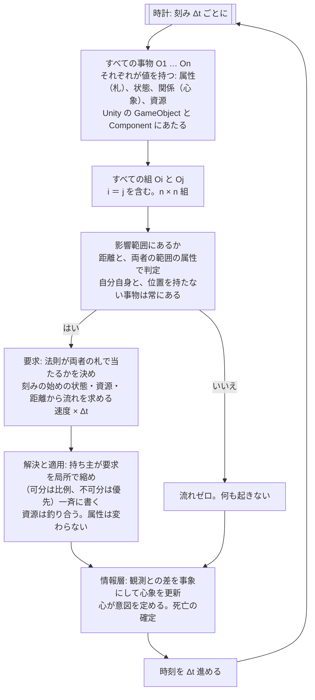
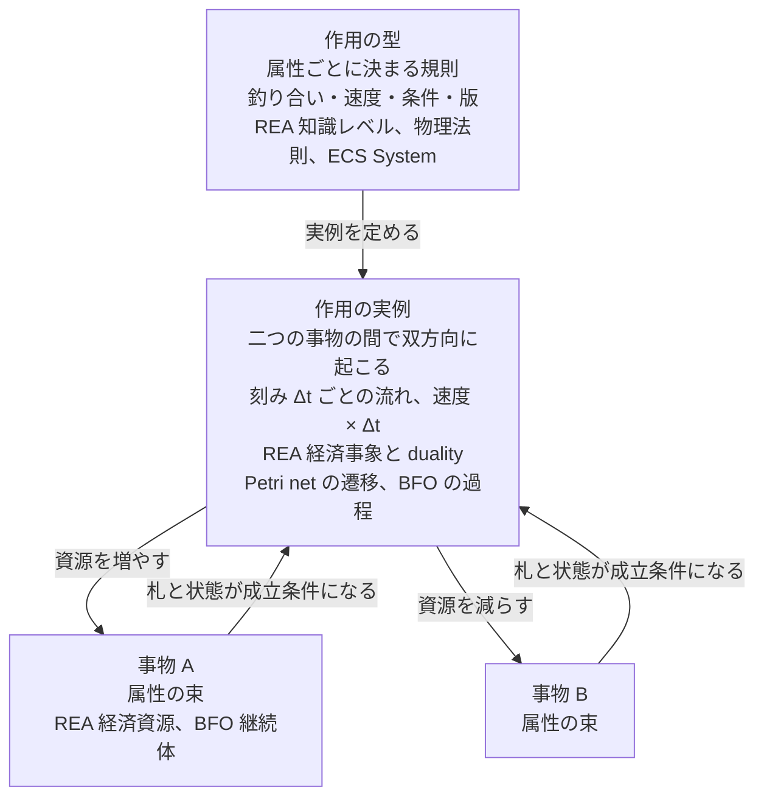
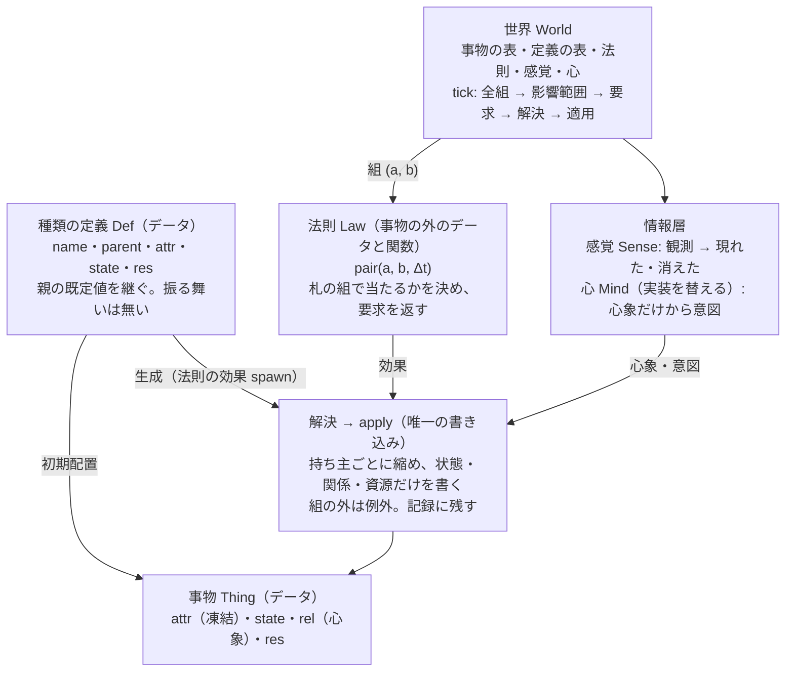

# 設計原則――資源を管理する世界と人物、法則、作用過程

更新: 2026-10-24。設計原則の正本。背景と確認範囲は[調査](RESEARCH.md)、実装済みの範囲は[STATUS](STATUS.md)。本書は新しい大構造の出発点であり、現行コードの構成を説明した文書ではない。

## 元々の目的と現在の位置

本書の原則は、次の目的のために置く。目的は過去文書に層をなして残っており、再編時に本書から落ちていたので2026-10-24に戻し、同日ユーザーが内容を確認した。出典の本文は参照アーカイブにあり、係数・クラス配置・当時の実装順は継承しない。

| 層 | 内容 | 出典 |
|---|---|---|
| 作りたいもの | 欲望、文化、約束、人間関係で動く小国家を率い、全員を思いどおりにできない中で、必要な局面だけ協力と準備を成立させるストラテジー。合理的な行動は不可能ではないが苦痛と困難を伴い、プレイヤー自身が個人の欲望や関係を優先したくなる。文化・約束・個人の利害・情報と指揮の制約から政治と戦争が生じる | [ユーザー原文](foundations/concept-original.md)、[企画書 v0.1](archive/project_proposal_v0.1.md) 1章・21章 |
| 世界の作り方 | 住民と兵士は同じ人物で、全員が固有の状態を持つ。目標規模は一国最大10,000人、軍籍1,000人、人口は実人数。前近代、通信は徒歩・騎馬の伝令。身分・文化・仕事・性格・経験によって正当性と利益の評価が違う。大義が集団に支持されれば反乱・革命・新勢力が成立し得る。ごく少数に、柔軟で一貫した意思を持つ人物を混ぜる | 同上 1.2節・2.1節 |
| 必ず守る性質 | 世界の真実と人物の認識を分ける。通貨・在庫・人口の保存と所有権を保証する。行動・約束・伝令・戦闘を因果Eventで追う。seed・Command・保存状態から結果を再現できる。simコアはUI・ネットワーク・人格の実装方式から独立する | 同上 21章の必須事項、[旧判断の最上位合意](archive/DECISIONS_HISTORY_2026-10-24.md) |
| 先に成立させる基盤 | 政治・外交・戦争の前に、人物が本人に届いた情報、身体の必要、記憶、文化、利害、他者との関係から自分で行動を選び、その作用と世界の制約から生活・仕事・交換・協力や対立が生じる世界を作る。中央が仕事・食料・所得・価格・人口を目標値へ補正しない。本人が働かなければ生産されず、運ばなければ届かない。まず食品の生産・採集・加工・運搬・売買・食事の小さな連鎖で原理を確認する | [箱庭の開発順](archive/AUTONOMOUS_SANDBOX_ROADMAP.md)、[旧DESIGNの目的](archive/DESIGN_HISTORY_2026-10-03.md)、[再編直前の目的](archive/DESIGN_HISTORY_2026-10-24.md) |
| 検証の仕方 | 「持続」は中央が救済して安定させることではなく、世界の状態と因果が破綻せず次の判断へ進み、条件が整えば生活が続くこと。安定は埋め込まず観測する。特定の人物を欠勤させれば下流が実際に変わる反事実、複数seed、保存再開で確かめる。ショックは正しく伝播し、二重資産や瞬間修復がないことを確かめ、必ず復旧することは要求しない。不足・協力・争い・移住・死亡は各個体の制約と行動の結果から生じさせ、中央ルールで結論を先取りしない | 同上 |

この目的から大構造へ渡す要請は次のとおりである。原則P01〜P12は、これらを現象の制約として言い直したものである。

- 人物の判断入力は本人に届いた情報と感覚だけであり、世界の隠れた状態や未来の正解を渡さない。
- 人物の判断方式はrule・NN・LLM・人間の代行で差し替えられ、どの方式も物理法則と更新責任を迂回できない。
- 世界側は時計、物体・通貨・所有権の実状態、相互作用の成立だけを確定し、全員分の脚本や目標値への補正を行わない。
- 同じ初期条件・入力から同じ結果を再現できる。同時刻の競合は決定的に整列する。
- 一国で数千人、90日という規模を扱えること。全人物を毎分走査する構成や、全仕訳を個別Eventへ膨張させる構成は目的に合わない。
- 所有・約束・文化は社会的関係として記録し、物理的成立とは別の経路で人物の反応を変える。
- 政治・外交・戦争の拡張は、この生活基盤が成立した後に同じ原則の上へ載せる。

現在の位置はこの表の「先に成立させる基盤」の、さらに最初の食事一経路である。本書の原則はこの基盤部分の制約であり、政治・戦争の規則そのものではない。

## 目的と原則の強さ

身体を持つ人物が、限られた資源と情報のもとで判断し、環境・他者と相互作用し、その結果を受けて生きる世界を扱う。これは[上の目的](#purpose)の基盤部分にあたる。資源の不足、行為の失敗、約束の不履行、死亡も、因果の整った結果として表現する。成功する生活をあらかじめ保証しない。

ここでいう普遍性は、**この対象現象を表す、どの実装にも課す意味上の制約**である。特定のクラス階層・計算式・時計・DBに依存しない。現実の全現象を説明し切ったという主張ではない。扱う現象・境界・粒度を明記し、範囲外との流入出も説明する。

「責任に応じてうまく分ける」という助言だけにはしない。P01〜P12に、守る関係と違反例を固定する。実装時には、それを破る操作を拒める構築・参照・更新の境界へ対応付ける。必要な改訂は、反例、影響する原則、旧記録との比較条件を示して行い、目先の実装都合で暗黙に例外を作らない。

## 大きな構造

前回の設計は、変化を起こす仕組みが一種類に揃わず、動く骨格のないまま細部を増やして止まった（[理由](RESEARCH.md#why-stalled)）。今回は、調査資料のすべてに共通する最も基本の組から構造を作る（[根拠](RESEARCH.md#event-as-action)）。中核は三つだけで、**事物（属性・状態・関係・資源を持つ）、属性ごとに決まる作用の型（釣り合いと速度）、刻みごとに二つの事物の間で双方向に起こる作用の実例（流れ）**である。主体・単位・境界・取引・物理現象・知覚・心象・記録は、この三つから導く。この見方は、どんな設計・実装になっても変わらない中核として置き、細部は骨格を動かしながら抽出する。

この中核は、Unity や Unreal Engine などのゲームエンジンが持つ GameObject・Component・Update の構造と同じ一般性を持ちながら、二つの制約を加えた一般化である。属性を変える経路を作用の実例だけに限ること、作用は二つの事物の間で双方向に釣り合うこと。ゲームエンジンは Update の中で任意の対象を任意に書き換えられるが、ここではそれを許さない。ゲームエンジンが汎用の構造で世界を表現できるのと同じく、この構造と制約を持って実装すれば世界を表現しシミュレーションできる、というのがこの基礎を据える理由である（[対応と相違](RESEARCH.md#event-as-action)）。

図1はこの構造の更新である。刻み Δt ごとに、すべての事物の組（自分自身を含む）のうち影響範囲にある組へ法則を当て、両者の札（属性）で当たるかを決め、状態・資源・距離から流れを決め、速度 × Δt だけ両者の状態と資源を同時に変える。Unity の「毎フレーム、各 GameObject の Update(Δt)」の、「各 GameObject」を「影響範囲にある事物の組」に、「Update」を「法則」に置き換えた形である。資源のやり取りはすべてこの更新に収まり、物理層はこれで担保される。n 個の事物で n² の組があるが、影響範囲にない組は流れゼロなので、影響範囲にある組を求める段が結果を変えずに計算を減らす。

**問題の本質。** 世界は資源を供給する構造であり、供給は有限で、場所と時間に偏り、腐る。人物はその中に身体を持つ個体で、身体が生む需要を満たすために、限られた手段を不完全な心象に基づく予測で取得の作用へ配分して生きる。世界の資源の配分とは、どの事物のどの属性がどの値で、誰が保管しているかの分布であり、全人物と自然の作用の総和がそれを変える。不足・競合・死亡はそこから生じる。適応とは、実結果で心象を更新し、配分を変えることである。政治・戦争は、この配分を集団の規模で行う形にすぎない。

### 中核の三つ

事物、属性、作用。属性は事物に属し、作用の性質を決める。作用には、属性ごとに決まる型と、二つの事物の間で起こる実例の二面がある。事物が持つ値は、**更新が書くかどうか**で四つに分ける。属性（札と仕様。更新は書かない）、状態、関係（相手ごとの状態）、資源（釣り合う量）。「可変属性」という区分は置かない。更新が書くなら状態である（[手がかり](RESEARCH.md#value-kinds)）。

| 中核 | 何であるか | 対応する既存の語 |
|---|---|---|
| 事物 | 属性・状態・関係・資源を持つもの。作用を受ける。それ自身は何もしない。穀物のロット、パン、水、薪、通貨、畑、棚、荷車、身体、人物 | REA の経済資源、BFO の継続体、Valueflows の EconomicResource、Petri net のトークン、ECS の Entity、Unreal の Actor |
| 属性 | 事物に付く札と仕様の値。どの法則が当たり得るか（相手のどの札と反応するか）と速さを決める。更新は書かない。男女、草食・肉食、見える範囲、採る速さ | REA・Valueflows の知識レベル（ResourceSpecification）、CPN の色集合とガード、Unreal GAS のタグ要件と AttributeSet の基本値、Coad の青（Description）、BFO の傾向性 |
| 状態 | 更新が書く値。位置、付属先、生死、意図。種類のようでも変わる値（生→死）はここ | Valueflows の EconomicResource の stage・state、BFO の性質、ECS の Component のデータ |
| 関係 | 相手ごとに持つ状態。心象（いつ・どこで・何を見たか）、相性、所有。向きは両側が別に持つ | BFO 2020 の関係的性質、Valueflows の AgentRelationship、Coad の黄（Role） |
| 資源 | 量として保存される状態。釣り合いはここに掛かる。栄養、胃の内容、鮮度、蓄え、廃棄 | REA の資源の数量と stock-flow、hREA の DecrementIncrement、Petri net のトークン |
| 作用（型） | 属性ごとに決まる作用の規則。どの属性の組に対して、どちらがどれだけ増減するか（釣り合い）、どの速さで、どの条件で起こるか。版を持ち、実例の状態を持たない | REA の知識レベル（資源タイプ、過程仕様、action 効果表）、Hruby の交換の双対と変換の双対、Laurier・Poels の不変条件、物理法則、CPN のガードと弧の式、ECS の System、Unreal の Gameplay Effect |
| 作用（実例） | 刻み Δt ごとに二つの事物の間で起こる変化の実績。速度 × Δt で、足りなければ細る。長い作用は刻みの列として現れ、途中で条件が外れればそこで止まる。両側の属性を一度に変え、記録を残す | REA の経済事象と duality、hREA の DecrementIncrement、Petri net の遷移の発火、BFO の過程、Valueflows の EconomicEvent と Process、Unreal の Effect Spec |

図2はこの関係である。作用の型が実例を定め、実例が二つの事物の状態と資源を同時に変え、事物の属性（札）と状態が実例の成立条件になる。

既存モデルの図は RESEARCH の[図A（REA の基本図）と図B（経済単位と協調空間）](RESEARCH.md#rea-figure)を使う。本書では再掲しない。

### 三つから導かれるもの

| 派生 | 元の三つの何から | どう出るか | 対応する既存の語 |
|---|---|---|---|
| 主体 | 事物＋属性（意図） | 作用に参加する事物のうち、意図という属性を持つ人物と、意図を持たない自然。人物は身体という事物を通じて作用に参加する | REA の経済主体、Valueflows の Person と EcologicalAgent |
| 単位と境界 | 属性（保管者） | 事物の「保管者」という属性。同じ保管者の事物の集まりが単位。作用の両側の保管者が異なるとき、その作用が境界である | REAU の経済単位、ISO 15944-4 の協調空間、Williamson の「技術的に分離可能な接面」、REA の custody |
| 取引 | 作用（保管者が異なる二つの事物の間） | 量または保管者の属性が双方向に変わる作用。両保管者にとっての流入と流出を同じ実例で確定する | REA の交換の双対（give と take）、Valueflows の transfer と Exchange |
| 物理現象 | 作用（自然が参加者） | 再生、腐敗、消耗、消化。属性ごとの型と速度で決まり、人物の需要に合わせて補正されない | Hruby の変換の双対（use・consume と produce）、Valueflows の produce・consume・use |
| 知覚・伝達 | 作用（可視属性と知識属性の間） | 対象側の変化がほぼゼロの双方向の作用。時刻・出所つきで、古く、誤り得る | 情報の非対称（経済理論）、Valueflows の Observation 層の本人用の写し |
| 心象・予測・配分 | 属性（人物の知識・期待・意図・手段の見積り）＋作用（知覚・想起・判断） | 人物という事物の属性と、それを変える作用。判断方式はここに差し替える。試みは、意図という属性から世界の事物への作用を求めること | Valueflows の Knowledge 層と Plan 層（Intent・Commitment・Plan）、Laurier・Poels の在庫方針 |
| 記録 | 属性（社会的属性）＋作用（合意・履行・違反） | 所有、利用権、約束、価格、役割は、保管者とは別の社会的な属性と、それを変える作用。物理的な効力を持たない | REA の経済コミットメント・契約、Valueflows の Agreement・Claim |

### 更新規則と影響範囲

世界にあるものはすべて事物であり、世界の更新は事物どうしの相互作用である。更新は Unity の Update と同じく Δt ごとで、刻みごとに**すべての事物の組（自分自身との組を含む）**へ法則を当てる。更新は**要求 → 解決 → 適用**の同期更新である。要求では、刻みの始めの状態だけを読んで、法則が組の両者の札（属性）で当たるかを決め、状態・資源・距離からこの刻みに起こる流れの要求を返す（a が切っ掛けを出す側、b が受ける側）。解決では、要求を資源の持ち主ごとに集め、持ち主が局所で縮める。出せる分を超えた可分の要求は比例で細り、不可分な物（実一個、能力の容量）の取り合いは持ち主に閉じた優先（持ち主の関係 favor、要求者の札 priority、無ければ要求者の id）で一人に決まる。適用では、解決済みの流れを一斉に書く。組をどの順に数えても、並列に計算しても、同じ結果になる。同じ刻みの中の連鎖（移動してから採る、採ってから食べる）は次の刻みへ送られる。順序を中央で決めないのは、中央集権の仕組みは事物が増えると破綻するからで、先行事例（Lamport の因果の半順序、並列離散事象シミュレーションの局所因果制約、Petri net の局所性、アクターモデル、同期更新と有限体積法）が同じ形に収束している（[記録](RESEARCH.md#decentral)）。組の数は事物の数の二乗になるが、まずこの形で実装する。実際の物理世界も同じで、どの二つの物の間にも法則が働き、遠ければ効果がゼロになるだけである。この制約で設計・実装するほうが、かえって単純になる。

影響範囲、つまりどの組が実際に相互作用するかは、法則が両者の属性（視界、手の届く範囲、見える範囲、匂う範囲）と距離から決める。その手前で、影響範囲にある組を求める段を置く。物理エンジンの broad phase にあたり、結果を変えずに法則を当てる組を減らす。骨格では全組（n²）を調べ、自分自身との組、位置を持たない事物（自然）との組、距離が両者の範囲の属性の最大値以下の組を影響範囲にあるとし、その組だけに法則を当てる。全組に当てたときと記録が同一になることをテストで確かめた。n² の走査そのものを減らす空間索引はまだ無い。

事物が持つ値は四つに分ける。属性は札と仕様の値で、どの法則が当たり得るか、つまり相手のどの札と反応するかと、速さを決める。更新は書かない。状態は更新が書く値、関係は相手ごとに持つ状態（心象はここ）、資源は量として保存される状態で、釣り合いは資源に掛かる。法則は事物の種類ではなく札の組で相手を選ぶ。果実の場面の札は、自然＝受け皿・育てる、木＝実をつける、実＝食べられる（植物性）・腐る、人＝植物を食べる・採る・見る。札が合わなければ何も起きない（肉を食べる者は植物性の実を持っていても食べられない）。札を資源や状態の有無で代用してはならない。鮮度の受け皿である自然も鮮度という資源を持つので、資源の有無で「腐る物」を選ぶと自然自身に腐敗が当たる。これは骨格で実際に起きた。

資源のやり取り（実る、腐る、採る、食べる、消化、消耗、移動の費用）は、すべてこの更新に収まる。これを**物理層**と呼ぶ。法則の効果が触れてよいのは組の二つの事物と、その組から生まれる事物だけで、世界がこれを検査する。一刻みにできる量は能力（属性）× Δt で、採る 6 個/時 なら 10 分で 1 個である。

知覚・心象・記憶は Δt の流れでは済まない。これを**情報層**と呼ぶ。見えることは刻みごとの関係だが、心象が変わるのは、現れたとき、消えたとき、意図が変わったときという**事象**である。世界は刻みごとに観測（これも全組）を集め、心象との差だけを事象として記録し、心象を更新する。覚えている物が、見えるはずの位置に無ければ「消えた」である。以前の事象駆動の設計はこの層に効く。心は心象だけから意図を定め、意図は属性として物理層の法則が読む。

図3は果実の場面の物理層の全組である。行が a、列が b で、組ごとに法則が流れを決める。見出しの括弧は札。空欄はゼロで、対角は自分自身との組である。

| a ＼ b | 自然（受け皿・育てる） | 木（実をつける） | 実（食べられる・腐る） | 人（食べる・採る・見る） |
|---|---|---|---|---|
| **自然** | （自分） | 実る: 育ち → 実（生成） | | |
| **木** | | （自分） | | |
| **実** | 腐る: 鮮度 → 廃棄 | | （自分） | |
| **人** | 移動: 栄養 → 熱。消化: 胃 → 栄養・排出。消耗: 栄養 → 熱 | | 採る: 付け替え。食べる: 実 → 胃 | （自分。未使用） |

情報層はこの表の外にある。人 ← 木・実の「見える」が観測で、心象との差が「現れた」「消えた」の事象になる。

骨格で確立した形（2026-10-24、果実の場面）。

- **全組への法則。** 法則は `pair(a, b, Δt)` で、両者の札で当たるかを決め、状態・資源・距離から流れを返す。（自然, 木）＝実る、（実, 自然）＝腐る、（人, 自然）＝移動・消化・消耗、（人, 実）＝採る・食べる。他の組はゼロ。世界が全組を調べて影響範囲にある組へ当てる。法則は絞り込みをしない。
- **要求 → 解決 → 適用。** 法則は刻みの始めの状態だけを読んで要求を返す。世界は要求を持ち主ごとに集めて局所で縮め（可分は比例、不可分は優先）、一斉に適用する。釣り合いは効果ごとに保つ。組の順を逆順・乱順にしても記録の集合と最終状態が同一であることを検査している。
- **値の四区分。** 属性は生成時に凍結され、書く経路が無い。状態・関係・資源だけを効果が書く。心象は関係（相手ごとの状態）として置き、いつ・どこで・何を見たかを持つ。
- **組の外に触れない。** 効果が触れた事物が組の二つ（と生まれた事物）の外なら、世界が例外にする。採るを（人, 木）で書くと木に付いた実という第三の事物に触れるので、（人, 実）の組になる。
- **能力 × Δt が刻みの容量。** Δt は Unity と同じく次の更新までの刻みで、流れは能力（属性）× Δt。採る 6 個/時 は 10 分の刻みで 1 個、食べる 12 個/時 は 2 個、歩く 60 m/時 は 10 m。実一個のような不可分な行為は、持ち主が容量を超える要求を優先順に落とす。時間という値は事物に無い。
- **観測と事象。** 見える（観測者の視界と対象の見える範囲の小さい方の内側、または自分に付いている）物を心象に写す。初めてなら「現れた」。覚えている物が、覚えている位置と見える範囲からして見えるはずなのに観測できなければ「消えた」。遠くて見えないだけの物は残る。
- **意図は属性。** 心は意図と目標を定めるだけで、属性を直接は変えない。変わったときだけ事象になる。行為の法則が意図を読む。
- **死亡は刻みの終わりに世界が確定する。** 以後その人物はどの組でも何も起こさない。

### 世界の進行

一刻み Δt の中で、まず物理層が、すべての事物の組のうち影響範囲にある組に法則を当てて要求を集め、持ち主ごとに解決し、一斉に適用する。次に情報層が観測を集めて事象にし、心が意図を定め、最後に世界が死亡を確定する（図1の下半分）。同じ初期状態から同じ記録になる。誰かの代わりに判断せず、目標値へ補正しない。

### 種類の定義と生成

事物の種類は、型やクラスではなくデータである。**種類の定義（Def）**は、札と仕様（属性）、初期の状態と資源を持つ雛形で、親の定義を指して既定値を継ぎ、自分の値で上書きする。振る舞いは継がない。振る舞いは法則にあり、法則は札の組で相手を選ぶので、種類を何種足しても法則のコードは変わらない。果実の場面の定義は自然・木・実・人の四つで、木の札 `bears` は生む実の定義の名を指す。

生成は更新の中にある。走っている世界で実が生まれるのは（育てる, 実をつける）の組に当たった法則が返す効果 `spawn` で、量は源泉の資源（自然の実の蓄え）から引く。消滅（食べる、腐る）も効果である。種類の定義は初期配置（世界を作るときに定義から置く）と、法則の効果の両方が同じ雛形として使う。更新の外にあるのは初期配置と定義の登録だけで、Factory という別の仕組みは置かない。

事物の派生クラスにメソッドを持たせる形を採らないのは、相互作用が二つの事物の間で起こるため、派生は片側しか選べず、相手側の分岐（種類 × 種類）が残るからである。札の組で選ぶ法則なら、法則の数は相互作用の種類の数に比例し、事物の種類の数には比例しない。派生が向くのは、判断の仕組みだけが違う心の実装、法則どうしの共通処理、種類の定義の既定値の継承である。この書き方は、継承より合成、式の問題、多重ディスパッチ、ECS、データ駆動の種類の定義という既知の定石に一致する（[定石の確認](RESEARCH.md#conventions)）。

図4は設計と実装の対応である。データ（定義、事物）と、世界が持つ振る舞い（法則、感覚、心）と、唯一の書き込み口（apply）を分けている。

### 実装に渡す語彙

語彙と型は Valueflows（`@valueflows/vf-graphql` の TypeScript 型定義の部分集合）、action 効果表は hREA の組込み定義、不変条件は Laurier・Poels の表1、最小の予測・配分規則は同論文の在庫方針を採る（[流用範囲](RESEARCH.md#rea-reuse)、[実装のヒント](RESEARCH.md#allocation-hints)）。事物は EconomicResource に身体を加えたもの、属性は EconomicResource の数量と custody に鮮度・栄養・知識などを加えたもの、作用の型は ResourceSpecification・ProcessSpecification・action 効果表・Recipe に速度と条件を加え、二つの事物の組に対して書いたもの、作用の実例は刻みごとに記録される適用済みの効果（EconomicEvent。長い作用は刻みの列）、保管者は primaryAccountable（custody）、主体は Agent、意図と約束は Intent と Commitment、記録は Agreement と Claim にあたる。事物が持つ値の四区分は、属性＝ResourceSpecification（知識レベル）、状態＝EconomicResource の stage・state、関係＝AgentRelationship と BFO 2020 の関係的性質、資源＝EconomicResource の数量と stock-flow にあたる（[手がかり](RESEARCH.md#value-kinds)）。種類の定義は ResourceSpecification、Unity の prefab、RimWorld の Def（ParentName で既定値を継ぐ）、Dwarf Fortress の raw にあたる。実装上の分かれ目である「両側を一つの作用で確定するか、予約を挟む二段にするか」は、前者を採る。

基本のオブジェクトの形は、ゲームエンジンの設計を参考にする（[属性が作用を決める実装の確認](RESEARCH.md#attribute-driven-impl)）。事物は ECS の Entity や Unreal の Actor、属性は Component や AttributeSet、作用の型は Unreal の Gameplay Effect（属性をどう変えるかだけを記したデータ資産）に色付き Petri net のガードと REA の釣り合いを加えたもの、作用の実例は Effect Spec の periodic な適用や遷移の発火を刻みごとに記録したものにあたる。調査の範囲では、属性が作用を決めること、両側を釣り合いをもって一度に変えること、型と時間を持つ実例を分けることの三つを一つに持つ既存実装は無かったので、既存の語で組み立てる。

Laurier・Poels の不変条件は骨格の検査に使う。各事物に流入と流出の作用があり識別できる実物に作用する。消費する作用は生産する作用と対になり、対にならない流入・流出はモデル境界（外部供給・散逸）として明示する。各作用に責任を持つ参加者がいる。交換には二者がいる。「資源は永久に貯蔵されない」「企業は報われる」という健全な代謝の前提は採らない。

### 骨格を動かして分かったこと（2026-10-24）

中核を `packages/skeleton/` に新規の TypeScript で実装し、果実の場面を30日走らせた（`npm run skeleton -- 30`、`--persons 2`、`--sight 20`）。既存コードは変更していない。版は五つ経た。最初は予定した実例を期日に完了させる事象駆動、次は Δt ごとだが法則が影響範囲を列挙する形、三つ目はすべての事物の組に法則を順に当てる形、四つ目はそれを値の四区分と札で書き直した形、現在は要求 → 解決 → 適用の同期更新である。残すのは現在の版で分かったことである。

| 分かったこと | 内容 |
|---|---|
| 全組で足りる | 事物 10、法則 7 で刻みあたり約 750 回、30日 4,320 刻みで約 324 万回の法則の評価、163 ms。絞り込み無しで動く。二人で一本の木を使っても両者が生きた |
| 同期更新で順序から自由になる | 要求 → 解決 → 適用に替えると、組を数える順を逆順・乱順にしても最終状態と記録の集合が同一になった。一人30日で縮めた要求の束は 47、二人で 71。中央に残るのは時計と定義の表だけ |
| 連鎖は一刻み遅れる | 同期更新の代償。食べた実の消化、たまった育ちからの実り、移動してからの採取が次の刻みになる。Δt が 10 分の果実の場面では一人も二人も 30 日生き、結果の差は採る回数 173 → 174 程度だった |
| 影響範囲の段は結果を変えない | 全組を調べて影響範囲にある組だけに法則を当てると、一人30日で法則の評価は 324 万回から 237 万回、二人で 152 万回から 135 万回に減り、記録は全組のときと同一だった。多くの組が自然（位置なし）か同じ木の実（距離 0）なので減りは小さい。n² の走査を減らす空間索引は後 |
| 組の外に触れない制約が設計を直す | 採るを（人, 木）で書くと木に付いた実という第三の事物に触れる。（人, 実）の組にすると自然に直る。消化は排出が自然へ行くので（人, 自然）の組になる |
| 能力 × Δt が刻みの容量 | 採る 6 個/時 は 10 分で 1 個、食べる 12 個/時 は 2 個、歩く 60 m/時 は 10 m。不可分な行為は持ち主が容量を超える要求を優先順に落とす。時間という値は事物に無い |
| 知覚は事象 | 刻みごとに写すと一人30日で 22,084 件だったものが、現れた 185・消えた 178 になった。意図も 4,320 から 496 に減った |
| 見えるはずの判定に見える範囲が要る | 覚えている物の見える範囲を一緒に覚える。家から木の実（30m）は見えないので、消えたことにならず心象に残る。前の版は忘れて木を見に行っていた |
| 知識は知覚からしか入らない | 採取者に木の場所を教えない。視界 60m で 40m 先の木は見え、実は近づくまで見えない。視界 20m では木を知らずに死ぬ |
| すべてが事物 | 実を木の属性（数）にせず、木に付いた事物にした。採る・食べる・腐るが同じ実に対して働き、二重の計上が起きない |
| 釣り合いは効果ごと | 実る、食べる、消化、消耗、移動の費用の総和が30日保存された |
| 供給と需要の境 | 一人なら木は 3〜5 個で安定し、二人なら木は空に近く、二人目の栄養は 2.7〜4.0 で推移した。配分の規則が境で結果を決める |
| 四区分は実装で保てる | 属性を凍結して書く経路を無くし、状態・関係・資源だけを効果が書く形にしても、果実の場面の記録は分ける前と同一（一人30日 43,710 件）。法則はどれも属性を書かず、心象は関係の置き場に収まった |
| 札を資源の有無で代用すると壊れる | 「腐る物」を鮮度の資源の有無で選んだら、鮮度の受け皿である自然自身に腐敗が当たり、自然が消えた。札 perishable で選ぶ形に直した。属性が反応可能性を決めるという定義の実例 |
| 種類の定義で仕様が一か所に集まる | 実の仕様（見える範囲、匂う範囲、鮮度）を木の属性に三つ持たせていたのを、実の定義に移した。木は生む実の定義の名を札で指すだけになり、場面の構築は定義からの生成に置き換わった。法則は変えず、記録は同一 |
| 記録の量 | 一人30日で 43,710 件。腐敗の鮮度の減り 31,447 件が大半。記録の粒度は細部として決める |

### 細部へ降りる前に満たす条件

1. 事物の状態・関係・資源は作用によってしか変わらない。属性は作用でも変わらず、どの法則が当たり得るかを決める。作用には型があり、型は属性ごとに釣り合いと速度を定める。
2. 作用は二つの事物の間で起こり、両側の属性を一度に変える。片側だけが変わることはない。足りなければ流れが細るだけで、負にならない。知覚で対象側の変化がゼロなのは、ゼロと確定することであって、変えないことではない。
3. 事物はちょうど一人の保管者という属性を持つ。保管者が異なる両側を持つ作用は、両保管者にとっての流入と流出として同じ実例で確定する。
4. 到達と保管の条件を満たさない事物には作用できない。所有は保管者とは別の属性であり、物理的な成立条件ではない。
5. 人物の心象は関係（相手ごとの状態）であり、知覚・伝達・想起の作用でしか変わらず、誤り得る。
6. 人物の意図は属性であり、行為の法則がそれを読んで流れを起こす。流れが起こるかは影響範囲と型の条件で決まり、足りなければ細る。手段（時間、余力、保管する事物）の範囲を超えない。
7. 自然の作用は型と速度から決まり、人物の需要に合わせて補正されない。
8. 同じ初期状態と作用の列から同じ結果になる。
9. 刻みごとにすべての事物の組（自分自身を含む）に法則を当てる。どの組が相互作用するかは法則が両者の属性と距離から決める。組の絞り込みは計算を減らす最適化で、結果を変えない。
10. 法則の効果は組の二つの事物と、その組から生まれる事物にしか触れない。
11. 知覚・心象・記憶・意図は事象として扱い、物理層の流れとは層を分ける。心象を変える事象は、現れた、消えた、意図が変わった、の三つ。
12. 法則は事物の種類ではなく、属性（札）の組で相手を選ぶ。札を資源や状態の有無で代用しない。
13. 事物の種類は定義（データ）で、親から既定値を継ぐ。振る舞いは継がない。走っている世界での生成は法則の効果で、量は源泉の資源から引く。
14. 更新は要求 → 解決 → 適用の同期更新で、法則は刻みの始めの状態だけを読む。衝突の解決は資源の持ち主に閉じる（可分は比例、不可分は持ち主の関係・要求者の札・id の優先）。組をどの順に数えても、並列に計算しても同じ結果になる。同じ刻みの連鎖は次の刻みへ送られる。

これらと Laurier・Poels の不変条件が成り立つ骨格を先に動かし、数値、知覚の精度、判断方式、制度はその上に順に加える。新しい事物（家畜、荷車、貨幣、兵站）を入れるときは、どの属性を持つ事物かをまず決め、その属性ごとの作用の型を釣り合いと速度で書けることを確かめてから入れる。ゲームエンジンの Update のように、任意の対象を任意に書き換える経路は作らない（[対応と相違](RESEARCH.md#event-as-action)）。

原則本文の「資源」は事物、「法則・仕組み」は作用の型、「具体的な作用過程」は作用の実例、「世界の管理責任」は世界の進行、「所在・占有・保管」は保管者という属性、「人物の認識・記憶」は心象、「判断・意図」は予測・配分、「制度・記録」は記録にあたる。P01〜P12はこの骨格が壊れないための制約であり、骨格より先に読む文書ではない。

## P01 世界内での実在と同一性

人物、身体、所持品、環境の資源は、同じ世界の中で関係する。人物の身体は判断のための表示値とは別に実在し、身体・環境・他者から作用を受ける。人物が持つパンを、世界側のパンと別の物として二重に計上しない。

同一性の粒度は、量を持つロット（同じ条件・産地の食品のまとまり）を基本とする。一個単位が要る場面は量1のロットで表す。分割・統合・変換後の由来と量が説明できなければならない。参照や表示を複数持つことと、実体を複製することを分ける。数千人・90日の規模と、保存則の日次照合がこの粒度の根拠である。

**違反例:** 世界の在庫と人物の所持量を独立に増減させ、食べた後も一方に同じパンが残る。人物の身体だけを世界の時間・作用から除外する。

根拠: [REA](RESEARCH.md#rea)、[存在論](RESEARCH.md#ontology)。

## P02 資源の種類・実例・利用可能性を分ける

ここで資源とは、人物や過程が利用・制御の対象にでき、その状態や利用可能性が作用を制約するものをいう。所有者のいない自然物も含む。世界にあるすべてを、同じ意味の資源や消費可能な残高と見なすわけではない。

| 区別 | 例 | 必要な説明 |
|---|---|---|
| 仕様と実物 | 食品の種類／いま棚にある食品 | 性質の定義と実際の所在・量・状態 |
| 在庫と能力 | 穀物／運べる能力・胃の処理能力 | 消費される量と、状態に依存する上限・利用条件 |
| 場所・設備の利用枠 | 作業場所、かまど | 占有、同時利用、期間、競合 |
| 情報 | 品質の知識、他者の発言の記憶 | 内容、保持者、取得・伝達の経路。複写で元が減るとは限らない |
| 社会的な権利・請求 | 利用権、代金請求権 | 対象、相手、条件、制度上の効力。現物や将来の確実な入金と同一ではない |

能力や時間的な余裕を、無条件に譲渡できる物品へ換算しない。時間の経過そのものと、一定期間の人員・設備の利用枠も区別する。新しい資源の種類を扱うときは、同一性・量の意味・利用条件・変化の規則を定める。

**違反例:** 「食品」という仕様だけから食事が成立する。空腹、貨幣、栄養、信頼を同一の足し引きできる残高として扱う。

根拠: [Valueflows](RESEARCH.md#valueflows)、[存在論](RESEARCH.md#ontology)。

## P03 法則・仕組みの定義と、実行中の状態を分ける

法則は、条件が与えられたときの変化や限界を拘束する。人物ごとの身体差、設備差、環境差は具体的な状態・性質・条件として参照する。共通の法則に従うことは、全員の係数や結果が同じになることではない。

仕組みの定義は、特定人物の食料、身体、進捗を管理する実体と区別する。具体的な作用は対象と時空間に結びつき、その場の状態に従って進む。実行が状態を持つことは自然であり、すべてを純粋関数にする要求ではない。

「消化の仕組み」と「この人物の体内で進んでいる消化」は異なる。能力があること、条件が整うこと、過程が開始すること、成果が出ることも区別する。法則は身体の中で別の特権的な規則へ変わらない。

**違反例:** 共用の消化定義に全人物の現在の胃内容を保存する。行程を選んだだけで処理時間を飛ばして吸収を完了する。

根拠: [Valueflows](RESEARCH.md#valueflows)、[存在論](RESEARCH.md#ontology)、[外部実装](RESEARCH.md#implementations)。

## P04 管理・所有・占有・制御・更新責任を混同しない

世界と人物が資源を管理するとは、対象と状態、利用関係、変化の責任を取りまとめることである。すべてを社会的に所有したり、自由に書き換えたりできる意味ではない。特に、世界の管理責任は資源の社会的所有者になることを意味しない。

| 関係 | 問い | それだけでは分からないこと |
|---|---|---|
| 所有・利用権 | 制度上、誰にどの権利があるか | 所在、到達可能性、現在量、実際に操作できるか |
| 所在・占有・保管 | どこにあり、誰が保持しているか | 所有権、合法な処分権 |
| 物理的な制御 | いま何に作用できるか | 正当性、成功、結果を知ること |
| 状態管理・更新責任 | どの整合条件のもとで変化を確定するか | 人物の社会的権利。コードの担当を所有権にしない |
| 知識 | 誰が何をどの根拠で知っているか | 実物の所在・量が現在も同じか |

各実状態の項目について、整合性を確定する責任を定める。複数の管理単位にまたがる作用は、各側が独立に成功扱いにせず、同じ作用の成立条件と実結果に対応させる。責任の一意性は、全世界を一つの保存場所や更新クラスにする意味ではない。

**違反例:** 自分の所有物なので遠隔から食べられる。判断器に身体値の書換え権限があるので、食事の実行なしに栄養を増やせる。

根拠: [DDD](RESEARCH.md#ddd)、[Valueflows](RESEARCH.md#valueflows)、[経済理論](RESEARCH.md#economics)。

## P05 実状態と人物の認識を分ける

人物は、届いた刺激・感覚・観察・伝達と記憶から認識する。知識、推定、予測、誤認は人物内の状態であり、世界の現在量そのものではない。世界の真実を監査に使うことと、人物の判断入力として渡すことを分ける。

届く情報には、内容、届いた相手、到達時刻、出所（自分の観察か、誰からの伝達か）を必ず関連付ける。観測対象の場所は内容の一部である。不確実さは人物が推定する認識側の属性であり、刺激の必須属性ではない。所有していても現況を知るとは限らず、見えても所有しているとは限らない。記憶の更新は、忘却・推論などを含む人物内部の過程として扱い、主観を書き換えて過去の観測事実を改変しない。

**違反例:** 観測・通信の経路なしに、所有者へ離れた倉庫の現在量を常時通知する。本人が成功したと信じたので世界の実結果も成功へ変える。

根拠: [情報・契約の経済理論](RESEARCH.md#economics)、[Valueflows](RESEARCH.md#valueflows)。

## P06 意図・約束・試み・作用・実結果を分ける

意図や計画は、これからどうしたいかという人物の状態である。約束は相手・条件を持つ社会的関係である。試みは実行を求める行為であり、具体的な作用の成立や成果を保証しない。自然過程には判断主体や意図がなくてもよい。

過程を具体化するときは、下記を埋める。適用しない項目は、その理由を示す。

| 項目 | 定める内容 |
|---|---|
| 参加する実体 | 人物、身体、設備、環境。判断主体がいる場合はその人物 |
| 対象と利用 | どの資源の、どの量・能力・期間に作用するか |
| 成立条件 | 所在、状態、到達、能力、必要な入力、他の作用との競合 |
| 拘束する規則 | 物理法則・変換条件。制度上の許可と違反時の扱いは別記 |
| 経過 | 開始、期間・進捗、条件の再評価、中断・失敗・完了 |
| 作用と結果 | 何がいつ変わり、何が変わらず、どこに残ったか |
| 情報への到達 | 誰に何が観測・伝達され、何が未知のままか |

これは保存JSONの必須フィールド定義ではなく、現象を欠落させない記述形式である。相互作用には双方の対象と結果があり、単独クラスのメソッド名だけでは関係を表したことにならない。

到達・確保（物理的制御の獲得）は、その後の利用・消費とは別の作用として成立条件と結果を持つ。取得したが使えなかった、使う前に失った、という経過を因果として残すためである。

**違反例:** 支払いの約束を代金の入手と数える。対象食品を確保できなかったのに「食事完了」の応答だけで身体を回復する。

根拠: [REA](RESEARCH.md#rea)、[Valueflows](RESEARCH.md#valueflows)、[経済理論](RESEARCH.md#economics)。

## P07 相互作用は時間・競合・部分的な結果を持つ

人物の行動、他者の行動、環境変化、身体内の過程は、互いの条件を変える。開始時に可能でも、完了前に対象が失われたり、体調が変わったりする。複数の過程が重なる場合、必要な資源・能力・占有期間の両立条件を定める。

同じ実物に二人が同時に作用することはできず、同時刻の競合は世界が決定的に整列して確定する。先に到達し把持した側が保持者になる。分割は人物が実際に分ける作用があるときだけ起きる。順番待ち、争い、制裁は人物の行動と制度の結果として後から起きる。予約・注文は人物間の約束であり（[P10](#p10)）、物理的な確保の機構ではない。

経過は刻みごとの流れとして進む。開始で完了を飛ばさないことは、刻みごとに条件を照合して速度 × Δt だけ進めることで満たし、条件が外れた刻みでそこまでの実績だけが残る。失敗・中断までに生じた移動、消耗、仕掛品、情報は、実際の作用として残る。

**違反例:** 中断で既に消費した栄養まで無条件に戻す。腐敗と摂食を独立処理し、同じ食品が両方へ全量使われる。死亡後も本人の意思決定だけが続く。

根拠: [具体的な資源を扱う実装](RESEARCH.md#implementations)、[過程の存在論](RESEARCH.md#ontology)。

## P08 変化は種類に応じた収支・限界・由来を持つ

移転なら出側と入側、変換なら入力・出力・仕掛かり・放出や損失を対応付ける。何を保存し、何を消費・生成できるかは資源と法則の種類に従う。全ての数値に同じ保存則を課したり、パン一個と栄養値を同じ次元で加算したりしない。

数量不足、収納・処理容量、運搬能力などを成立条件に含める。世界の外を省略するときも、外部からの供給・散逸を明示する。生育や回復を、説明のない物質・栄養の無限生成としない。情報の複写、技能の変化、請求権の成立には、それぞれ別の規則が要る。

**違反例:** 食料がないのに休息から栄養を生成する。現金を直接栄養へ変える。売上だけを加算して代金側や現物移転を扱わない。

根拠: [REAとその適用限界](RESEARCH.md#rea)、[hREA](RESEARCH.md#valueflows)、[abcEconomics](RESEARCH.md#implementations)。

## P09 身体と認知は同じ人物に属する

人物は身体を通じて知覚し、行動し、影響を受ける。身体状態は実状態、空腹感などは感覚、健康や食事効果の見込みは認識として区別する。認知・記憶・判断も身体を持つ人物の働きであり、世界の外にある無制限な操作装置にしない。

人物は知覚・記憶・判断を取りまとめる。HMOSAICはその内部の判断方式の候補であり、別の方式も同じ世界内の条件に従う。身体法則を人格ごとに都合よく変えず、判断方式の違いから行動や結果の差が生じるようにする。身体の実状態から感覚への変換は共用の法則であり、人物差は身体の性質として入る。文化・性格・経験の差は感覚の解釈と評価、つまり判断側に置く。

死亡は身体法則から世界側が確定し、判断は停止する。身体は死体として世界に残り、所持品は所在に、所有権は制度の記録に残る。相続・遺品取得は社会的過程として別に扱う。

モデル化する範囲で注意・処理能力・時間等の限界を明示する。ただし、すべての思考に既知の追加カロリーを割り当てるといった未校正の生理法則は、この原則から導かれない。

**違反例:** 身体の条件や作用を変えず、判断方式の変更だけで同じ食品の吸収量を増やす。身体と無関係に全世界を観測・操作する人物を作る。

根拠: [存在論](RESEARCH.md#ontology)、[身体を持つ実装](RESEARCH.md#implementations)。判断方式の位置付けは本プロジェクトの合意。

## P10 物理的成立と制度・利害を別の関係として扱う

権利、約束、価格、評判、役割は、人物の相互作用を拘束・誘導する社会的関係である。所有していても物理的に利用できるとは限らず、物理的に持ち出せても正当な処分とは限らない。違法な行為を物理法則そのものが常に阻止する構造にしない。

所有権・利用権は、最初の具体化でも記録として省かない。無断の利用は物理的に成立し、それを観測した他者の反応は別経路で起きる。モデルの対象外の行為を受け付けない制限と、世界内の禁止・制裁も区別する。たとえば旧版の「農作業は所有農夫だけ」は特定の実験範囲であり、所有権が普遍的な物理能力を生むという法則にはしない。

人物間の情報・利害・能力の差は許す。取引の成功、誠実さ、欺瞞、合理性、同じ効用関数の最大化を全員へ強制しない。社会的作用を実装するときは、合意・記録・通知・履行・制裁等の成立条件を扱う。

**違反例:** 所有者以外は物理的に物へ触れないと一般化する。契約があるので将来の履行は必ず成功する。嘘や高額な支出だけで相手の内面が確定する。

根拠: [経済理論](RESEARCH.md#economics)、[権利と保管の区別](RESEARCH.md#valueflows)。

## P11 法則・記録・比較条件を保ち、実装は置換できる

実装は必要に応じて再利用・置換・統合・削除する。維持するのは、採用する法則の意味、既存記録の解釈と比較可能性である。旧版の係数・時計・食品条件は版に結びついた比較条件として保ち、新しい大構造の普遍的な定数へ昇格させない。

挙動や意味を変える場合は、初期条件、法則・判断方式の版、比較方法、記録の扱いを明記する。完全一致を主張するなら対応範囲を検証し、一致しない場合は差を示す。旧実行器、変換手段、保存形式など、再現に必要なものを無断で失わない。

因果・資源収支の整合、判断の再現、保存再開、人物の生活成立、学習の効果は別々に評価する。既知の死亡を再現するテストの成功は生存改善ではない。記録方式にイベントソーシングを選ぶことは可能だが、この原則は特定の保存方式を要求しない。

**違反例:** 生存させるため供給・消耗を黙って変更する。新設計の文書を書いただけで実装・検証済みと報告する。

根拠: [記録方式との区別](RESEARCH.md#other-modeling)、既存の版別実験と比較の合意。

## P12 制約を形式化し、裁量だけに委ねない

世界は行為の成立、人物は知覚・記憶・判断を取りまとめる。その内部は、資源の管理対象、更新を確定する責任、不変条件、法則の共用、判断方式の差し替え、変更理由の違いに基づいて構成する。単にクラスの大小を禁止・推奨する原則にはしない。

以下の責任表を、具体化・実装へ進む際の必須の照合形式とする。「管理者」という名前だけで自由な書換えを許可せず、更新の契機と拒否条件まで定める。

| 対象 | 取りまとめる責任 | 許される変化 | 拒むべき操作 |
|---|---|---|---|
| 環境・人物をまたぐ現物 | 世界内の相互作用の成立と資源整合 | 成立した移転・変換・自然過程による変化 | 判断の都合から在庫だけを増やす |
| 身体の実状態 | 世界の実行側が、身体法則と世界内の作用との整合のもとで確定する | 食事・活動・休息・外部作用等を法則に従って反映 | 主観的な希望で栄養・疲労を設定する。判断方式が身体を直接書き換える |
| 知覚・記憶・認識 | 人物内での情報取得と認知の過程 | 届いた証拠、推論、忘却、モデル化した身体作用等 | 取得経路なしに世界の非公開状態を知識へ直接複写する |
| 判断・意図 | 人物の判断方式と選択 | 利用できる情報・能力に基づく変更 | 意図だけで現物の作用を確定する |
| 進行中の過程 | 対象・条件・進行・実結果の対応 | 条件に従う進行、中断、部分結果、完了 | 同じ入力や作用を重複計上する |
| 共用の仕組み | 法則・仕様の意味と版 | 明示した版で定義を変更 | 特定人物の現在量や進捗を定義と混在させる |

これらは責任の区別であり、そのまま六つのクラスを要求する表ではない。身体の実状態は世界の実行側が確定し、人物側は感覚・観察・予測だけを持つ。判断方式を差し替えても物理を迂回できないこと、同じ入力からの再現、旧契約（世界が現物消費後にだけ摂取を作る）がこの配置の根拠である。摂取は、現物の減少と胃内容の増加を一つの作用として世界が確定する。世界が成立を取りまとめることは、全処理を一つのメソッドが直接実行することではない。

クラスの非公開状態と操作、型、参照の制限、コマンドや所有権の仕組み等は、これを強制する候補になる。形式を決める段階では、各不変条件をどこで強制し、迂回する参照をどう防ぐかを示す。クラスにまとめる利点は境界を固定できること、過度に集約する欠点は無関係な更新権限まで一緒に与えやすいこと、細分化する欠点は資源間の整合と実行の関係を見失いやすいことである。

**違反例:** 「適切に分割する」とだけ書き、誰でも共有状態を書き換えられる。資源との結合箇所がなく、仕組みのクラス群だけで食事が成立したことにする。

根拠: [DDD](RESEARCH.md#ddd)、[具体的な資源管理の実装](RESEARCH.md#implementations)、制約を明示的な形式へ落とすという本プロジェクトの合意。

## 食事で大構造を照合する

食事の一経路を七局面で照合した初稿（表A・表B、反例6件、未決事項10件とその答え）は[保存版](archive/DESIGN_MEAL_DRAFT_2026-10-24.md)へ退避した。未決事項への答えはユーザーが確認済みで、P01・P05・P06・P07・P09・P10・P12 に反映されている。中核の三つが動く骨格として成立したら、同じ経路を事物・作用の型・作用の実例の語で書き直し、骨格の最初の検査に使う。

## 文書・設計を増やす前の条件

新しい概念には、既存の概念では表せない現象と、必要な関係・制約を示す。新しいクラスや設計文書を作ること自体を進展に数えない。当面は本書と[調査](RESEARCH.md)へ統合し、原則を変更しない運用・測定は[STATUS](STATUS.md)と[NEXT_SESSION](NEXT_SESSION.md)に短く記す。旧資料は[保存と再利用の方針](README.md#legacy)に従う。
