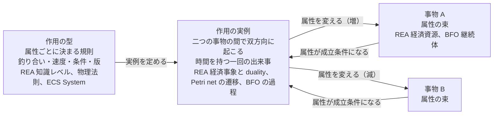
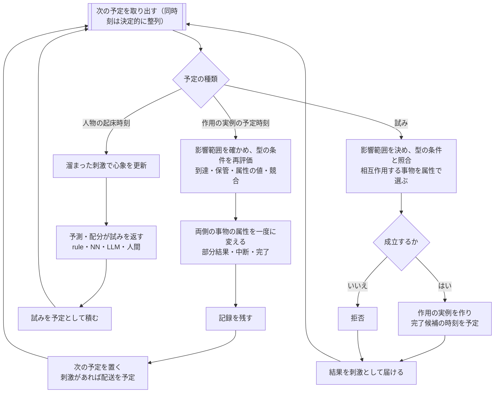

# 設計原則――資源を管理する世界と人物、法則、作用過程

更新: 2026-10-24。設計原則の正本。背景と確認範囲は[調査](RESEARCH.md)、実装済みの範囲は[STATUS](STATUS.md)。本書は新しい大構造の出発点であり、現行コードの構成を説明した文書ではない。

## 元々の目的と現在の位置

本書の原則は、次の目的のために置く。目的は過去文書に層をなして残っており、再編時に本書から落ちていたので2026-10-24に戻し、同日ユーザーが内容を確認した。出典の本文は参照アーカイブにあり、係数・クラス配置・当時の実装順は継承しない。

| 層 | 内容 | 出典 |
|---|---|---|
| 作りたいもの | 欲望、文化、約束、人間関係で動く小国家を率い、全員を思いどおりにできない中で、必要な局面だけ協力と準備を成立させるストラテジー。合理的な行動は不可能ではないが苦痛と困難を伴い、プレイヤー自身が個人の欲望や関係を優先したくなる。文化・約束・個人の利害・情報と指揮の制約から政治と戦争が生じる | [ユーザー原文](foundations/concept-original.md)、[企画書 v0.1](archive/project_proposal_v0.1.md) 1章・21章 |
| 世界の作り方 | 住民と兵士は同じ人物で、全員が固有の状態を持つ。目標規模は一国最大10,000人、軍籍1,000人、人口は実人数。前近代、通信は徒歩・騎馬の伝令。身分・文化・仕事・性格・経験によって正当性と利益の評価が違う。大義が集団に支持されれば反乱・革命・新勢力が成立し得る。ごく少数に、柔軟で一貫した意思を持つ人物を混ぜる | 同上 1.2節・2.1節 |
| 必ず守る性質 | 世界の真実と人物の認識を分ける。通貨・在庫・人口の保存と所有権を保証する。行動・約束・伝令・戦闘を因果Eventで追う。seed・Command・保存状態から結果を再現できる。simコアはUI・ネットワーク・人格の実装方式から独立する | 同上 21章の必須事項、[旧判断の最上位合意](archive/DECISIONS_HISTORY_2026-10-24.md) |
| 先に成立させる基盤 | 政治・外交・戦争の前に、人物が本人に届いた情報、身体の必要、記憶、文化、利害、他者との関係から自分で行動を選び、その作用と世界の制約から生活・仕事・交換・協力や対立が生じる世界を作る。中央が仕事・食料・所得・価格・人口を目標値へ補正しない。本人が働かなければ生産されず、運ばなければ届かない。まず食品の生産・採集・加工・運搬・売買・食事の小さな連鎖で原理を確認する | [箱庭の開発順](archive/AUTONOMOUS_SANDBOX_ROADMAP.md)、[旧DESIGNの目的](archive/DESIGN_HISTORY_2026-10-03.md)、[再編直前の目的](archive/DESIGN_HISTORY_2026-10-24.md) |
| 検証の仕方 | 「持続」は中央が救済して安定させることではなく、世界の状態と因果が破綻せず次の判断へ進み、条件が整えば生活が続くこと。安定は埋め込まず観測する。特定の人物を欠勤させれば下流が実際に変わる反事実、複数seed、保存再開で確かめる。ショックは正しく伝播し、二重資産や瞬間修復がないことを確かめ、必ず復旧することは要求しない。不足・協力・争い・移住・死亡は各個体の制約と行動の結果から生じさせ、中央ルールで結論を先取りしない | 同上 |

この目的から大構造へ渡す要請は次のとおりである。原則P01〜P12は、これらを現象の制約として言い直したものである。

- 人物の判断入力は本人に届いた情報と感覚だけであり、世界の隠れた状態や未来の正解を渡さない。
- 人物の判断方式はrule・NN・LLM・人間の代行で差し替えられ、どの方式も物理法則と更新責任を迂回できない。
- 世界側は時計、物体・通貨・所有権の実状態、相互作用の成立だけを確定し、全員分の脚本や目標値への補正を行わない。
- 同じ初期条件・入力から同じ結果を再現できる。同時刻の競合は決定的に整列する。
- 一国で数千人、90日という規模を扱えること。全人物を毎分走査する構成や、全仕訳を個別Eventへ膨張させる構成は目的に合わない。
- 所有・約束・文化は社会的関係として記録し、物理的成立とは別の経路で人物の反応を変える。
- 政治・外交・戦争の拡張は、この生活基盤が成立した後に同じ原則の上へ載せる。

現在の位置はこの表の「先に成立させる基盤」の、さらに最初の食事一経路である。本書の原則はこの基盤部分の制約であり、政治・戦争の規則そのものではない。

## 目的と原則の強さ

身体を持つ人物が、限られた資源と情報のもとで判断し、環境・他者と相互作用し、その結果を受けて生きる世界を扱う。これは[上の目的](#purpose)の基盤部分にあたる。資源の不足、行為の失敗、約束の不履行、死亡も、因果の整った結果として表現する。成功する生活をあらかじめ保証しない。

ここでいう普遍性は、**この対象現象を表す、どの実装にも課す意味上の制約**である。特定のクラス階層・計算式・時計・DBに依存しない。現実の全現象を説明し切ったという主張ではない。扱う現象・境界・粒度を明記し、範囲外との流入出も説明する。

「責任に応じてうまく分ける」という助言だけにはしない。P01〜P12に、守る関係と違反例を固定する。実装時には、それを破る操作を拒める構築・参照・更新の境界へ対応付ける。必要な改訂は、反例、影響する原則、旧記録との比較条件を示して行い、目先の実装都合で暗黙に例外を作らない。

## 大きな構造

前回の設計は、変化を起こす仕組みが一種類に揃わず、動く骨格のないまま細部を増やして止まった（[理由](RESEARCH.md#why-stalled)）。今回は、調査資料のすべてに共通する最も基本の組から構造を作る（[根拠](RESEARCH.md#event-as-action)）。中核は三つだけで、**事物（属性の束）、属性ごとに決まる作用の型（釣り合いと速度）、二つの事物の間で双方向に起こる作用の実例（時間を持つ）**である。主体・単位・境界・取引・物理現象・知覚・心象・記録は、この三つから導く。この見方は、どんな設計・実装になっても変わらない中核として置き、細部は骨格を動かしながら抽出する。

この中核は、Unity や Unreal Engine などのゲームエンジンが持つ GameObject・Component・Update の構造と同じ一般性を持ちながら、二つの制約を加えた一般化である。属性を変える経路を作用の実例だけに限ること、作用は二つの事物の間で双方向に釣り合うこと。ゲームエンジンは Update の中で任意の対象を任意に書き換えられるが、ここではそれを許さない。ゲームエンジンが汎用の構造で世界を表現できるのと同じく、この構造と制約を持って実装すれば世界を表現しシミュレーションできる、というのがこの基礎を据える理由である（[対応と相違](RESEARCH.md#event-as-action)）。

**問題の本質。** 世界は資源を供給する構造であり、供給は有限で、場所と時間に偏り、腐る。人物はその中に身体を持つ個体で、身体が生む需要を満たすために、限られた手段を不完全な心象に基づく予測で取得の作用へ配分して生きる。世界の資源の配分とは、どの事物のどの属性がどの値で、誰が保管しているかの分布であり、全人物と自然の作用の総和がそれを変える。不足・競合・死亡はそこから生じる。適応とは、実結果で心象を更新し、配分を変えることである。政治・戦争は、この配分を集団の規模で行う形にすぎない。

### 中核の三つ

事物、属性、作用。属性は事物に属し、作用の性質を決める。作用には、属性ごとに決まる型と、二つの事物の間で起こる実例の二面がある。

| 中核 | 何であるか | 対応する既存の語 |
|---|---|---|
| 事物 | 属性の束。状態を持ち、作用を受ける。それ自身は何もしない。穀物のロット、パン、水、薪、通貨、畑、棚、荷車、身体、人物 | REA の経済資源、BFO の継続体、Valueflows の EconomicResource、Petri net のトークン、ECS の Entity、Unreal の Actor |
| 属性 | 事物に属する値。量、鮮度、所在、保管者、栄養、余力、知識、意図。どの作用が起こり得るか、どう進むかを決める | REA の資源の数量と custody、BFO の性質と傾向性、Petri net のトークンの色、ECS の Component、Unreal の Attribute と AttributeSet |
| 作用（型） | 属性ごとに決まる作用の規則。どの属性の組に対して、どちらがどれだけ増減するか（釣り合い）、どの速さで、どの条件で起こるか。版を持ち、実例の状態を持たない | REA の知識レベル（資源タイプ、過程仕様、action 効果表）、Hruby の交換の双対と変換の双対、Laurier・Poels の不変条件、物理法則、CPN のガードと弧の式、ECS の System、Unreal の Gameplay Effect |
| 作用（実例） | 二つの事物の間で双方向に起こる、時間を持つ一回の出来事。開始、予定された完了、条件の再評価、中断、部分結果、完了を持つ。両側の属性を一度に変え、記録を残す | REA の経済事象と duality、hREA の DecrementIncrement、Petri net の遷移の発火、BFO の過程、Valueflows の EconomicEvent と Process、Unreal の Effect Spec |

図1はこの関係である。作用の型が実例を定め、実例が二つの事物の属性を同時に変え、事物の属性が実例の成立条件になる。

既存モデルの図は RESEARCH の[図A（REA の基本図）と図B（経済単位と協調空間）](RESEARCH.md#rea-figure)を使う。本書では再掲しない。

### 三つから導かれるもの

| 派生 | 元の三つの何から | どう出るか | 対応する既存の語 |
|---|---|---|---|
| 主体 | 事物＋属性（意図） | 作用に参加する事物のうち、意図という属性を持つ人物と、意図を持たない自然。人物は身体という事物を通じて作用に参加する | REA の経済主体、Valueflows の Person と EcologicalAgent |
| 単位と境界 | 属性（保管者） | 事物の「保管者」という属性。同じ保管者の事物の集まりが単位。作用の両側の保管者が異なるとき、その作用が境界である | REAU の経済単位、ISO 15944-4 の協調空間、Williamson の「技術的に分離可能な接面」、REA の custody |
| 取引 | 作用（保管者が異なる二つの事物の間） | 量または保管者の属性が双方向に変わる作用。両保管者にとっての流入と流出を同じ実例で確定する | REA の交換の双対（give と take）、Valueflows の transfer と Exchange |
| 物理現象 | 作用（自然が参加者） | 再生、腐敗、消耗、消化。属性ごとの型と速度で決まり、人物の需要に合わせて補正されない | Hruby の変換の双対（use・consume と produce）、Valueflows の produce・consume・use |
| 知覚・伝達 | 作用（可視属性と知識属性の間） | 対象側の変化がほぼゼロの双方向の作用。時刻・出所つきで、古く、誤り得る | 情報の非対称（経済理論）、Valueflows の Observation 層の本人用の写し |
| 心象・予測・配分 | 属性（人物の知識・期待・意図・手段の見積り）＋作用（知覚・想起・判断） | 人物という事物の属性と、それを変える作用。判断方式はここに差し替える。試みは、意図という属性から世界の事物への作用を求めること | Valueflows の Knowledge 層と Plan 層（Intent・Commitment・Plan）、Laurier・Poels の在庫方針 |
| 記録 | 属性（社会的属性）＋作用（合意・履行・違反） | 所有、利用権、約束、価格、役割は、保管者とは別の社会的な属性と、それを変える作用。物理的な効力を持たない | REA の経済コミットメント・契約、Valueflows の Agreement・Claim |

### 更新規則と影響範囲

Unity では全 GameObject を毎フレーム更新するのが仕組みである。ここでは作用が二つの事物の間で双方向に起こるという制約を入れたので、更新のたびに**影響範囲**が必要なパラメータになる。影響範囲とは、相互作用する事物を決める行為である。どの事物のどの属性が、どの型の作用の相手になるかを、所在・到達・保管者・属性の値で選び、そのうえで型の条件を照合して実例を作る。更新は全事物の走査ではなく、作用の実例とその影響範囲から駆動される。これが、このシミュレーションの更新規則が Unity と大きく異なる点である。

自然の作用も同じ規則に従う。腐敗は「鮮度という属性を持つ事物」を影響範囲として選び、事物ごとに次の変化の時刻を予定する。これは ECS の Query や色付き Petri net の束縛（どのトークンが遷移の変数に結びつくか）と同じ役割で、毎フレームの走査ではなく予定で動かす。

骨格では次の形で確立した（2026-10-24、果実の場面）。

- **影響範囲の定義。** 作用の型は役割ごとに条件（所在が同じ＝到達、保管者が本人、属性の値）を持つ。影響範囲とは、期日にその条件を満たす事物を役割へ束縛した組の集合である。世界がこれを列挙する。
- **自然の作用は集合の全要素に起こる。** 生きている全員が消耗し、胃に内容のある全員が消化し、上限未満の全ての木に実り、鮮度を持つ全ロットが腐る。人物やロットごとに予定を配線しない。果樹と果実を足したとき、腐敗・移動・消耗の型には手を入れていない。
- **人物の試みは集合から一つを定める。** 本人が指定した役割（自分、行き先）を世界が補完し、残る役割は条件を満たす事物から決定的に選ぶ。到達していない木は集合に入らないので、家にいて木の実を採る試みは拒否される。
- **影響範囲は完了時に再評価する。** 同じ木の最後の実を二人が狙うと、先に完了した実例が実を移し、後の実例は再評価で集合から外れて取り消される。実は負にならず、二重に消費されない。二人で一本の木を使った30日では取り消しが87回起き、二人とも生きた。
- **種類ではなく属性で範囲を決める。** 場所とは「居場所数という属性を持つ事物」で、畑も森も果樹も場所になれる。腐敗の相手は「鮮度という属性を持つ事物」で、パンでも果実でもよい。新しい事物は属性を持たせるだけで既存の作用の範囲に入る。ただし知覚で写す属性の表には登録が要る。

### 世界の進行

時計と作用の待ち行列。人物の試みと自然の予定について、まず影響範囲を決め、型の条件（到達、保管、属性の値、競合）と照合して作用の実例にし、両側の事物の属性を一度に変え、記録を残し、刺激を届ける。同時刻は決定的に整列する。誰かの代わりに判断せず、目標値へ補正しない。心象・予測・配分が「保管する在庫の見込みが需要を下回れば取りに行く」程度の規則でも世界は動く。図2はこの一周である。

### 実装に渡す語彙

語彙と型は Valueflows（`@valueflows/vf-graphql` の TypeScript 型定義の部分集合）、action 効果表は hREA の組込み定義、不変条件は Laurier・Poels の表1、最小の予測・配分規則は同論文の在庫方針を採る（[流用範囲](RESEARCH.md#rea-reuse)、[実装のヒント](RESEARCH.md#allocation-hints)）。事物は EconomicResource に身体を加えたもの、属性は EconomicResource の数量と custody に鮮度・栄養・知識などを加えたもの、作用の型は ResourceSpecification・ProcessSpecification・action 効果表・Recipe に速度と条件を加えたもの、作用の実例は EconomicEvent と Process に予定時刻・再評価・中断を加えたもの、保管者は primaryAccountable（custody）、主体は Agent、意図と約束は Intent と Commitment、記録は Agreement と Claim にあたる。実装上の分かれ目である「両側を一つの作用で確定するか、予約を挟む二段にするか」は、前者を採る。

基本のオブジェクトの形は、ゲームエンジンの設計を参考にする（[属性が作用を決める実装の確認](RESEARCH.md#attribute-driven-impl)）。事物は ECS の Entity や Unreal の Actor、属性は Component や AttributeSet、作用の型は Unreal の Gameplay Effect（属性をどう変えるかだけを記したデータ資産）に色付き Petri net のガードと REA の釣り合いを加えたもの、作用の実例は Effect Spec や遷移の発火に時刻・期間・再評価を加えたものにあたる。調査の範囲では、属性が作用を決めること、両側を釣り合いをもって一度に変えること、型と時間を持つ実例を分けることの三つを一つに持つ既存実装は無かったので、既存の語で組み立てる。

Laurier・Poels の不変条件は骨格の検査に使う。各事物に流入と流出の作用があり識別できる実物に作用する。消費する作用は生産する作用と対になり、対にならない流入・流出はモデル境界（外部供給・散逸）として明示する。各作用に責任を持つ参加者がいる。交換には二者がいる。「資源は永久に貯蔵されない」「企業は報われる」という健全な代謝の前提は採らない。

### 骨格を動かして分かったこと（2026-10-24）

中核の三つと九つの条件を `packages/skeleton/` に新規の TypeScript で実装し、畑一つ・家二軒・農夫Aと訪問者Bで10日分を走らせた（`npm run skeleton -- 10`）。既存コードは変更していない。動かして初めて見えた要件は次のとおりで、いずれも構造ではなく細部の決定である。

1. 起床は二段にする。知覚の試みを出して即時に完了させてから判断する。一段だと判断が一回分古い心象で行われる。
2. 心象には事物の種類を写す。種類は属性ではなく事物の別の面なので、属性だけを写すと判断が種類を区別できない。
3. ロットは保管者と場所の組ごとの入れ物として固定し、運搬はロット間の量の移動にする。移動でロットの所在を付け替えると、畑に戻ったとき収穫先のロットが無い。未決事項3「量を持つロット」の具体化である。
4. 配分には止め時が要る。収穫は運べる量と焼く時間から目標量を決めて止め、家へ戻る。見込みがある限り収穫し続ける規則は、家で焼く時間を失って破綻する。
5. 死亡の確定は、作用の完了直後に影響範囲の人物について行う。日次の判定では遅い。
6. 供給が需要と同程度のとき、配分の規則がそのまま誰が死ぬかを決める。農夫の「手元に1個残して渡す」と「パンがあれば食べる」の組では、農夫の栄養が積み上がり、訪問者が9日目に餓死した。需要に応じた摂食（満腹）の規則と、引き渡しの方針が次の細部になる。
7. 拒否された試みの記録が規則の欠陥を示す。古い心象による拒否は正常だが、同じ拒否が繰り返されるのは規則の欠陥である。
8. 完了時に影響範囲と条件を再評価し、効果は完了時の状態から計算する。全効果を事前に検証してから適用すると、片側だけの成功は起きない。
9. 対照で確かめた。世界側（事物、作用の型、自然の予定）を一切変えず、農夫の規則だけを「栄養の見込みが4未満のときだけ食べる」に変えると（`npm run skeleton -- 10 --contrast`）、基準では9日目に餓死した訪問者が10日生き、引き渡しは17回から26回に増え、畑の作物は11で安定した。供給ではなく配分の規則が結果を決めた場面であり、心の差し替えが世界の法則を迂回していないことの最初の確認になる。
10. 第二の資源（薪）と三人目（木こり）は、事物と属性と作用の型（再生、採集、薪を使う製パン、薪とパンの交換）の追加だけで足せた（`--wood`）。世界の進行には手を入れていない。ただし、新しい属性は「知覚で写す属性」に登録しないと心象に入らず、木こりは森の薪が見えずに往復し続けた。属性ごとに可視かどうかを決める表が要る。
11. いちばん小さな環を確かめた。果樹の林と家、採取者一人。実がなる（自然）、採る（到達した木から自分の果実ロットへ）、食べる、消化、消耗、腐敗だけで、採取者は果実だけで30日生き、毎日の栄養は正だった（`npm run skeleton -- 30 --fruit`）。一人なら供給が需要を上回り、木は上限12で止まる。同じ木を二人で使うと（`--persons 2`）供給と需要が釣り合い、両者が生きた。
12. 影響範囲を属性で決めると、既存の型が新しい事物に働く。腐敗は鮮度を持つ事物すべて、移動は居場所数を持つ事物の間、消耗は生きている全員に、期日に列挙して一つずつ実例を作る。配線を増やさずに果樹と果実を足せた。腐敗で尽きた量は廃棄へ変換し、保存則の検査に入れた。
13. 完了時の再評価が競合を解く。二人が同じ木の最後の実を狙った試みは、後の方が取り消され（30日で87回）、実は負にならない。拒否や取り消しの件数は、競合の強さの観測値として使える。
14. 交換は、売り手の薪と買い手のパンの二つの移転を一つの実例で確定でき、REA の交換の双対がそのまま動いた。しかし、パンに薪が要り、薪はパンとしか交換されない連鎖は、農夫に初期の薪を与えても一巡で止まり、木こりは薪を持ったまま、農夫はパンを持たないまま全員が餓死した。物々交換の双対だけでは生産の連鎖は始まらない。REA のコミットメント（先に渡し、後で履行する約束。債権と債務が釣り合う記録）か、自給（農夫が自分で薪を採る）が要る。分離5「記録」を細部ではなく早い段階で中核に接続する必要がある、という要件である。

### 細部へ降りる前に満たす条件

1. 事物の属性は作用の実例によってしか変わらない。作用には型があり、型は属性ごとに釣り合いと速度を定める。
2. 作用の実例は二つの事物の間で起こり、両側の属性を一度に変える。片側だけが変わることはない。知覚で対象側の変化がゼロなのは、ゼロと確定することであって、変えないことではない。
3. 事物はちょうど一人の保管者という属性を持つ。保管者が異なる両側を持つ作用は、両保管者にとっての流入と流出として同じ実例で確定する。
4. 到達と保管の条件を満たさない事物には作用できない。所有は保管者とは別の属性であり、物理的な成立条件ではない。
5. 人物の知識という属性は、知覚・伝達・想起の作用でしか変わらず、誤り得る。
6. 人物の意図から世界の事物への作用は試みであり、実例になるかは型の条件と競合で決まる。手段（時間、余力、保管する事物）の範囲を超えない。
7. 自然の作用は型と速度から決まり、人物の需要に合わせて補正されない。
8. 同じ初期状態と作用の列から同じ結果になる。
9. 作用の実例を作る前に影響範囲を決める。更新は実例と影響範囲から駆動し、全事物を毎回走査しない。

これらと Laurier・Poels の不変条件が成り立つ骨格を先に動かし、数値、知覚の精度、判断方式、制度はその上に順に加える。新しい事物（家畜、荷車、貨幣、兵站）を入れるときは、どの属性を持つ事物かをまず決め、その属性ごとの作用の型を釣り合いと速度で書けることを確かめてから入れる。ゲームエンジンの Update のように、任意の対象を任意に書き換える経路は作らない（[対応と相違](RESEARCH.md#event-as-action)）。

原則本文の「資源」は事物、「法則・仕組み」は作用の型、「具体的な作用過程」は作用の実例、「世界の管理責任」は世界の進行、「所在・占有・保管」は保管者という属性、「人物の認識・記憶」は心象、「判断・意図」は予測・配分、「制度・記録」は記録にあたる。P01〜P12はこの骨格が壊れないための制約であり、骨格より先に読む文書ではない。

## P01 世界内での実在と同一性

人物、身体、所持品、環境の資源は、同じ世界の中で関係する。人物の身体は判断のための表示値とは別に実在し、身体・環境・他者から作用を受ける。人物が持つパンを、世界側のパンと別の物として二重に計上しない。

同一性の粒度は、量を持つロット（同じ条件・産地の食品のまとまり）を基本とする。一個単位が要る場面は量1のロットで表す。分割・統合・変換後の由来と量が説明できなければならない。参照や表示を複数持つことと、実体を複製することを分ける。数千人・90日の規模と、保存則の日次照合がこの粒度の根拠である。

**違反例:** 世界の在庫と人物の所持量を独立に増減させ、食べた後も一方に同じパンが残る。人物の身体だけを世界の時間・作用から除外する。

根拠: [REA](RESEARCH.md#rea)、[存在論](RESEARCH.md#ontology)。

## P02 資源の種類・実例・利用可能性を分ける

ここで資源とは、人物や過程が利用・制御の対象にでき、その状態や利用可能性が作用を制約するものをいう。所有者のいない自然物も含む。世界にあるすべてを、同じ意味の資源や消費可能な残高と見なすわけではない。

| 区別 | 例 | 必要な説明 |
|---|---|---|
| 仕様と実物 | 食品の種類／いま棚にある食品 | 性質の定義と実際の所在・量・状態 |
| 在庫と能力 | 穀物／運べる能力・胃の処理能力 | 消費される量と、状態に依存する上限・利用条件 |
| 場所・設備の利用枠 | 作業場所、かまど | 占有、同時利用、期間、競合 |
| 情報 | 品質の知識、他者の発言の記憶 | 内容、保持者、取得・伝達の経路。複写で元が減るとは限らない |
| 社会的な権利・請求 | 利用権、代金請求権 | 対象、相手、条件、制度上の効力。現物や将来の確実な入金と同一ではない |

能力や時間的な余裕を、無条件に譲渡できる物品へ換算しない。時間の経過そのものと、一定期間の人員・設備の利用枠も区別する。新しい資源の種類を扱うときは、同一性・量の意味・利用条件・変化の規則を定める。

**違反例:** 「食品」という仕様だけから食事が成立する。空腹、貨幣、栄養、信頼を同一の足し引きできる残高として扱う。

根拠: [Valueflows](RESEARCH.md#valueflows)、[存在論](RESEARCH.md#ontology)。

## P03 法則・仕組みの定義と、実行中の状態を分ける

法則は、条件が与えられたときの変化や限界を拘束する。人物ごとの身体差、設備差、環境差は具体的な状態・性質・条件として参照する。共通の法則に従うことは、全員の係数や結果が同じになることではない。

仕組みの定義は、特定人物の食料、身体、進捗を管理する実体と区別する。具体的な作用は対象と時空間に結びつき、その場の状態に従って進む。実行が状態を持つことは自然であり、すべてを純粋関数にする要求ではない。

「消化の仕組み」と「この人物の体内で進んでいる消化」は異なる。能力があること、条件が整うこと、過程が開始すること、成果が出ることも区別する。法則は身体の中で別の特権的な規則へ変わらない。

**違反例:** 共用の消化定義に全人物の現在の胃内容を保存する。行程を選んだだけで処理時間を飛ばして吸収を完了する。

根拠: [Valueflows](RESEARCH.md#valueflows)、[存在論](RESEARCH.md#ontology)、[外部実装](RESEARCH.md#implementations)。

## P04 管理・所有・占有・制御・更新責任を混同しない

世界と人物が資源を管理するとは、対象と状態、利用関係、変化の責任を取りまとめることである。すべてを社会的に所有したり、自由に書き換えたりできる意味ではない。特に、世界の管理責任は資源の社会的所有者になることを意味しない。

| 関係 | 問い | それだけでは分からないこと |
|---|---|---|
| 所有・利用権 | 制度上、誰にどの権利があるか | 所在、到達可能性、現在量、実際に操作できるか |
| 所在・占有・保管 | どこにあり、誰が保持しているか | 所有権、合法な処分権 |
| 物理的な制御 | いま何に作用できるか | 正当性、成功、結果を知ること |
| 状態管理・更新責任 | どの整合条件のもとで変化を確定するか | 人物の社会的権利。コードの担当を所有権にしない |
| 知識 | 誰が何をどの根拠で知っているか | 実物の所在・量が現在も同じか |

各実状態の項目について、整合性を確定する責任を定める。複数の管理単位にまたがる作用は、各側が独立に成功扱いにせず、同じ作用の成立条件と実結果に対応させる。責任の一意性は、全世界を一つの保存場所や更新クラスにする意味ではない。

**違反例:** 自分の所有物なので遠隔から食べられる。判断器に身体値の書換え権限があるので、食事の実行なしに栄養を増やせる。

根拠: [DDD](RESEARCH.md#ddd)、[Valueflows](RESEARCH.md#valueflows)、[経済理論](RESEARCH.md#economics)。

## P05 実状態と人物の認識を分ける

人物は、届いた刺激・感覚・観察・伝達と記憶から認識する。知識、推定、予測、誤認は人物内の状態であり、世界の現在量そのものではない。世界の真実を監査に使うことと、人物の判断入力として渡すことを分ける。

届く情報には、内容、届いた相手、到達時刻、出所（自分の観察か、誰からの伝達か）を必ず関連付ける。観測対象の場所は内容の一部である。不確実さは人物が推定する認識側の属性であり、刺激の必須属性ではない。所有していても現況を知るとは限らず、見えても所有しているとは限らない。記憶の更新は、忘却・推論などを含む人物内部の過程として扱い、主観を書き換えて過去の観測事実を改変しない。

**違反例:** 観測・通信の経路なしに、所有者へ離れた倉庫の現在量を常時通知する。本人が成功したと信じたので世界の実結果も成功へ変える。

根拠: [情報・契約の経済理論](RESEARCH.md#economics)、[Valueflows](RESEARCH.md#valueflows)。

## P06 意図・約束・試み・作用・実結果を分ける

意図や計画は、これからどうしたいかという人物の状態である。約束は相手・条件を持つ社会的関係である。試みは実行を求める行為であり、具体的な作用の成立や成果を保証しない。自然過程には判断主体や意図がなくてもよい。

過程を具体化するときは、下記を埋める。適用しない項目は、その理由を示す。

| 項目 | 定める内容 |
|---|---|
| 参加する実体 | 人物、身体、設備、環境。判断主体がいる場合はその人物 |
| 対象と利用 | どの資源の、どの量・能力・期間に作用するか |
| 成立条件 | 所在、状態、到達、能力、必要な入力、他の作用との競合 |
| 拘束する規則 | 物理法則・変換条件。制度上の許可と違反時の扱いは別記 |
| 経過 | 開始、期間・進捗、条件の再評価、中断・失敗・完了 |
| 作用と結果 | 何がいつ変わり、何が変わらず、どこに残ったか |
| 情報への到達 | 誰に何が観測・伝達され、何が未知のままか |

これは保存JSONの必須フィールド定義ではなく、現象を欠落させない記述形式である。相互作用には双方の対象と結果があり、単独クラスのメソッド名だけでは関係を表したことにならない。

到達・確保（物理的制御の獲得）は、その後の利用・消費とは別の作用として成立条件と結果を持つ。取得したが使えなかった、使う前に失った、という経過を因果として残すためである。

**違反例:** 支払いの約束を代金の入手と数える。対象食品を確保できなかったのに「食事完了」の応答だけで身体を回復する。

根拠: [REA](RESEARCH.md#rea)、[Valueflows](RESEARCH.md#valueflows)、[経済理論](RESEARCH.md#economics)。

## P07 相互作用は時間・競合・部分的な結果を持つ

人物の行動、他者の行動、環境変化、身体内の過程は、互いの条件を変える。開始時に可能でも、完了前に対象が失われたり、体調が変わったりする。複数の過程が重なる場合、必要な資源・能力・占有期間の両立条件を定める。

同じ実物に二人が同時に作用することはできず、同時刻の競合は世界が決定的に整列して確定する。先に到達し把持した側が保持者になる。分割は人物が実際に分ける作用があるときだけ起きる。順番待ち、争い、制裁は人物の行動と制度の結果として後から起きる。予約・注文は人物間の約束であり（[P10](#p10)）、物理的な確保の機構ではない。

経過は事象として進む。開始時に完了候補の時刻を予定し、その時刻と割込みの到達時に条件を再評価して確定する。開始で完了を飛ばさないことは、完了を未来の事象として再検証することで満たす。失敗・中断までに生じた移動、消耗、仕掛品、情報は、実際の作用として残る。

**違反例:** 中断で既に消費した栄養まで無条件に戻す。腐敗と摂食を独立処理し、同じ食品が両方へ全量使われる。死亡後も本人の意思決定だけが続く。

根拠: [具体的な資源を扱う実装](RESEARCH.md#implementations)、[過程の存在論](RESEARCH.md#ontology)。

## P08 変化は種類に応じた収支・限界・由来を持つ

移転なら出側と入側、変換なら入力・出力・仕掛かり・放出や損失を対応付ける。何を保存し、何を消費・生成できるかは資源と法則の種類に従う。全ての数値に同じ保存則を課したり、パン一個と栄養値を同じ次元で加算したりしない。

数量不足、収納・処理容量、運搬能力などを成立条件に含める。世界の外を省略するときも、外部からの供給・散逸を明示する。生育や回復を、説明のない物質・栄養の無限生成としない。情報の複写、技能の変化、請求権の成立には、それぞれ別の規則が要る。

**違反例:** 食料がないのに休息から栄養を生成する。現金を直接栄養へ変える。売上だけを加算して代金側や現物移転を扱わない。

根拠: [REAとその適用限界](RESEARCH.md#rea)、[hREA](RESEARCH.md#valueflows)、[abcEconomics](RESEARCH.md#implementations)。

## P09 身体と認知は同じ人物に属する

人物は身体を通じて知覚し、行動し、影響を受ける。身体状態は実状態、空腹感などは感覚、健康や食事効果の見込みは認識として区別する。認知・記憶・判断も身体を持つ人物の働きであり、世界の外にある無制限な操作装置にしない。

人物は知覚・記憶・判断を取りまとめる。HMOSAICはその内部の判断方式の候補であり、別の方式も同じ世界内の条件に従う。身体法則を人格ごとに都合よく変えず、判断方式の違いから行動や結果の差が生じるようにする。身体の実状態から感覚への変換は共用の法則であり、人物差は身体の性質として入る。文化・性格・経験の差は感覚の解釈と評価、つまり判断側に置く。

死亡は身体法則から世界側が確定し、判断は停止する。身体は死体として世界に残り、所持品は所在に、所有権は制度の記録に残る。相続・遺品取得は社会的過程として別に扱う。

モデル化する範囲で注意・処理能力・時間等の限界を明示する。ただし、すべての思考に既知の追加カロリーを割り当てるといった未校正の生理法則は、この原則から導かれない。

**違反例:** 身体の条件や作用を変えず、判断方式の変更だけで同じ食品の吸収量を増やす。身体と無関係に全世界を観測・操作する人物を作る。

根拠: [存在論](RESEARCH.md#ontology)、[身体を持つ実装](RESEARCH.md#implementations)。判断方式の位置付けは本プロジェクトの合意。

## P10 物理的成立と制度・利害を別の関係として扱う

権利、約束、価格、評判、役割は、人物の相互作用を拘束・誘導する社会的関係である。所有していても物理的に利用できるとは限らず、物理的に持ち出せても正当な処分とは限らない。違法な行為を物理法則そのものが常に阻止する構造にしない。

所有権・利用権は、最初の具体化でも記録として省かない。無断の利用は物理的に成立し、それを観測した他者の反応は別経路で起きる。モデルの対象外の行為を受け付けない制限と、世界内の禁止・制裁も区別する。たとえば旧版の「農作業は所有農夫だけ」は特定の実験範囲であり、所有権が普遍的な物理能力を生むという法則にはしない。

人物間の情報・利害・能力の差は許す。取引の成功、誠実さ、欺瞞、合理性、同じ効用関数の最大化を全員へ強制しない。社会的作用を実装するときは、合意・記録・通知・履行・制裁等の成立条件を扱う。

**違反例:** 所有者以外は物理的に物へ触れないと一般化する。契約があるので将来の履行は必ず成功する。嘘や高額な支出だけで相手の内面が確定する。

根拠: [経済理論](RESEARCH.md#economics)、[権利と保管の区別](RESEARCH.md#valueflows)。

## P11 法則・記録・比較条件を保ち、実装は置換できる

実装は必要に応じて再利用・置換・統合・削除する。維持するのは、採用する法則の意味、既存記録の解釈と比較可能性である。旧版の係数・時計・食品条件は版に結びついた比較条件として保ち、新しい大構造の普遍的な定数へ昇格させない。

挙動や意味を変える場合は、初期条件、法則・判断方式の版、比較方法、記録の扱いを明記する。完全一致を主張するなら対応範囲を検証し、一致しない場合は差を示す。旧実行器、変換手段、保存形式など、再現に必要なものを無断で失わない。

因果・資源収支の整合、判断の再現、保存再開、人物の生活成立、学習の効果は別々に評価する。既知の死亡を再現するテストの成功は生存改善ではない。記録方式にイベントソーシングを選ぶことは可能だが、この原則は特定の保存方式を要求しない。

**違反例:** 生存させるため供給・消耗を黙って変更する。新設計の文書を書いただけで実装・検証済みと報告する。

根拠: [記録方式との区別](RESEARCH.md#other-modeling)、既存の版別実験と比較の合意。

## P12 制約を形式化し、裁量だけに委ねない

世界は行為の成立、人物は知覚・記憶・判断を取りまとめる。その内部は、資源の管理対象、更新を確定する責任、不変条件、法則の共用、判断方式の差し替え、変更理由の違いに基づいて構成する。単にクラスの大小を禁止・推奨する原則にはしない。

以下の責任表を、具体化・実装へ進む際の必須の照合形式とする。「管理者」という名前だけで自由な書換えを許可せず、更新の契機と拒否条件まで定める。

| 対象 | 取りまとめる責任 | 許される変化 | 拒むべき操作 |
|---|---|---|---|
| 環境・人物をまたぐ現物 | 世界内の相互作用の成立と資源整合 | 成立した移転・変換・自然過程による変化 | 判断の都合から在庫だけを増やす |
| 身体の実状態 | 世界の実行側が、身体法則と世界内の作用との整合のもとで確定する | 食事・活動・休息・外部作用等を法則に従って反映 | 主観的な希望で栄養・疲労を設定する。判断方式が身体を直接書き換える |
| 知覚・記憶・認識 | 人物内での情報取得と認知の過程 | 届いた証拠、推論、忘却、モデル化した身体作用等 | 取得経路なしに世界の非公開状態を知識へ直接複写する |
| 判断・意図 | 人物の判断方式と選択 | 利用できる情報・能力に基づく変更 | 意図だけで現物の作用を確定する |
| 進行中の過程 | 対象・条件・進行・実結果の対応 | 条件に従う進行、中断、部分結果、完了 | 同じ入力や作用を重複計上する |
| 共用の仕組み | 法則・仕様の意味と版 | 明示した版で定義を変更 | 特定人物の現在量や進捗を定義と混在させる |

これらは責任の区別であり、そのまま六つのクラスを要求する表ではない。身体の実状態は世界の実行側が確定し、人物側は感覚・観察・予測だけを持つ。判断方式を差し替えても物理を迂回できないこと、同じ入力からの再現、旧契約（世界が現物消費後にだけ摂取を作る）がこの配置の根拠である。摂取は、現物の減少と胃内容の増加を一つの作用として世界が確定する。世界が成立を取りまとめることは、全処理を一つのメソッドが直接実行することではない。

クラスの非公開状態と操作、型、参照の制限、コマンドや所有権の仕組み等は、これを強制する候補になる。形式を決める段階では、各不変条件をどこで強制し、迂回する参照をどう防ぐかを示す。クラスにまとめる利点は境界を固定できること、過度に集約する欠点は無関係な更新権限まで一緒に与えやすいこと、細分化する欠点は資源間の整合と実行の関係を見失いやすいことである。

**違反例:** 「適切に分割する」とだけ書き、誰でも共有状態を書き換えられる。資源との結合箇所がなく、仕組みのクラス群だけで食事が成立したことにする。

根拠: [DDD](RESEARCH.md#ddd)、[具体的な資源管理の実装](RESEARCH.md#implementations)、制約を明示的な形式へ落とすという本プロジェクトの合意。

## 食事で大構造を照合する

食事の一経路を七局面で照合した初稿（表A・表B、反例6件、未決事項10件とその答え）は[保存版](archive/DESIGN_MEAL_DRAFT_2026-10-24.md)へ退避した。未決事項への答えはユーザーが確認済みで、P01・P05・P06・P07・P09・P10・P12 に反映されている。中核の三つが動く骨格として成立したら、同じ経路を事物・作用の型・作用の実例の語で書き直し、骨格の最初の検査に使う。

## 文書・設計を増やす前の条件

新しい概念には、既存の概念では表せない現象と、必要な関係・制約を示す。新しいクラスや設計文書を作ること自体を進展に数えない。当面は本書と[調査](RESEARCH.md)へ統合し、原則を変更しない運用・測定は[STATUS](STATUS.md)と[NEXT_SESSION](NEXT_SESSION.md)に短く記す。旧資料は[保存と再利用の方針](README.md#legacy)に従う。
