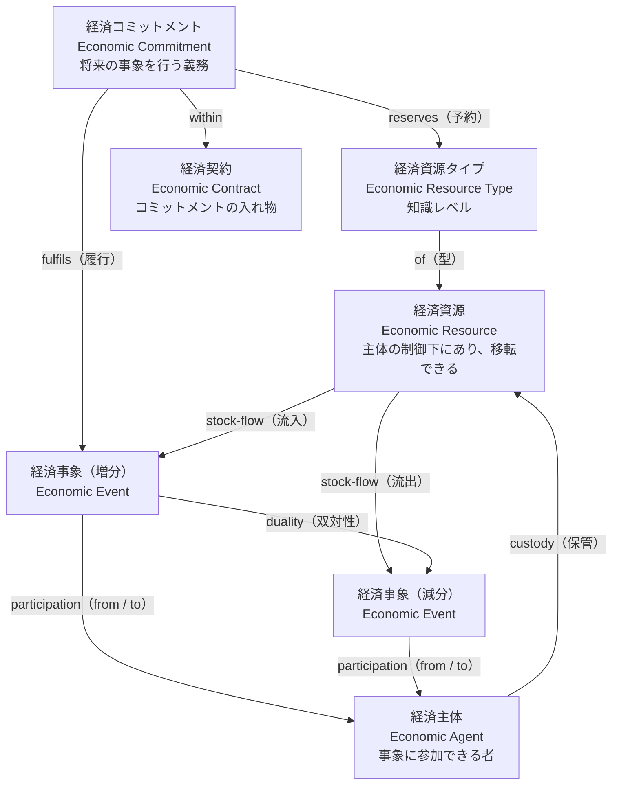
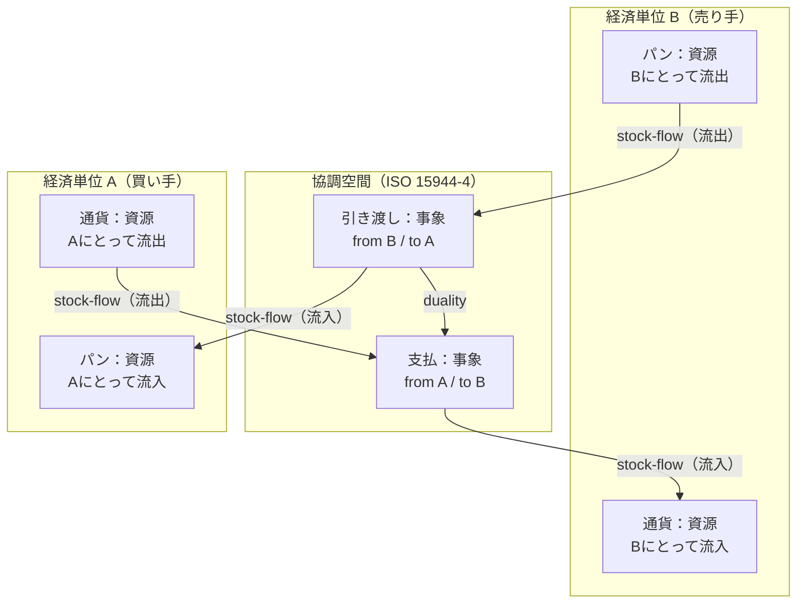

# 設計思想の背景調査――資源・主体・法則・作用過程

更新: 2026-10-24。設計の根拠を扱う正本。[設計原則](DESIGN.md)と対になる。実装手順や日々の経過はここへ蓄積しない。

## 調査の問いと結論

問いは、世界と人物を単なる処理の入口にせず、**何が実在し、誰が何を管理し、どの条件で何が変化するか**を、実装に先立って定められるか、である。仕組みの抽象化だけでは、食べ物の実在、保管、競合、身体への作用を説明できない。

出発点として、**資源を管理する世界と人物、両者を拘束する法則、具体的な資源へ作用する過程**を核にするのが妥当である。ただし、これは下記の理論から得た区別を組み合わせた、このプロジェクトの設計判断である。一つの既成理論がこの世界全体を証明・規定しているわけではない。

根拠には役割の違いがある。REAは資源・出来事・主体の関係、Valueflowsは具体的な資源と過程の入出力、DDDは整合性と責任の境界、存在論は実在物・性質・過程の区別を助ける。経済理論は、その上で情報差・権利・約束・利害を持つ人物間の営みを説明する。記録方式やクラス配置は、この構造を実現する段階で選ぶ。

### 前回の設計が止まった理由

この調査の出発点は、前回の設計が大枠の構造で失敗して止まったことである。記録は次のとおり。2026-09-25の[適合調査](archive/ARCHITECTURE_FIT_AUDIT.md)は、刺激の受信・解釈・動機・判断がsim内で混ざり、日次処理が仕事・給与・消費を直接更新していると判定した。世界側は資源と過程ではなく、処理の入口で組まれていた。その後の設計は人物内部の判断方式へ集中し、[運用契約](foundations/HMOSAIC_RUNTIME_CONTRACT.md)・[形式仕様](foundations/HMOSAIC_FORMAL_SPEC.md)など5本約1,800行と、[実装前レビュー](foundations/HMOSAIC_IMPLEMENTATION_READINESS_REVIEW.md)の未決12項目を生んだ。接続試作の[v25](baseline/HMOSAIC_RECOVERY_V25_RESULT.md)では、回復の候補に休息がなく初日に疲労死し、修正後も食品取得・食事が接続されず全員が栄養死した。再編直前の[引き継ぎ](archive/NEXT_SESSION_HISTORY_2026-10-24.md)の「次の作業」は遠隔在庫の表示項目の分離であり、90日生存は未達のままだった。

反省は二つある。第一に、変化を起こす仕組みが「過程」として一種類に揃っておらず、食事のような基本の作用が人物内部への特別な配線作業になり、着手されなかった。第二に、動く骨格がないまま判断方式の細部と契約を増やし、要件を実行から抽出できなかった。資源・法則・過程を核にするという本調査の結論は、この二点への答えである。ある程度自律的に動く骨格を先に作り、細かな要件は動かしながら抽出して直す。

## 根拠の読み方

- **一次資料で確認した事実**: 著者・標準化団体・実装元の説明と、対象箇所のソースコード。資料ごとに確認範囲を示す。
- **構造上の類似からの推論**: 理論の採用を著者が明言していない実装にも、比較に使える分離がある。類似だけでREA・DDD実装とは呼ばない。
- **本プロジェクトで採用する制約**: 根拠を参照して[DESIGN](DESIGN.md)に定める。外部理論の権威と、こちらの採用判断を混同しない。

調査は2026-10-24までの公開資料の対象箇所に限る。リンク先全体の通読、標準全文の購入・照合、外部実装のビルド・実行はしていない。「確認範囲に完全な適用例がなかった」は、世界中に存在しないという意味ではない。

## 1. REA――何が変わり、誰が関わったか

McCarthyのREAは、経済資源、資源を変化させる経済イベント、関与するエージェントとその関係を中心に置く。会計上の集計値だけでなく、資源の増減や交換の実態を追う出発点になる。[McCarthy, 1982（出版社）](https://doi.org/10.2308/TAR-4487748)

このプロジェクトでは、パンを買ったつもり、代金を払う約束、実際に引き渡されたパンを分ける根拠になる。人物の判断だけから所持量や栄養を増やす構造を避けられる。一方、経済資源という範囲を、そのまま自然界の全存在や身体生理へ拡張することはできない。

### REAを用いたシミュレーション

Laurier・Poelsの *Invariant Conditions in Value System Simulation Models*（2013）は、REAの三公理を供給連鎖・価値連鎖・業務過程の三層に言い換え、ExSpecTの色付き時間付き階層Petri netでBeer Gameの価値系を離散事象シミュレーションとして動かした。資源・出来事・主体の関連を、動作するモデルの整合条件へ進めた直接的な先例である。2026-10-24に公開著者稿の全文（本文30ページ）を読んだ。[大学掲載の論文と公開稿](https://biblio.ugent.be/publication/4087707)

論文の表1が言い換えた不変条件は次のとおり。第一公理: 各経済資源には少なくとも一つの流入事象と流出事象があり、事象は識別できる資源に作用する（供給連鎖では「資源は組織から組織へ流れる」）。第二公理: 資源を消費する事象は、いずれ資源を生産する事象と対になる。著者はこれを業務過程の段階では「物質保存則」と呼ぶ（価値連鎖では「交換に関わる各組織は資源を手放して別の資源を得る」）。第三公理: 各経済事象には組織内の責任者が少なくとも一人いる（供給連鎖では「交換には二つ以上の組織が要る」）。さらに、公理の違反はモデルの境界を示す印として使える。工場モデルで水・麦芽に流入が無く、廃棄物に流出が無いことを、著者は「モデルの境界にいる合図」と読み、拡張の指針にしている。

モデルの構造も参考になる。経済事象はトークン（資源）を消費・生産する遷移、在庫は単一トークンを持つ店（store）、未履行の注文・受注残は約束を表す店、情報の流れは資源の流れを調整する別のトークンである。資源を変えない事象は「業務事象」として経済事象から区別される。モデルファイルは公開されておらず、ExSpecTは入手できない（Bakkenist社の製品で、後にProtosへ統合されたと2005年の文献にある）。

ただし、この論文の公理は「健全な代謝」を前提に置く。資源は永久に貯蔵されず、企業は努力に報われる。こちらでは、支払い不履行、浪費、資源の滅失、飢餓死も成立する必要がある。将来の対価への期待と、実際に得た対価を分け、取引の成功や資源の有効利用を世界の必然にしない。身体・自然過程・変換の速度は扱っておらず、時間は遷移の遅延だけである。

### REAの図そのものと、単位・協調空間

2026-10-24、ユーザーの「新しい概念を作らず、調査の中にある適切なものを使え」という指摘を受けて、REAの図そのものを一次資料で確認した。結論は、**大構造の図はREAの基本図と、REAU／ISO 15944-4 の経済単位・協調空間でそのまま表せる**。こちらが言い換えた「資源・行為者・境界」は不要で、REAの語を使う。

**基本REA。** 経済資源、経済事象、経済主体の三つと、四つの関係からなる。stock-flow は資源と事象の関係で、事象が資源の流入か流出かを表す。duality は事象と事象の関係で、資源を得るには別の資源を手放すという対を表す。participation は事象と主体の関係で、from と to の二役を持つ。custody は主体と資源の関係で、保管を表す。定義は、経済資源が「主体の制御下にあり、主体から主体へ移転できる価値あるもの」、経済事象が「資源の制御の主体間の移転」、経済主体が「事象に参加できる者」。知識レベルには経済資源タイプ（資源の型）、経済コミットメント（将来の事象を行う義務。資源タイプを reserves し、事象に fulfils される）、経済契約（コミットメントの入れ物）、業務過程がある。出典は INTEROP プロジェクトの講義資料（[Johannesson 2006](https://people.dsv.su.se/~distans/INTEROP/INTEROPWP10/BMREAIntro.pdf)、教育目的の利用が許可されている。スライド6〜8、12、17、20）。

**単位と協調空間。** McCarthy 1982 の control participation は、事象・内部主体・外部主体の三項関係である。Hruby 2006 以降の多くの実装は二項の participation に置き換えた。[Laurier・Kiehn・Polovina 2011](https://research.dial.uclouvain.be/bitstreams/be52fc37-08b2-4c22-a563-9e12650d5679/download) の REAU は、これを**経済単位（unit）**として明示する。経済単位は「経済事象の効果を受ける（一群の）自然人・法人」で、同じ人物が主体と単位の両方を演じられる。stock-flow は「どの単位にとっての流入か流出か」、duality は「どの単位にとって流入事象と流出事象が対になるか」、participation は「どの単位のために参加するか」として、すべて単位に相対的な三項関係になる。企業中心の依存ビューでは単位が暗黙で一つだが、供給連鎖中心の独立ビュー（ISO/IEC 15944-4 の OeBTO）では、単位どうしの**協調空間**で流入・流出を扱い、内部主体は協調空間に現れず、双対性は協調空間に一つだけ存在して全当事者がその存在に合意する。ISO 15944-4 の要旨は、業務取引を「当事者ごとに一つ、二つのREA構成を接合したもの」と述べる（[FDIS 要旨](https://www.jtc1sc32.org/doc/N1501-1550/32N1511A-ABSTRACT_FDIS_15944-4_doc)。本文は委員会草案PDFが破損しており未入手）。

**Valueflows の核。** 公式序文は、主体（Agent）が経済事象（Economic Event）を行って経済資源（Economic Resource）に作用し、事象は資源を produce・modify・consume・use するか、主体間で transfer するか、場所間で transport すると述べる。過程（Process）は流れをつなぎ、交換（Exchange）は合意に基づく二つの相互の流れである。[序文](https://www.valueflo.ws/introduction/core/)

**こちらの言い換えとの対応。** 行為者は経済主体（自然は Valueflows の EcologicalAgent）。境界は経済単位とその custody。所属はどの単位の保管下にあるか。行為は経済事象。境界内の変換は、同じ単位の中で consume・use（減分）と produce（増分）が双対になる変換過程。境界を越える移動は、単位間の交換・移転で、give と take が双対になり、協調空間で両単位が合意する。影響範囲は、事象の stock-flow と from／to を単位ごとに読んだものに他ならない。したがって新しい概念は要らない。残るこちらの追加は、自然を主体に置くこと、身体を資源に置くこと、法則に速度と時間を持たせることの三つで、これはREAもValueflowsも扱わない。

### 作用としての出来事：資料に共通するもの

同日、ユーザーは「境界とは、存在単位どうしの資源の取引、さらに言えば相互作用であり、物理現象もその一種で、要するに事物に何らかの作用があるということではないか。資料はどれも同じことを扱っているはずだ」と指摘した。資料と実装を読み直すと、そのとおりである。どの資料も、**事物（作用を受け、状態を持つもの）**と、**事物への作用（参加者を持ち、事物の流入と流出が釣り合う出来事）**の組を原始概念にしている。境界・取引・相互作用・物理現象は、作用の種類か見方であって、別の部品ではない。

| 資料 | 事物 | 作用 | 参加者 | 釣り合い | 境界はどこに現れるか |
|---|---|---|---|---|---|
| REA（McCarthy 1982、Geerts・McCarthy） | 経済資源 | 経済事象。「資源の制御の主体間の移転」 | 経済主体。from と to | duality。資源を得るには別の資源を手放す | 事象そのもの。二主体の間で制御が移る点 |
| Hruby 2006 の整理 | 同上 | 交換過程（give・take）と変換過程（use・consume・produce）の二種。五つの stock-flow | 交換は二主体、変換は一主体 | 交換の双対と変換の双対 | 交換は主体間、変換は主体内。[Laurier・Bernaert・Poels 2010 の統合モデル](https://www.scitepress.org/Papers/2010/28717/28717.pdf) は両者を一つにする |
| REAU、ISO/IEC 15944-4 | 同上 | 同上。単位にとっての流入か流出か | 経済単位 | 協調空間に一つだけ存在する双対性に全当事者が合意 | 協調空間。二つのREA構成の接合面 |
| Laurier・Poels 2013（Petri net） | トークン（店に置かれた資源） | 遷移（processor）。入力トークンを消費し出力トークンを生成 | 遷移を担う系（組織） | 第二公理を「物質保存則」と呼ぶ | 系と系をつなぐ pin。組織間の資源の流れはそこを通る |
| Valueflows、hREA | EconomicResource | EconomicEvent（produce・consume・use・transfer・move）と Process | Agent（Person・Organization・EcologicalAgent）。provider と receiver | action 効果表の増減、Exchange は合意に基づく二つの相互の流れ | transfer 系の action。provider と receiver が異なる事象 |
| BFO | 継続体（物、性質、傾向性） | 過程（occurrent）。時間に展開する変化 | 過程への参加（participation） | 定めない | 定めない。参加者が複数の過程がそれにあたる |
| 経済理論（Williamson 1981） | 財・サービス | 取引。「財やサービスが技術的に分離可能な接面を越えて移転するときに生じる」 | 取引の両当事者 | 契約で定める | 接面（interface）が取引を定義する。[要旨](https://acawiki.org/The_economics_of_organization:_The_transaction_cost_approach) |
| Coad のカラーモデリング | 緑（Party・Place・Thing） | 桃（Moment-Interval。追跡すべき時点・期間の出来事） | 黄（Role を担う Party） | 青（Description）が型を与える | Moment-Interval が複数の Party を結ぶ |
| DDD（Evans、[Fowler の要約](https://martinfowler.com/bliki/DDD_Aggregate.html)） | 集約（単位として扱う対象の塊） | トランザクション。「集約の境界を越えてはならない」 | 外からは集約ルートだけを参照 | 集約内で不変条件を保つ | 集約の境界。集約間の変化は別のトランザクション |
| abcEconomics（確認版） | 主体の在庫（haves）と予約量 | sell・buy の申し出、accept、give | 送り手と受け手 | 申し出で予約し、受諾で両側を更新 | 受け手側は accept で即時更新、送り手側はメッセージ到着時に commit。両側は別の時点で更新される |
| Mars Sim（確認版） | ResourceHolder の在庫（Settlement・Vehicle・Person・Equipment） | retrieve と store の二段。Trade ミッションは交渉、売り荷の降ろし、買い荷の積み込みを別の局面で行う | 移転元と移転先の保持者 | 容量を超えた分は返す | 保持者の切り替わり。両側の確定は同時ではない |

この表から三つが言える。第一に、原始概念は「事物」と「事物への作用」で足りる。参加者（主体）は作用の属性であり、境界は作用の両側に別の保管者がいることの別名である。第二に、作用には釣り合いの規則がある。REAの双対性、Petri netのトークン保存、Laurier・Poelsの「物質保存則」、物理の保存則は、同じ要請を別の語で言っている。こちらが「法則」と呼んだものは、作用の型が持つ釣り合いと速度の規則である。第三に、実装上の分かれ目は「両側を一つの作用として確定するか、二段に分けるか」にある。REA、ISO 15944-4、Valueflows の Exchange は一つの双対性として扱い、abcEconomics と Mars Sim は予約を挟んだ二段で扱う。DDD の「トランザクションは集約の境界を越えない」は、作用そのものを一つの単位にすれば両立する。

したがって大構造の原始概念は、REA/BFO の語で、資源（事物。身体を含む）、出来事（事物への作用。参加者、流入と流出、釣り合い、速度と期間）、主体（参加者。人物と自然）、型（知識レベル。資源タイプ、過程仕様、効果表）の四つに収まる。取引は二主体の交換の双対、物理現象は自然を参加者とする作用、知覚と伝達は複写しても元が減らない情報という事物への作用である。「境界」「行為者」「影響範囲」という言い換えはこの四つから導けるので、本文の語としては使わない。

**ユーザーの定式化（2026-10-24、合意）。** 「事物の属性ごとに、決まる作用が双方向で起こる」と考えると、さらに簡単になる。作用の型は事物の属性（量、鮮度、所在、保管者、栄養、温度、知識）ごとに定まり、作用は関わる二つの事物の双方の属性を同時に変える。資料の対応は次のとおり。REA の stock-flow は資源の量という属性への作用で、duality がその双方向性である。hREA の action 効果表で transfer・move が `DecrementIncrement`（片方を減らし片方を増やす一つの効果）として定義されているのは、この双方向の作用を一語で表したものにあたる。Petri net の遷移は入力の店と出力の店のトークンを同時に変える。物理の相互作用は、関わる属性（質量、電荷、温度）ごとに法則が決まり、作用と反作用が対で起こり、保存則が釣り合いを与える。BFO では、性質と傾向性を持つ継続体が過程に参加する。知覚は、観測対象の可視属性と観測者の知識属性の間の作用で、対象側の変化がゼロに近い双方向の特殊例である。この定式化では、主体・単位・境界は、作用に参加する事物と、その保管者という属性から導かれる派生概念になる。

**ゲームエンジンとの対応と相違（ユーザーの指摘）。** Unity の GameObject・Component・毎フレームの Update と物理ステップは、事物・属性・作用に対応する。公式マニュアルでは、物理ステップ（衝突検出、剛体の積分、OnCollisionEnter 等の呼出し）が FixedUpdate または Update の直後に走る（[実行順](https://docs.unity3d.com/Manual/execution-order.html)）。Unity の ECS では、Entity は識別子、Component はデータ、System がそれを処理する論理で、データと論理を分ける（[Entities の概念](https://docs.unity3d.com/Packages/com.unity.entities@1.0/manual/concepts-intro.html)）。これは「属性ごとに決まる作用」を System として書く形にあたる。際立った相違は、こちらでは資源のやりとりが厳格なことである。ゲームエンジンは Update の中で任意の対象を任意に書き換えられ、何かを無から生成しても止めないが、こちらでは作用だけが属性を変え、作用は双方向で釣り合い、Laurier・Poels の不変条件（流入と流出、消費と生産の対、責任者）を検査に通す。前回の失敗は、この「Update で何でもできる」形に近づいたことでもある。

### 属性が作用を決める実装は、調査の中にあるか

ユーザーの「事物・属性・作用の三つが重要で、属性は事物に属し作用の性質を決める。調査にそういう実装はないか」という問いで、資料と実装を「属性が作用を決めるか」「両側を一度に変えるか」「釣り合うか」「時間を持つか」の四点で見直した（2026-10-24）。Mountaincore のリンクは `rossturner/mountaincore` が正しく、本節で修正した。

| 実装・形式 | 事物と属性 | 属性が作用を決めるか | 両側を一度に変えるか | 釣り合うか | 時間を持つか |
|---|---|---|---|---|---|
| 色付き Petri net（Laurier・Poels の ExSpecT、[CPN の定義](https://en.wikipedia.org/wiki/Coloured_Petri_net)） | トークンが色（データ値）を持ち、店は色集合を持つ | 決める。遷移のガードは色の式で、偽なら発火しない。弧の式がどの色のトークンを消費・生成するか定める | 発火で入力の店と出力の店を同時に変える | 弧の式で消費と生成を対応づければ釣り合う | 時間付き CPN が時刻と遅延を持つ。[CPN Tools](https://cpntools.org/) は無償だが 2015 年の 4.0.1 で開発停止、CPN IDE に置き換え |
| [Mountaincore](https://github.com/rossturner/mountaincore/blob/08afcf6d276f0d4a75c14bf34e02d169a4322ea8/core/src/main/java/technology/rocketjump/mountaincore/entities/model/Entity.java)（Java、MIT） | `Entity` が物理・位置・行動の部品と、クラスをキーにした `EntityComponentMap` を持つ。`update` は行動部品にだけ委譲 | [ConsumeFoodAction](https://github.com/rossturner/mountaincore/blob/08afcf6d276f0d4a75c14bf34e02d169a4322ea8/core/src/main/java/technology/rocketjump/mountaincore/entities/ai/goap/actions/nourishment/ConsumeFoodAction.java) は食品割当て（属性）の有無と経過時間（6秒）で決まる | 食品数量 −1 と需要 +50 を同じ `update` で行う | 釣り合わない。両方とも固定値で、数量と需要の対応は無い。割当ての解放は別の場所 | 経過時間で完了する |
| Rust 版 COLONY（[components.rs](https://github.com/ryankopf/colony/blob/e9a8f2bf621cb745d61a940fa69f9c8ac57a65ba/src/components.rs)、[eat.rs](https://github.com/ryankopf/colony/blob/e9a8f2bf621cb745d61a940fa69f9c8ac57a65ba/src/task_system/eat.rs)、Bevy ECS） | `PhysicalBody`（needs）、`Food`（nutrition・spoilage）などの部品 | System が部品の組（Query）で対象を選ぶ | 需要を上限に設定し食品を despawn する。同じ実行内 | 釣り合わない。`Food` の nutrition は読まれず、フィルタにしか使われていない | 無い |
| Unity ECS（[概念](https://docs.unity3d.com/Packages/com.unity.entities@1.0/manual/concepts-intro.html)、[System](https://docs.unity3d.com/Packages/com.unity.entities@1.0/manual/concepts-systems.html)） | Entity は識別子、Component はデータ | System が部品データを次の状態へ変える論理 | System の書き方次第 | 強制しない | 毎フレーム |
| Unreal Gameplay Ability System（[Attribute](https://dev.epicgames.com/documentation/en-us/unreal-engine/gameplay-attributes-and-attribute-sets-for-the-gameplay-ability-system-in-unreal-engine)、[Gameplay Effect](https://dev.epicgames.com/documentation/en-us/unreal-engine/gameplay-effects-for-the-gameplay-ability-system-in-unreal-engine)） | Actor が AttributeSet（Health 等の浮動小数の属性。基本値と現在値）を Ability System Component に持つ | Gameplay Effect は属性を変える方法だけを記したデータ資産で、修飾子（どの属性をどう変えるか）とタグ要件を持つ | 対象 Actor 一体に適用する。双方向ではない | 強制しない | Instant・Has Duration・Infinite の持続方針、周期、重ね掛け。実行時は Effect Spec という実例 |
| hREA の action 効果表 | EconomicResource の accountingQuantity と onhandQuantity | action ごとに増減が決まる | transfer・move は `DecrementIncrement` で二資源を一度に変える | 増減が対になる | 無い（時刻は事象の属性） |

結論は三つ。第一に、「属性が作用を決める」実装は調査の中に複数ある。形式としては色付き Petri net のガードと弧の式、エンジンとしては ECS の System と Unreal の Gameplay Effect、記録としては hREA の効果表である。第二に、「両側を一度に、釣り合いをもって変える」のは REA/hREA と Petri net だけで、ゲームとエンジンは両側を同じ更新で変えても釣り合いを強制しない。Mountaincore と COLONY の食事は、数量と需要が独立の固定値である。第三に、「属性ごとの作用の型」と「時間を持つ実例」を分けて持つ実装は Unreal の Gameplay Effect（資産）と Effect Spec（実例）、CPN の遷移と発火である。この三点を一つに持つ既存実装は確認できなかったので、基本のオブジェクトは、事物（Entity／Actor）、属性（Component／AttributeSet。保管者を含む）、作用の型（Gameplay Effect の資産に CPN のガードと REA の釣り合いを加えたもの）、作用の実例（Effect Spec と遷移の発火に時刻・期間・再評価を加えたもの）として、既存の語で組み立てる。TypeScript の ECS 基盤として [bitECS](https://github.com/NateTheGreatt/bitECS)（MPL-2.0、型定義あり）と [miniplex](https://github.com/hmans/miniplex)（MIT、型定義あり）があるが、採否は骨格の後に決める。

MAREAは名前と公開要旨でREAの利用を明示する多主体ビジネスシミュレータである。2018年の論文は、商社モデルの実行からイベントログを抽出し、プロセスマイニングへつなぐ実装を報告する。確認できたのは出版社の公開要旨などで、本文全体と対応ソースコードは未確認。2026-10-24に二度検索したが、原著（Vymětal・Schoeller 2012、Silesian University in Opava）を含めソースコードや配布物は見つからなかった。身体を持つ人物の生活世界全体の実装とは確認していない。[Itoほか, 2018](https://link.springer.com/article/10.1007/s10588-018-9268-6)

## 2. ValueflowsとhREA――資源に結びついた過程

Valueflowsは、資源の仕様と具体的な資源、過程の入力・出力、意図・約束・実際の経済イベントを区別する。同じ過程に、計画と実績を関連付けられる。権利の移転と保管・占有の移転も区別する。これにより、資源の抽象名から、対象の実物とその変化へ降りられる。[公式モデル](https://www.valueflo.ws/specification/model-text/)、[過程](https://www.valueflo.ws/concepts/processes/)、[移転](https://www.valueflo.ws/concepts/transfers/)

ただし、ValueflowsのProcessだけで、実行途中の全手順、身体の吸収機構、割込みの制御まで決まるわけではない。このプロジェクトでは「パンを消費した」という実績に加え、摂取中・消化中・吸収済みという経過を必要な粒度で扱う。

### hREAのコードで確認できる区別

hREAはREA・Valueflowsの実装を明示する。確認版は `8c99160bbf6c4ffab0b4d05a3edf8ec629c09ab4`。次のリンクを固定し、後続の変更と混同しない。

| 対象 | 確認した内容 | このプロジェクトでの意味 |
|---|---|---|
| [ReaEconomicResource](https://github.com/h-REA/hREA/blob/8c99160bbf6c4ffab0b4d05a3edf8ec629c09ab4/dnas/hrea/zomes/integrity/hrea/src/rea_economic_resource.rs) | 仕様参照、所在、数量、責任主体などを資源に保持 | 「食品」という種類と、この場所にある食品を分ける |
| [組込みaction定義](https://github.com/h-REA/hREA/blob/8c99160bbf6c4ffab0b4d05a3edf8ec629c09ab4/dnas/hrea/zomes/coordinator/hrea/vf_actions/src/builtins.rs) | consume・use・produce等の効果、権利と保管の移転を区別 | 仕組みの定義は特定人物の在庫そのものではない |
| [経済イベントの処理](https://github.com/h-REA/hREA/blob/8c99160bbf6c4ffab0b4d05a3edf8ec629c09ab4/dnas/hrea/zomes/coordinator/hrea/src/rea_economic_event.rs) | 実イベントの対象と効果定義を関連付けて数量等へ反映 | 定義と実物が結びつく適用箇所が必要 |
| [受入シナリオ](https://github.com/h-REA/hREA/blob/8c99160bbf6c4ffab0b4d05a3edf8ec629c09ab4/clients/acceptance/src/scenarios/rea-flows.ts) | 生産・増減・消費を通した残量の検査コード | 最終値だけでなく変化の対応を検査する例。実行は未確認 |

hREAは実資源を調整・記録するシステムであり、自然法則を自律計算する生活シミュレータではない。produceの記録が作れることと、投入物から物理的に生産できることは別である。

### REAの実装はどこまで使えるか

2026-10-24に、上記の実装を「入手できる形」「取り込める部分」「取り込めない部分」で照合した。結論は、**語彙・型・action効果表・不変条件は直接採り、実行系は採らない**。この照合の前に独自の大構造を書き始めたのは順序の誤りだった。

| 対象 | 入手できる形 | 取り込める部分 | 取り込めない部分 | 判断 |
|---|---|---|---|---|
| Laurier・Poels 2013 | 著者稿の全文。モデルファイルとExSpecTは入手不可 | 表1の不変条件（流入・流出、消費と生産の対、責任者、二者）。公理違反をモデル境界の印にする読み方。事象＝資源を変える遷移、在庫＝店、約束＝未履行の店、情報＝調整用トークンという離散事象の構造 | 健全な代謝の前提。身体・自然過程・速度。コード | 不変条件と事象構造を骨格に採る |
| MAREA | 論文のみ | REAのERPに主体を載せて商社が動き、イベントログが出るという先例の確認 | コード・配布物が無い | 参照のみ |
| Valueflows仕様と[vf-graphql](https://www.npmjs.com/package/@valueflows/vf-graphql) | 公開仕様。TypeScript型定義 `@valueflows/vf-graphql` 0.9.1-alpha.4（Apache-2.0、`index.d.ts` 約1,100行、リポジトリは lab.allmende.io） | 型: EconomicResource（onhand/accounting量、primaryAccountable、currentLocation、containedIn、stage/state、lotと期限）、EconomicEvent（action、provider/receiver、resourceInventoriedAs/toResourceInventoriedAs、量、時刻、inputOf/outputOf、atLocation/toLocation）、Process（hasBeginning/hasEnd/finished、観測・約束・意図の入出力）、ResourceSpecification、ProcessSpecification、Commitment、Intent、Agreement、Claim、SpatialThing、ProductBatch。意図→約束→実績の区別。[action一覧](https://www.valueflo.ws/concepts/actions/) | 仕様が「定義しない」と明言する物理的変換の速度と予定。知覚・身体・時間進行。GraphQL/DB層。仕様本文のライセンスは未確認 | 骨格の語彙と型として直接採る。必要な部分型だけを写し、GraphQL層は採らない |
| hREA（固定commit） | Rust、Holochain、Apache-2.0 | action効果表（21種、accounting/onhandの増減、入出力、対。約150行の純データ）。`apply_effect` の規則、produce/raiseでの資源生成、fulfills/satisfies/settlesの対応付け。受入シナリオ（TypeScript約240行）の流れ | Holochainランタイム。負量・単位不一致・二資源間のtransfer/move・所在と保管の更新が未実装。検査は終値のみで失敗例が無い | 効果表と規則を移植する。ランタイムと検査の薄さは引き継がない |

この照合から、[大きな構造](DESIGN.md#structure)の部品はREA/Valueflowsの語彙に対応づけられる。足すものは三つに限られる。身体を資源として世界に置くこと、法則に速度・上限・変換比と時間進行を持たせること、人物の心象（知覚・記憶）を加えること。この三つはValueflowsとLaurier・Poelsのどちらも扱っていない。

### 供給と配分の構造への実装のヒント

ユーザーの指摘（2026-10-24）で、問題の本質は「世界が資源をどう供給し、人物が不完全な心象で供給を予測し、自分の手段を配分して取得し、結果で心象を更新するか」であり、本調査はその構造を表に出していなかった。個別の区別（資源・過程・責任）は正しいが、個体の適応の環として読んでいなかった。読み直すと、調査資料には実装の手掛かりがある。

| 手掛かり | 確認した内容 | 大構造での位置 |
|---|---|---|
| Valueflowsの三層 | 公式序文は Knowledge（分類・方針・手順・規則・型）、Plan（提示と要求、予定、約束）、Observation（実際に起きたこと）の三層を定義する。[序文](https://www.valueflo.ws/introduction/core/)。Recipe系はKnowledge層の部品、Plan・Intent・Commitment・ProposalはPlan層、EconomicEvent・EconomicResourceはObservation層、Processは計画と観測の両方に存在し得る（[モデル説明](https://www.valueflo.ws/specification/model-text/)） | 心象の知識部分＝Knowledge層の本人用の写し。予測・配分の出力＝Plan層。実結果＝Observation層。心象の信念＝最後に観測したObservationの写し（時刻・出所つき） |
| Laurier・Poelsの在庫方針 | 在庫管理は所定の頻度で在庫を調べ、発注点を下回れば経済発注量を発注する。注文・請求は情報トークンとして遅れて届き、未着注文と受注残は約束を表す店に置かれる | 最小の予測・配分規則。遅れた情報で動く心象。期待される流入＝Commitment。最初の骨格の人物はこの程度でよい |
| Beer Gameの結果 | 局所的な在庫方針と情報の遅れから、上流ほど在庫が振れるbullwhipが生じ、発注頻度を変えると消える | 個体の適応の総和が世界の配分になることの先例。心象と実状態のずれが系全体の挙動を作る |
| abcEconomics | 主体が自分の在庫と予約量を持ち、投入可能量を確認してから生産・取引する | 自分の手段の予算と、その範囲での配分 |
| Mountaincore | 目標ごとに具体的な食品・物品を割り当て、確保・解放する | 配分の対象は仕様ではなく実物 |
| 経済理論 | 情報の非対称、観察できない行動、不完備契約 | 心象は実状態の複写ではなく、約束は履行と別 |
| 既存の数表 | [5人の90日の実行可能性](baseline/AUTONOMOUS_90_DAY_FEASIBILITY.md)は食料・薪・通貨・時間の供給と需要の算術 | 世界の供給が需要を満たし得るかの境界条件。人物の判断を含まない |

抜けていたのは、これらを供給・心象・予測・配分・実結果という一つの環として読むことだった。この環を大構造に置くと、HMOSAICを含む判断方式は「予測・配分」の差し替え可能な中身になり、知覚仕様は「心象の更新経路」の細部になり、法則の係数は「供給の速度」の細部になる。

## 3. DDD――状態と不変条件の責任境界

EvansのDDDには、同一性を持つEntity、整合性を保つAggregate、特定のEntityへ自然に属さない操作を扱うService、計算機構を分離するCohesive Mechanismsがある。確認したのは著者の *DDD Reference* の各該当項目である。[著者の案内](https://www.domainlanguage.com/ddd/reference/)、[参照文書](https://www.domainlanguage.com/wp-content/uploads/2016/05/DDD_Reference_2015-03.pdf)

ここから得るのは「人物や世界に、状態と整合性を取りまとめる責任を持たせられる」「物理計算の共用と、資源を持つ実体の責任を分けられる」という設計上の足場である。世界全体を一つのDBトランザクションやAggregateにする結論は導かれない。DDDは世界の存在論でも物理法則でもない。

クラスは、その責任をアクセス制御・構築条件・操作の入口として強制する有力な形式である。しかし、同じ可変状態を別経路から変更できれば、クラス名だけでは制約にならない。「担当者が毎回正しく判断する」ことへの依存を減らすには、許す操作と拒む操作を明記し、実装時に境界を強制する必要がある。

## 4. カラーモデリング・TM・イベントソーシング

| 理論 | 確認した区別・根拠 | 利用する範囲と限界 |
|---|---|---|
| Coadらのカラーモデリング | 4類型は緑Party/Place/Thing、黄Role、青Description、桃Moment-Interval。[著者書籍の出版社案内](https://www.informit.com/store/java-modeling-in-color-with-uml-enterprise-components-9780130115102)、[公開第5章](https://www.informit.com/content/images/013011510X/samplechapter/013011510X.pdf) | 人・物・場所、役割、記述、時間を持つ活動を分ける。公開章には要求・活動・テンプレートや資源の確保・解放を扱う例がある。全ソースや生活世界への適用は未確認 |
| TM（T字形ER手法） | 考案者の佐藤正美氏が、実装上の無矛盾と事業の事実への対応、関係・制約の把握を区別する。[考案者へのインタビュー](https://www.sei-info.co.jp/framework/column/data-modeling/) | 資源と出来事を関係から見直す手掛かり。「resource」の語義は物理的な消費物に限定されず、こちらの資源定義と同一ではない。モデルが形式的に整っても対象現象を捉えた証明にはならない |
| イベントソーシング | 状態の変化をイベントとして保存し、再適用で状態を再構成する。[Fowlerの解説](https://martinfowler.com/eaaDev/EventSourcing.html) | 実際の変化の追跡・再現に使える保存方式。イベントという存在の区別とは別。全履歴保存を大構造の必須条件にしない |

色の分類は「緑が人物、黄が物」ではなく、人物と物は同じ緑、黄は役割である。この区別は、身体を持つ人物と、売り手・所有者などの社会的役割を同一視しないために有用である。

## 5. 存在論――もの・性質・可能性・過程

BFOは、時間を通じて存在を保つものと、時間に展開する過程を分け、物的実体、性質、傾向性、役割、参加・実現の関係を扱う。BFO 2020はISO/IEC 21838-2:2021に対応する公開成果物を持つ。確認対象は公式案内と公開定義であり、標準全文の精査ではない。[公式案内](https://bfo-ontology.github.io/bfo-2020.html)、[公開コア定義](https://github.com/BFO-ontology/BFO-2020/blob/master/21838-2/owl/bfo-core.ofn)

これを参考に、次を区別する。

- 身体・パン・かまどなどの実体と、重さ・温度・栄養状態などの性質。
- 身体や設備が条件下で発揮できる能力と、実際に起きている摂食・加熱などの過程。
- 売り手・雇用主・所有者などの役割と、その役割を担う人物。
- 過程の種類・説明と、特定の時刻・場所・参加者に結びついた一回の過程。

**法則、能力、種類の定義、過程の実例は別物**である。法則は変化を拘束する関係、能力は実体に備わる可能性、過程は条件下で実際に起きる変化である。BFOの傾向性を物理法則そのものと同一視したり、BFOだけで所有権や判断の全構造が定まるとしたりはしない。この区別をこちらの資源・作用モデルへどう対応させるかは設計判断である。

## 6. 経済理論――権利・知識・利害の異なる人物の相互作用

これらは同じ階層の理論ではない。資源・出来事・主体の基本構造の上に、契約・情報・誘因に関する条件を置き、特定の現象を説明する。欺瞞や最適化を全人物の本性として埋め込む根拠にはしない。

| 理論・現象 | 中立的な説明 | 世界・人物・資源への接点 |
|---|---|---|
| プリンシパル＝エージェント理論 | 委任関係で、利害や利用できる情報が異なるときの契約・誘因 | 依頼と受諾、実作業、監視できる結果、報酬を分ける |
| モラルハザード | 契約後などに行動が十分観察できず、誘因が結果に影響する問題 | 行為の真相と相手が得た観察証拠が異なる。不道徳や嘘に限定しない |
| 逆選抜 | 契約前の属性・品質などの私的情報と、取引相手の選択が関係する問題 | 食品の品質の実状態、売り手の知識、買い手の推定を区別する |
| 不完備契約理論 | 将来の状態や行動のすべてを契約・第三者検証の対象にできない条件での権利配分 | 所有と残余の決定権、約束にない事態、実際の処分を扱う |
| ホールドアップ | 他の用途へ転用しにくい投資の後、交渉条件が変化し得る問題 | 設備・技能・立地の特定相手への依存と、投資前後の交渉力 |
| シグナリング | 情報を持つ側の行動が相手の推定を変える。型による費用差などが重要 | 支払った費用・観察された行動・受け手の推論を分ける。高価な行為だけで誠実さは証明されない |
| スクリーニング | 情報の乏しい側が条件や選択肢を設け、相手の選択から情報を得る | 提示条件、本人の選択、得られる証拠。罠や欺瞞を必須にしない |
| 取引費用理論 | 探索・交渉・監視・執行などの費用と、企業内調整を含む統治方式の比較 | 移動・調査・契約・監督も時間と能力を使う過程。市場にも組織にも費用がある |

一次資料の入口は、[2001年の情報非対称性に関する受賞説明](https://www.nobelprize.org/prizes/economic-sciences/2001/press-release/)、[2016年の契約理論の科学的背景](https://www.nobelprize.org/uploads/2018/06/advanced-economicsciences2016-1.pdf)、[Williamson本人による研究の説明](https://www.nobelprize.org/prizes/economic-sciences/2009/williamson/biographical/?frame=0)。Nobel資料には直接取得が403になるものがあり、検索で取得できた公開説明・抜粋の範囲を参照した。原論文を全件精査した一覧ではなく、形式モデルの仮定や均衡の採用は未決である。

この調査から採るのは、社会的権利と物理的な制御、真の状態と相手の知識、約束と履行を分ける必要性である。雇用、契約均衡、欺瞞行動等を今回の実装項目へ追加するものではない。

## 7. 他の実装――資源の保持と仕組みの適用はどこで結びつくか

### abcEconomics：人物に相当する主体の資源と共用機構

確認版は `adb9e137abe496f71eedb7885a0d860dbf8384d3`。Inventoryは実際の保有量と予約量を持ち、GoodsやFirmは投入・生産・消費を扱う。Traderは売買に伴う予約等を扱う。生産関数の仕組みを渡すことと、特定主体の投入可能量を確認して実在庫を変えることが分かれている。REA・DDDを明示採用したとの確認はなく、構造の比較例である。[公式リポジトリ](https://github.com/AB-CE/abce)

| 確認箇所 | 参考になる点 | 限界 |
|---|---|---|
| [Inventory](https://github.com/AB-CE/abce/blob/adb9e137abe496f71eedb7885a0d860dbf8384d3/abcEconomics/inventory.py) | 所持と予約、数量不足の検査 | createでの生成はモデル作成者が管理する必要がある |
| [Goods](https://github.com/AB-CE/abce/blob/adb9e137abe496f71eedb7885a0d860dbf8384d3/abcEconomics/agents/goods.py)、[Firm](https://github.com/AB-CE/abce/blob/adb9e137abe496f71eedb7885a0d860dbf8384d3/abcEconomics/agents/firm.py) | 共用する変換の仕組みを具体的な投入在庫へ適用 | あらゆる生産が身体・自然法則に基づく保証はない |
| [Trader](https://github.com/AB-CE/abce/blob/adb9e137abe496f71eedb7885a0d860dbf8384d3/abcEconomics/agents/trader.py) | 提示・予約・受諾・移転の関係 | 物理的な輸送時間や身体生活をそのまま得られるわけではない |

### コロニー・身体シミュレーション：定義、実物、進行中の作用

| 実装・固定した版 | 対象箇所で確認した構造 | 採用時に注意する点 |
|---|---|---|
| [Mountaincore](https://github.com/rossturner/mountaincore/tree/08afcf6d276f0d4a75c14bf34e02d169a4322ea8) | InventoryComponent、ItemAllocationComponent、FoodAllocation、AssignedGoal、ConsumeFoodAction。所持品・数量割当て・食事行動の進行を関連付ける | 一連の動作に具体的な食品と確保・解放が必要という例。クラス分割だけで全更新権限が限定されているとは言えない |
| [Mars Sim](https://github.com/mars-sim/mars-sim/tree/6ee62e85b11912a4f56759b6a7fd02aca25856a5) | Personが身体・Mind・所持設備を持つ。ResourceProcessSpecは変換の仕様、ResourceProcessは設備側の資源保持者に結びついた実行、MicroInventoryは実量と容量を扱う | 仕様と、資源を使う実行の区別が参考になる。仕様クラスは設定状態を持ち得るため「完全な純粋関数」とはしない |
| [KeeperRL](https://github.com/miki151/keeperrl/tree/95d2be4e97db2243210a71918e36a533ad94dcd1) | Equipmentの実物管理と、CreatureActionに束縛された対象・実行・失敗を区別 | 行動の説明だけでは作用しないことが参考になる。Creatureが多くの処理を取りまとめること自体を欠陥とはしない |

外部実装はソースの対象箇所のみを確認し、実行・ビルド・受入試験は未実施。[以前のコロニー系調査](foundations/COLONY_SIM_ARCHITECTURE_REVIEW.md)は追加の探索資料として残すが、新しい原則の正本とはしない。

## 8. 何を採り、何を留保するか

採るのは次の関係である。これらを実装上のクラス名や保存形に直結させず、[設計原則](DESIGN.md)で現象の制約として定義する。

| 採る関係 | 主な根拠 | 原則 |
|---|---|---|
| 世界内の実物と、それに関わる人物 | REA、存在論、身体を持つシミュレーション | [P01](DESIGN.md#p01)、[P02](DESIGN.md#p02) |
| 仕組みの定義と、対象・条件に結びついた具体的な作用 | Valueflows、Mars Sim、abcEconomics | [P03](DESIGN.md#p03)、[P06](DESIGN.md#p06)、[P07](DESIGN.md#p07) |
| 資源の管理、社会的権利、物理的な制御、整合性の責任 | DDD、Valueflows、契約理論 | [P04](DESIGN.md#p04)、[P10](DESIGN.md#p10)、[P12](DESIGN.md#p12) |
| 実状態、知識、意図、約束、履行の区別 | REA、Valueflows、情報・契約の経済理論 | [P05](DESIGN.md#p05)、[P06](DESIGN.md#p06)、[P10](DESIGN.md#p10) |
| 資源制約と、身体・環境・人物間の相互作用 | 具体的な在庫管理、身体・生活シミュレーション | [P07](DESIGN.md#p07)、[P08](DESIGN.md#p08)、[P09](DESIGN.md#p09) |
| 変化の証拠と版別の検証 | REAのシミュレーション、イベントソーシング、既存の比較実験 | [P11](DESIGN.md#p11) |

留保するのは、唯一の普遍的クラス階層、全世界を覆う単一の経済モデル、全人物の合理性・欺瞞・交換成功、全資源を同じ数量として扱うこと、特定の保存・実行方式の必須化である。

確認範囲では、REAを使った経済シミュレーションと、資源・身体・作用を扱う別の実装は見つかった。一方、それらを統合し、このプロジェクトの自律生活・身体・主観まで満たす完成済みの雛形は確認できていない。外部構造の丸写しではなく、根拠のある区別と反例を用いて制約を確立する。

## 更新する条件

原則の変更を支える新しい根拠、既存解釈への反例、実装から判明した関係の不足があるときに更新する。出典、確認範囲、こちらの推論、採用・留保を同じ場所に記す。調査の追加だけで本文を増やさず、既存の区別を修正するか、今回の設計に必要な未解決点を埋める。
