# 設計思想の背景調査――資源・主体・法則・作用過程

更新: 2026-10-28（10 節を追加し、10.7 を足した）。設計の根拠を扱う正本。[設計原則](DESIGN.md)と対になる。実装手順や日々の経過はここへ蓄積しない。

## 調査の問いと結論

問いは、世界と人物を単なる処理の入口にせず、**何が実在し、誰が何を管理し、どの条件で何が変化するか**を、実装に先立って定められるか、である。仕組みの抽象化だけでは、食べ物の実在、保管、競合、身体への作用を説明できない。

出発点として、**資源を管理する世界と人物、両者を拘束する法則、具体的な資源へ作用する過程**を核にするのが妥当である。ただし、これは下記の理論から得た区別を組み合わせた、このプロジェクトの設計判断である。一つの既成理論がこの世界全体を証明・規定しているわけではない。

根拠には役割の違いがある。REAは資源・出来事・主体の関係、Valueflowsは具体的な資源と過程の入出力、DDDは整合性と責任の境界、存在論は実在物・性質・過程の区別を助ける。経済理論は、その上で情報差・権利・約束・利害を持つ人物間の営みを説明する。記録方式やクラス配置は、この構造を実現する段階で選ぶ。

### 前回の設計が止まった理由

この調査の出発点は、前回の設計が大枠の構造で失敗して止まったことである。記録は次のとおり。2026-09-25の[適合調査](archive/ARCHITECTURE_FIT_AUDIT.md)は、刺激の受信・解釈・動機・判断がsim内で混ざり、日次処理が仕事・給与・消費を直接更新していると判定した。世界側は資源と過程ではなく、処理の入口で組まれていた。その後の設計は人物内部の判断方式へ集中し、[運用契約](foundations/HMOSAIC_RUNTIME_CONTRACT.md)・[形式仕様](foundations/HMOSAIC_FORMAL_SPEC.md)など5本約1,800行と、[実装前レビュー](foundations/HMOSAIC_IMPLEMENTATION_READINESS_REVIEW.md)の未決12項目を生んだ。接続試作の[v25](baseline/HMOSAIC_RECOVERY_V25_RESULT.md)では、回復の候補に休息がなく初日に疲労死し、修正後も食品取得・食事が接続されず全員が栄養死した。再編直前の[引き継ぎ](archive/NEXT_SESSION_HISTORY_2026-10-24.md)の「次の作業」は遠隔在庫の表示項目の分離であり、90日生存は未達のままだった。

反省は二つある。第一に、変化を起こす仕組みが「過程」として一種類に揃っておらず、食事のような基本の作用が人物内部への特別な配線作業になり、着手されなかった。第二に、動く骨格がないまま判断方式の細部と契約を増やし、要件を実行から抽出できなかった。資源・法則・過程を核にするという本調査の結論は、この二点への答えである。ある程度自律的に動く骨格を先に作り、細かな要件は動かしながら抽出して直す。

## 根拠の読み方

- **一次資料で確認した事実**: 著者・標準化団体・実装元の説明と、対象箇所のソースコード。資料ごとに確認範囲を示す。
- **構造上の類似からの推論**: 理論の採用を著者が明言していない実装にも、比較に使える分離がある。類似だけでREA・DDD実装とは呼ばない。
- **本プロジェクトで採用する制約**: 根拠を参照して[DESIGN](DESIGN.md)に定める。外部理論の権威と、こちらの採用判断を混同しない。

調査は2026-10-24までの公開資料の対象箇所に限る。リンク先全体の通読、標準全文の購入・照合、外部実装のビルド・実行はしていない。「確認範囲に完全な適用例がなかった」は、世界中に存在しないという意味ではない。

## 1. REA――何が変わり、誰が関わったか

McCarthyのREAは、経済資源、資源を変化させる経済イベント、関与するエージェントとその関係を中心に置く。会計上の集計値だけでなく、資源の増減や交換の実態を追う出発点になる。[McCarthy, 1982（出版社）](https://doi.org/10.2308/TAR-4487748)

このプロジェクトでは、パンを買ったつもり、代金を払う約束、実際に引き渡されたパンを分ける根拠になる。人物の判断だけから所持量や栄養を増やす構造を避けられる。一方、経済資源という範囲を、そのまま自然界の全存在や身体生理へ拡張することはできない。

### REAを用いたシミュレーション

Laurier・Poelsの *Invariant Conditions in Value System Simulation Models*（2013）は、REAの三公理を供給連鎖・価値連鎖・業務過程の三層に言い換え、ExSpecTの色付き時間付き階層Petri netでBeer Gameの価値系を離散事象シミュレーションとして動かした。資源・出来事・主体の関連を、動作するモデルの整合条件へ進めた直接的な先例である。2026-10-24に公開著者稿の全文（本文30ページ）を読んだ。[大学掲載の論文と公開稿](https://biblio.ugent.be/publication/4087707)

論文の表1が言い換えた不変条件は次のとおり。第一公理: 各経済資源には少なくとも一つの流入事象と流出事象があり、事象は識別できる資源に作用する（供給連鎖では「資源は組織から組織へ流れる」）。第二公理: 資源を消費する事象は、いずれ資源を生産する事象と対になる。著者はこれを業務過程の段階では「物質保存則」と呼ぶ（価値連鎖では「交換に関わる各組織は資源を手放して別の資源を得る」）。第三公理: 各経済事象には組織内の責任者が少なくとも一人いる（供給連鎖では「交換には二つ以上の組織が要る」）。さらに、公理の違反はモデルの境界を示す印として使える。工場モデルで水・麦芽に流入が無く、廃棄物に流出が無いことを、著者は「モデルの境界にいる合図」と読み、拡張の指針にしている。

モデルの構造も参考になる。経済事象はトークン（資源）を消費・生産する遷移、在庫は単一トークンを持つ店（store）、未履行の注文・受注残は約束を表す店、情報の流れは資源の流れを調整する別のトークンである。資源を変えない事象は「業務事象」として経済事象から区別される。モデルファイルは公開されておらず、ExSpecTは入手できない（Bakkenist社の製品で、後にProtosへ統合されたと2005年の文献にある）。

ただし、この論文の公理は「健全な代謝」を前提に置く。資源は永久に貯蔵されず、企業は努力に報われる。こちらでは、支払い不履行、浪費、資源の滅失、飢餓死も成立する必要がある。将来の対価への期待と、実際に得た対価を分け、取引の成功や資源の有効利用を世界の必然にしない。身体・自然過程・変換の速度は扱っておらず、時間は遷移の遅延だけである。

### REAの図そのものと、単位・協調空間

2026-10-24、ユーザーの「新しい概念を作らず、調査の中にある適切なものを使え」という指摘を受けて、REAの図そのものを一次資料で確認した。結論は、**大構造の図はREAの基本図と、REAU／ISO 15944-4 の経済単位・協調空間でそのまま表せる**。こちらが言い換えた「資源・行為者・境界」は不要で、REAの語を使う。

**基本REA。** 経済資源、経済事象、経済主体の三つと、四つの関係からなる。stock-flow は資源と事象の関係で、事象が資源の流入か流出かを表す。duality は事象と事象の関係で、資源を得るには別の資源を手放すという対を表す。participation は事象と主体の関係で、from と to の二役を持つ。custody は主体と資源の関係で、保管を表す。定義は、経済資源が「主体の制御下にあり、主体から主体へ移転できる価値あるもの」、経済事象が「資源の制御の主体間の移転」、経済主体が「事象に参加できる者」。知識レベルには経済資源タイプ（資源の型）、経済コミットメント（将来の事象を行う義務。資源タイプを reserves し、事象に fulfils される）、経済契約（コミットメントの入れ物）、業務過程がある。出典は INTEROP プロジェクトの講義資料（[Johannesson 2006](https://people.dsv.su.se/~distans/INTEROP/INTEROPWP10/BMREAIntro.pdf)、教育目的の利用が許可されている。スライド6〜8、12、17、20）。

<!-- 図の正本は figures/src/research-figA-rea.mmd。scripts/docs/render-figures.cjs で SVG を再生成する -->

**単位と協調空間。** McCarthy 1982 の control participation は、事象・内部主体・外部主体の三項関係である。Hruby 2006 以降の多くの実装は二項の participation に置き換えた。[Laurier・Kiehn・Polovina 2011](https://research.dial.uclouvain.be/bitstreams/be52fc37-08b2-4c22-a563-9e12650d5679/download) の REAU は、これを**経済単位（unit）**として明示する。経済単位は「経済事象の効果を受ける（一群の）自然人・法人」で、同じ人物が主体と単位の両方を演じられる。stock-flow は「どの単位にとっての流入か流出か」、duality は「どの単位にとって流入事象と流出事象が対になるか」、participation は「どの単位のために参加するか」として、すべて単位に相対的な三項関係になる。企業中心の依存ビューでは単位が暗黙で一つだが、供給連鎖中心の独立ビュー（ISO/IEC 15944-4 の OeBTO）では、単位どうしの**協調空間**で流入・流出を扱い、内部主体は協調空間に現れず、双対性は協調空間に一つだけ存在して全当事者がその存在に合意する。ISO 15944-4 の要旨は、業務取引を「当事者ごとに一つ、二つのREA構成を接合したもの」と述べる（[FDIS 要旨](https://www.jtc1sc32.org/doc/N1501-1550/32N1511A-ABSTRACT_FDIS_15944-4_doc)。本文は委員会草案PDFが破損しており未入手）。

<!-- 図の正本は figures/src/research-figB-units.mmd。scripts/docs/render-figures.cjs で SVG を再生成する -->

**Valueflows の核。** 公式序文は、主体（Agent）が経済事象（Economic Event）を行って経済資源（Economic Resource）に作用し、事象は資源を produce・modify・consume・use するか、主体間で transfer するか、場所間で transport すると述べる。過程（Process）は流れをつなぎ、交換（Exchange）は合意に基づく二つの相互の流れである。[序文](https://www.valueflo.ws/introduction/core/)

**こちらの言い換えとの対応。** 行為者は経済主体（自然は Valueflows の EcologicalAgent）。境界は経済単位とその custody。所属はどの単位の保管下にあるか。行為は経済事象。境界内の変換は、同じ単位の中で consume・use（減分）と produce（増分）が双対になる変換過程。境界を越える移動は、単位間の交換・移転で、give と take が双対になり、協調空間で両単位が合意する。影響範囲は、事象の stock-flow と from／to を単位ごとに読んだものに他ならない。したがって新しい概念は要らない。残るこちらの追加は、自然を主体に置くこと、身体を資源に置くこと、法則に速度と時間を持たせることの三つで、これはREAもValueflowsも扱わない。

### 作用としての出来事：資料に共通するもの

同日、ユーザーは「境界とは、存在単位どうしの資源の取引、さらに言えば相互作用であり、物理現象もその一種で、要するに事物に何らかの作用があるということではないか。資料はどれも同じことを扱っているはずだ」と指摘した。資料と実装を読み直すと、そのとおりである。どの資料も、**事物（作用を受け、状態を持つもの）**と、**事物への作用（参加者を持ち、事物の流入と流出が釣り合う出来事）**の組を原始概念にしている。境界・取引・相互作用・物理現象は、作用の種類か見方であって、別の部品ではない。

| 資料 | 事物 | 作用 | 参加者 | 釣り合い | 境界はどこに現れるか |
|---|---|---|---|---|---|
| REA（McCarthy 1982、Geerts・McCarthy） | 経済資源 | 経済事象。「資源の制御の主体間の移転」 | 経済主体。from と to | duality。資源を得るには別の資源を手放す | 事象そのもの。二主体の間で制御が移る点 |
| Hruby 2006 の整理 | 同上 | 交換過程（give・take）と変換過程（use・consume・produce）の二種。五つの stock-flow | 交換は二主体、変換は一主体 | 交換の双対と変換の双対 | 交換は主体間、変換は主体内。[Laurier・Bernaert・Poels 2010 の統合モデル](https://www.scitepress.org/Papers/2010/28717/28717.pdf) は両者を一つにする |
| REAU、ISO/IEC 15944-4 | 同上 | 同上。単位にとっての流入か流出か | 経済単位 | 協調空間に一つだけ存在する双対性に全当事者が合意 | 協調空間。二つのREA構成の接合面 |
| Laurier・Poels 2013（Petri net） | トークン（店に置かれた資源） | 遷移（processor）。入力トークンを消費し出力トークンを生成 | 遷移を担う系（組織） | 第二公理を「物質保存則」と呼ぶ | 系と系をつなぐ pin。組織間の資源の流れはそこを通る |
| Valueflows、hREA | EconomicResource | EconomicEvent（produce・consume・use・transfer・move）と Process | Agent（Person・Organization・EcologicalAgent）。provider と receiver | action 効果表の増減、Exchange は合意に基づく二つの相互の流れ | transfer 系の action。provider と receiver が異なる事象 |
| BFO | 継続体（物、性質、傾向性） | 過程（occurrent）。時間に展開する変化 | 過程への参加（participation） | 定めない | 定めない。参加者が複数の過程がそれにあたる |
| 経済理論（Williamson 1981） | 財・サービス | 取引。「財やサービスが技術的に分離可能な接面を越えて移転するときに生じる」 | 取引の両当事者 | 契約で定める | 接面（interface）が取引を定義する。[要旨](https://acawiki.org/The_economics_of_organization:_The_transaction_cost_approach) |
| Coad のカラーモデリング | 緑（Party・Place・Thing） | 桃（Moment-Interval。追跡すべき時点・期間の出来事） | 黄（Role を担う Party） | 青（Description）が型を与える | Moment-Interval が複数の Party を結ぶ |
| DDD（Evans、[Fowler の要約](https://martinfowler.com/bliki/DDD_Aggregate.html)） | 集約（単位として扱う対象の塊） | トランザクション。「集約の境界を越えてはならない」 | 外からは集約ルートだけを参照 | 集約内で不変条件を保つ | 集約の境界。集約間の変化は別のトランザクション |
| abcEconomics（確認版） | 主体の在庫（haves）と予約量 | sell・buy の申し出、accept、give | 送り手と受け手 | 申し出で予約し、受諾で両側を更新 | 受け手側は accept で即時更新、送り手側はメッセージ到着時に commit。両側は別の時点で更新される |
| Mars Sim（確認版） | ResourceHolder の在庫（Settlement・Vehicle・Person・Equipment） | retrieve と store の二段。Trade ミッションは交渉、売り荷の降ろし、買い荷の積み込みを別の局面で行う | 移転元と移転先の保持者 | 容量を超えた分は返す | 保持者の切り替わり。両側の確定は同時ではない |

この表から三つが言える。第一に、原始概念は「事物」と「事物への作用」で足りる。参加者（主体）は作用の属性であり、境界は作用の両側に別の保管者がいることの別名である。第二に、作用には釣り合いの規則がある。REAの双対性、Petri netのトークン保存、Laurier・Poelsの「物質保存則」、物理の保存則は、同じ要請を別の語で言っている。こちらが「法則」と呼んだものは、作用の型が持つ釣り合いと速度の規則である。第三に、実装上の分かれ目は「両側を一つの作用として確定するか、二段に分けるか」にある。REA、ISO 15944-4、Valueflows の Exchange は一つの双対性として扱い、abcEconomics と Mars Sim は予約を挟んだ二段で扱う。DDD の「トランザクションは集約の境界を越えない」は、作用そのものを一つの単位にすれば両立する。

したがって大構造の原始概念は、REA/BFO の語で、資源（事物。身体を含む）、出来事（事物への作用。参加者、流入と流出、釣り合い、速度と期間）、主体（参加者。人物と自然）、型（知識レベル。資源タイプ、過程仕様、効果表）の四つに収まる。取引は二主体の交換の双対、物理現象は自然を参加者とする作用、知覚と伝達は複写しても元が減らない情報という事物への作用である。「境界」「行為者」「影響範囲」という言い換えはこの四つから導けるので、本文の語としては使わない。

**ユーザーの定式化（2026-10-24、合意）。** 「事物の属性ごとに、決まる作用が双方向で起こる」と考えると、さらに簡単になる。作用の型は事物の属性（量、鮮度、所在、保管者、栄養、温度、知識）ごとに定まり、作用は関わる二つの事物の双方の属性を同時に変える。資料の対応は次のとおり。REA の stock-flow は資源の量という属性への作用で、duality がその双方向性である。hREA の action 効果表で transfer・move が `DecrementIncrement`（片方を減らし片方を増やす一つの効果）として定義されているのは、この双方向の作用を一語で表したものにあたる。Petri net の遷移は入力の店と出力の店のトークンを同時に変える。物理の相互作用は、関わる属性（質量、電荷、温度）ごとに法則が決まり、作用と反作用が対で起こり、保存則が釣り合いを与える。BFO では、性質と傾向性を持つ継続体が過程に参加する。知覚は、観測対象の可視属性と観測者の知識属性の間の作用で、対象側の変化がゼロに近い双方向の特殊例である。この定式化では、主体・単位・境界は、作用に参加する事物と、その保管者という属性から導かれる派生概念になる。

**ゲームエンジンとの対応と相違（ユーザーの指摘）。** Unity の GameObject・Component・毎フレームの Update と物理ステップは、事物・属性・作用に対応する。公式マニュアルでは、物理ステップ（衝突検出、剛体の積分、OnCollisionEnter 等の呼出し）が FixedUpdate または Update の直後に走る（[実行順](https://docs.unity3d.com/Manual/execution-order.html)）。Unity の ECS では、Entity は識別子、Component はデータ、System がそれを処理する論理で、データと論理を分ける（[Entities の概念](https://docs.unity3d.com/Packages/com.unity.entities@1.0/manual/concepts-intro.html)）。これは「属性ごとに決まる作用」を System として書く形にあたる。際立った相違は、こちらでは資源のやりとりが厳格なことである。ゲームエンジンは Update の中で任意の対象を任意に書き換えられ、何かを無から生成しても止めないが、こちらでは作用だけが属性を変え、作用は双方向で釣り合い、Laurier・Poels の不変条件（流入と流出、消費と生産の対、責任者）を検査に通す。前回の失敗は、この「Update で何でもできる」形に近づいたことでもある。

### 属性が作用を決める実装は、調査の中にあるか

ユーザーの「事物・属性・作用の三つが重要で、属性は事物に属し作用の性質を決める。調査にそういう実装はないか」という問いで、資料と実装を「属性が作用を決めるか」「両側を一度に変えるか」「釣り合うか」「時間を持つか」の四点で見直した（2026-10-24）。Mountaincore のリンクは `rossturner/mountaincore` が正しく、本節で修正した。

| 実装・形式 | 事物と属性 | 属性が作用を決めるか | 両側を一度に変えるか | 釣り合うか | 時間を持つか |
|---|---|---|---|---|---|
| 色付き Petri net（Laurier・Poels の ExSpecT、[CPN の定義](https://en.wikipedia.org/wiki/Coloured_Petri_net)） | トークンが色（データ値）を持ち、店は色集合を持つ | 決める。遷移のガードは色の式で、偽なら発火しない。弧の式がどの色のトークンを消費・生成するか定める | 発火で入力の店と出力の店を同時に変える | 弧の式で消費と生成を対応づければ釣り合う | 時間付き CPN が時刻と遅延を持つ。[CPN Tools](https://cpntools.org/) は無償だが 2015 年の 4.0.1 で開発停止、CPN IDE に置き換え |
| [Mountaincore](https://github.com/rossturner/mountaincore/blob/08afcf6d276f0d4a75c14bf34e02d169a4322ea8/core/src/main/java/technology/rocketjump/mountaincore/entities/model/Entity.java)（Java、MIT） | `Entity` が物理・位置・行動の部品と、クラスをキーにした `EntityComponentMap` を持つ。`update` は行動部品にだけ委譲 | [ConsumeFoodAction](https://github.com/rossturner/mountaincore/blob/08afcf6d276f0d4a75c14bf34e02d169a4322ea8/core/src/main/java/technology/rocketjump/mountaincore/entities/ai/goap/actions/nourishment/ConsumeFoodAction.java) は食品割当て（属性）の有無と経過時間（6秒）で決まる | 食品数量 −1 と需要 +50 を同じ `update` で行う | 釣り合わない。両方とも固定値で、数量と需要の対応は無い。割当ての解放は別の場所 | 経過時間で完了する |
| Rust 版 COLONY（[components.rs](https://github.com/ryankopf/colony/blob/e9a8f2bf621cb745d61a940fa69f9c8ac57a65ba/src/components.rs)、[eat.rs](https://github.com/ryankopf/colony/blob/e9a8f2bf621cb745d61a940fa69f9c8ac57a65ba/src/task_system/eat.rs)、Bevy ECS） | `PhysicalBody`（needs）、`Food`（nutrition・spoilage）などの部品 | System が部品の組（Query）で対象を選ぶ | 需要を上限に設定し食品を despawn する。同じ実行内 | 釣り合わない。`Food` の nutrition は読まれず、フィルタにしか使われていない | 無い |
| Unity ECS（[概念](https://docs.unity3d.com/Packages/com.unity.entities@1.0/manual/concepts-intro.html)、[System](https://docs.unity3d.com/Packages/com.unity.entities@1.0/manual/concepts-systems.html)） | Entity は識別子、Component はデータ | System が部品データを次の状態へ変える論理 | System の書き方次第 | 強制しない | 毎フレーム |
| Unreal Gameplay Ability System（[Attribute](https://dev.epicgames.com/documentation/en-us/unreal-engine/gameplay-attributes-and-attribute-sets-for-the-gameplay-ability-system-in-unreal-engine)、[Gameplay Effect](https://dev.epicgames.com/documentation/en-us/unreal-engine/gameplay-effects-for-the-gameplay-ability-system-in-unreal-engine)） | Actor が AttributeSet（Health 等の浮動小数の属性。基本値と現在値）を Ability System Component に持つ | Gameplay Effect は属性を変える方法だけを記したデータ資産で、修飾子（どの属性をどう変えるか）とタグ要件を持つ | 対象 Actor 一体に適用する。双方向ではない | 強制しない | Instant・Has Duration・Infinite の持続方針、周期、重ね掛け。実行時は Effect Spec という実例 |
| hREA の action 効果表 | EconomicResource の accountingQuantity と onhandQuantity | action ごとに増減が決まる | transfer・move は `DecrementIncrement` で二資源を一度に変える | 増減が対になる | 無い（時刻は事象の属性） |

結論は三つ。第一に、「属性が作用を決める」実装は調査の中に複数ある。形式としては色付き Petri net のガードと弧の式、エンジンとしては ECS の System と Unreal の Gameplay Effect、記録としては hREA の効果表である。第二に、「両側を一度に、釣り合いをもって変える」のは REA/hREA と Petri net だけで、ゲームとエンジンは両側を同じ更新で変えても釣り合いを強制しない。Mountaincore と COLONY の食事は、数量と需要が独立の固定値である。第三に、「属性ごとの作用の型」と「時間を持つ実例」を分けて持つ実装は Unreal の Gameplay Effect（資産）と Effect Spec（実例）、CPN の遷移と発火である。この三点を一つに持つ既存実装は確認できなかったので、基本のオブジェクトは、事物（Entity／Actor）、属性（Component／AttributeSet。保管者を含む）、作用の型（Gameplay Effect の資産に CPN のガードと REA の釣り合いを加えたもの）、作用の実例（Effect Spec と遷移の発火に時刻・期間・再評価を加えたもの）として、既存の語で組み立てる。TypeScript の ECS 基盤として [bitECS](https://github.com/NateTheGreatt/bitECS)（MPL-2.0、型定義あり）と [miniplex](https://github.com/hmans/miniplex)（MIT、型定義あり）があるが、採否は骨格の後に決める。

MAREAは名前と公開要旨でREAの利用を明示する多主体ビジネスシミュレータである。2018年の論文は、商社モデルの実行からイベントログを抽出し、プロセスマイニングへつなぐ実装を報告する。確認できたのは出版社の公開要旨などで、本文全体と対応ソースコードは未確認。2026-10-24に二度検索したが、原著（Vymětal・Schoeller 2012、Silesian University in Opava）を含めソースコードや配布物は見つからなかった。身体を持つ人物の生活世界全体の実装とは確認していない。[Itoほか, 2018](https://link.springer.com/article/10.1007/s10588-018-9268-6)

### 事物が持つ値の四区分：属性・状態・関係・資源

2026-10-25、ユーザーの問い「属性と状態（ステータス）は違うのではないか。友人の相性のように、相手との組や向きで変わるものは属性か状態か」から、資料を「値がどこに属し、何がそれを変えるか」で読み直した。結論は、値は四つに分かれ、基準は固定か可変かではなく**更新がそれを書くかどうか**である。「可変属性」という区分は置かない。更新が書くなら状態である。

| 区分 | 定義 | 例 | 資料の対応 |
|---|---|---|---|
| 属性 | 仕様の側の値。どの法則が当たり得るか、どの速さかを決める。更新は書かない。変えるには別の事物に置き換えるか、明示の出来事が要る | 男女、草食・肉食、見える範囲、採る速さ | REA・Valueflows の知識レベル（ResourceSpecification）、CPN の色集合とガード、Unreal GAS のタグ要件、Coad の青（Description）、BFO の傾向性 |
| 状態 | 運用の側の値。更新が書くものはすべて状態。種類のようでも変わる値（子供→大人、新鮮→腐敗、生→死）はここ | 位置、空腹、意図、生死 | Valueflows の EconomicResource の `stage`・`state`（仕様ではなく実物側）、BFO の性質（quality） |
| 関係 | 相手ごとに持つ状態。向きは両側が別に持つ | 友人の相性、好意、親子、所有、雇用。心象もこの形 | BFO 2020 の関係的性質、Valueflows の AgentRelationship と AgentRelationshipRole、Coad の黄（Role）、経済理論の特定相手への依存（ホールドアップ）と委任（プリンシパル＝エージェント） |
| 資源 | 量として保存される状態。釣り合いはここだけに掛かる | 栄養、鮮度、蓄え、廃棄 | REA の stock-flow と duality、hREA の DecrementIncrement、Petri net のトークン保存 |

法則のガードは四つとも読む。空腹（状態）なら食べられる物（属性）に、親（関係）なら自分の子に注意が向く、という規則は三つを一緒に読む。区別は読む側ではなく書く側にある。

確認した一次資料（2026-10-25）。BFO 2020 の公開コア定義（[公式案内](https://bfo-ontology.github.io/bfo-2020.html)、[定義ファイル bfo-core.ofn](https://github.com/BFO-ontology/BFO-2020/blob/master/21838-2/owl/bfo-core.ofn)）は BFO_0000145「relational quality」を「b は性質であり、互いに異なる c と d が存在して、b が c にも d にも特異的に依存する」と定義する。Valueflows の型定義 [`@valueflows/vf-graphql`](https://www.npmjs.com/package/@valueflows/vf-graphql) 0.9.1-alpha.4（`schemas/agent.gql`、`index.d.ts`）には `AgentRelationship`（二主体と `relationship: AgentRelationshipRole`）と `AgentRelationshipRole`（「二つの主体の間に存在する経済的な関係の役割。member、trading partner など」）がある。[流用範囲の表](#rea-reuse)に挙げた EconomicResource の `stage`・`state` は実物側の項目である。Coad の役割と経済理論は[第4節](#other-modeling)・[第6節](#economics)の記録のとおり。

資料に無いもの。相手の属性と自分の状態（空腹、関心、注意）から何に注意を向けるかを選ぶ規則（関心の段）は、どの資料にも無い。候補として Unreal の AI Perception の所属フィルタ、Mountaincore の派閥があるが未確認。対に付く状態を一級の部品として持つ ECS として Flecs の relationship があるが未確認。四区分を一般の法則に落とすには、男女・捕食・親子・友人・所有・雇用を要件として集め、定義が全部に当てはまるかを見る。

### 種類が増えても壊れない書き方の定石

2026-10-25、ユーザーの問い「派生（継承）を使わないと、事物の種類が増えたときフラグと if のお化けにならないか。オブジェクト指向とその後の研究に定石があるのではないか」に答えて、関連する定石を一次資料で確かめた。結論は、分野を越えて同じ形に収束している。**種類は型やクラスではなくデータであり、振る舞いは組に対する規則で、規則は札の組で選ぶ。** 事物の派生クラスにメソッドを持たせる形は、相互作用が二つの事物の間で起こるため片側しか選べず、相手側の分岐（種類 × 種類）が残る。

| 定石 | 内容 | 確認した一次資料 | ここでの対応 |
|---|---|---|---|
| 継承より合成 | 振る舞いは部品の組合せで作り、クラス階層で作らない。Gamma ほか『デザインパターン』（1994）の原則 | [Wikipedia の項](https://en.wikipedia.org/wiki/Composition_over_inheritance)（原典の引用を含む。原典本文は未照合） | 札の重ね合わせ |
| 式の問題 | 新しい型の追加と新しい操作の追加を、既存コードを変えずに両立させる難しさ。OOP は型の追加が易しく操作が難しく、関数型は逆 | [Wadler 1998 の原文](https://homepages.inf.ed.ac.uk/wadler/papers/expression/expression.txt) | 種類はデータなので追加はただ、操作は法則を一つ足す。両方が易しい |
| 多重ディスパッチ | 引数の型の組で処理を選ぶ。単一ディスパッチの相手側分岐を解消する | [Julia のマニュアル](https://docs.julialang.org/en/v1/manual/methods/)（「multiple dispatch … a powerful and convenient paradigm for structuring and organizing programs」） | 法則のガードが (a の札, b の札) で選ぶ |
| ECS とデータ指向 | Entity はデータ、System は「部品 X と Y を持つもの」を問い合わせて処理する | [Unity Entities](https://docs.unity3d.com/Packages/com.unity.entities@1.0/manual/concepts-intro.html)、[Bevy の ECS 入門](https://bevyengine.org/learn/quick-start/getting-started/ecs/)（Query）、[Flecs の Relationships](https://github.com/SanderMertens/flecs/blob/master/docs/Relationships.md)（(Likes, Bob) のような組を一級の部品に持つ） | 法則が札の組で相手を選ぶ。関係（相手ごとの状態）は Flecs の組にあたる |
| データ駆動の種類の定義 | 生物や物の種類を定義ファイルの札で書き、種類を何百足してもコードを変えない。親の定義から既定値を継ぐ | [Dwarf Fortress の生物トークン](https://dwarffortresswiki.org/index.php/Creature_token)（CARNIVORE、GRAZER など）、[RimWorld の Def と ParentName 継承](https://rimworldwiki.com/wiki/Modding_Tutorials/Def_classes)、[Unreal の GameplayTag](https://dev.epicgames.com/documentation/en-us/unreal-engine/using-gameplay-tags-in-unreal-engine)（階層つきの札） | 種類の定義 `ThingDef`（parent で既定値を継ぐ）、札の値の階層 |

The Sims の smart object（物が「自分に何ができるか」を広告し、人物は汎用）も同じ系列の定石として知られるが、一次資料（Wright・Forbus の講義資料や GDC 講演）は今回取得できず未確認。

**お化けになる条件と規律。** どちらの書き方でも、札を旗のように読んで一つの法則の中で `if 植物 … else if 肉 …` と分岐し始めればお化けになる。規律は「一法則は一つの相互作用、ガードは札の組の判定だけ。分岐が増えたら法則を割る。法則は種類名（kind）を読まない」。種類の違いは札の値（`eats: plant` と `edible: plant` の一致）で吸収し、歩留まりのような差は札の値で持つ。法則の数は相互作用の種類の数に比例し、事物の種類の数には比例しない。

**派生（継承）が向く場所。** 判断の仕組みだけが違う心（rule・NN・LLM・人間）の実装クラス、法則どうしの共通処理、種類の定義の既定値の継承（RimWorld の ParentName）。いずれも事物そのもののクラス階層ではない。

**生成の位置。** 走っている世界での生成は、法則の効果（spawn）であり、量を源泉の資源から引く（釣り合い）。消滅（食べる、腐る）も効果である。種類の定義は雛形のデータで、初期配置と法則の効果の両方が同じ定義から作る。更新の外にあるのは初期配置と定義の登録だけで、Factory という別の仕組みは置かない。

### 関係から処理順が決まる更新：分散・並列の先行事例

2026-10-25、ユーザーの指摘を受けて調べた。「世界が親子の索引を持ち順序を決める」のは中央集権の発想で部分しか見ていない。相互作用には反応の**切っ掛けを出す側**と**受ける側**があり、影響範囲と合わせて関係をもっと普遍的に扱う必要がある。この種のシミュレーションで中央集権的なものは大体うまく行かない。事物の関係性から処理順が一意に決まり、どこから計算しても並列に計算してもうまく行く仕組みでないと、事物が少ないときは動いてもすぐ破綻する。先行事例を「順序はどこから来るか」「衝突はどこで解くか」「並列にできるか」で読んだ。

| 先行事例 | 原理 | 確認した一次資料 | ここへの含意 |
|---|---|---|---|
| Lamport 1978「時間、時計、事象の順序」 | 事象の順序は「先に起きた（happened before）」という因果の半順序だけで決まる。因果で結ばれない事象は同時で、どの順に処理しても同じ。論理時計が半順序に合う番号を与える | [原文 PDF](https://lamport.azurewebsites.net/pubs/time-clocks.pdf) | 順序を要するのは因果で結ばれた組だけ。中央の全順序は要らない |
| 並列離散事象シミュレーション（Fujimoto 1999、HLA） | 状態を持つ論理プロセスが時刻つきの事象を送り合う。**局所因果制約**: 各プロセスが自分の事象を時刻順に処理すれば全体が正しい。守り方は保守的（Chandy・Misra・Bryant の lookahead）か楽観的（Time Warp の巻き戻し） | [Fujimoto, WSC 1999](https://www.informs-sim.org/wsc99papers/016.PDF)、[HLA の時間管理](https://en.wikipedia.org/wiki/High-level_architecture) | 正しさの条件は局所。中央のスケジューラ無しに並列化できる |
| Petri net（Laurier・Poels、CPN） | 遷移が発火できるかは入力の店だけで決まる（局所性）。店を共有しない遷移は同時で、どの順に発火しても同じ。衝突は店を共有する遷移の間にだけあり、その店で解く | [Petri net の項](https://en.wikipedia.org/wiki/Petri_net)（並行性と衝突）、[第1節の記録](#rea) | 順序が要るのは同じ資源を取り合う組だけ。衝突の解決は資源のある場所に閉じる |
| アクターモデル（Hewitt 1973） | アクターは自分の状態を自分だけが持ち、相互作用はメッセージだけ。受け取った側が反応を決める。共有状態が無いので並列が前提 | [Hewitt・Bishop・Steiger, IJCAI 1973](https://www.ijcai.org/Proceedings/73/Papers/027B.pdf) | 切っ掛け（送る）と受ける（処理する）の分離。自分の値は自分が書く |
| 二段の取引（abcEconomics、Mars Sim、REA のコミットメント） | 申し出と受諾、予約と確定。資源の持ち主が受けるかを決める | [第7節の記録](#implementations)、[第1節の記録](#rea) | 衝突の解決を資源の持ち主に閉じる形。中央の整列を要しない |
| 同期更新（Jacobi）と逐次更新（Gauss・Seidel）、有限体積法 | 同期更新は古い値から全ての新しい値を計算し、順序に依らず並列にできる。逐次更新は新しい値を即座に使い、順序に依る。有限体積法は面ごとの流束を現在の状態から計算し、出た分が隣に入るので保存則が構成的に成り立つ | [Jacobi 法](https://en.wikipedia.org/wiki/Jacobi_method)、[有限体積法](https://en.wikipedia.org/wiki/Finite_volume_method) | 刻みの始めの状態から全組の流れを計算し、一斉に適用すれば順序独立。足りない分は源泉で縮める（流束制限） |
| 物理エンジンの島（Box2D） | 拘束で結ばれた物体の連結成分を島とし、島ごとに独立に（並列に）解く。島の中だけ反復で解く | [Box2D の simulation 文書](https://box2d.org/documentation/md_simulation.html) | 影響範囲のグラフの連結成分ごとに独立。島の中でも同期更新なら順序不要 |
| ECS のスケジューラ（Bevy、Unity） | System の実行順は宣言した読み書きの衝突から導き、衝突しない System は並列に走る | [Bevy の ECS 入門](https://bevyengine.org/learn/quick-start/getting-started/ecs/)、[Unity Entities](https://docs.unity3d.com/Packages/com.unity.entities@1.0/manual/concepts-intro.html) | 順序は中央の一覧ではなく、データの依存から導く |

**現状の評価。** いまの骨格は逐次更新（Gauss・Seidel 型）で、法則の順と事物の id 順という中央の規約で順序を決めている。保存則と決定性は保てているが、順序を中央が持つ点で、ユーザーの基準に照らすと破綻の芽である。

**候補の仕組み: 要求 → 解決 → 適用。** 先行事例を重ねると、一つの形に収束する。

1. **要求。** 刻みの始めの状態から、影響範囲にあるすべての組 (a, b) について法則が流れの要求を計算する。a は切っ掛けを出す側（意図、行為、変化の起点）、b は受ける側。読むだけなので並列にできる。
2. **解決。** 要求を資源の持ち主ごとに集め、持ち主が局所で解く。出す側は手持ちを超える要求を比例で縮め（流束制限）、受ける側は受容の上限（容量、札による拒否）で縮める。不可分な物（実一個）の取り合いは、その物に閉じた決定的な規則（要求者の札や関係で決まる優先、無ければ id）で一人に決める。事物ごとに独立なので並列にできる。
3. **適用。** 解決済みの流れを一斉に書く。順序に依らない。出た分が入るので保存則は構成的に成り立つ。

階層（付属）は関係の一種で、位置の継承は関係を辿る読み取り、親が消える連鎖は親の消滅が子に送る切っ掛けとして同じ枠で扱う。同じ刻みで生じた切っ掛けは次の刻みの要求になる（Lamport の因果、PDES の時刻順）。並列化は影響範囲のグラフの連結成分（島）ごとで、島の中も同期更新なら順序を要しない。中央に残るのは時計（Δt）と定義の表だけで、法則の順序の一覧は消える。

**代償。** 同期更新では同じ刻みの中の連鎖（移動してから採る、採ってから食べる）が次の刻みへ送られる。Δt が 10 分なら許容できる見込みだが、確かめる。逐次更新のほうが連鎖は速いが、順序に依る。

**検証の仕方。** 組の列挙順を入れ替えても（逆順、乱順）記録が同一であること、島ごとに別々に計算しても同一であること、保存則、決定性。これが「どこから計算しても並列でも同じ」の実証になる。

**実装した（2026-10-25、ユーザーの決定）。** `World.tick` の物理層を要求 → 解決 → 適用に置き換えた。法則の形 `pair(a, b, Δt)` は変えていない。不可分な物の優先は、当初は持ち主の関係 `favor`、要求者の札 `priority`、無ければ要求者の id とした。消す要求が通った事物に触れる他の要求は落とす（消す側が勝つ）。組を逆順・乱順に数えても最終状態と記録の集合が同一になることをテストで確かめた。代償として同じ刻みの連鎖は次の刻みへ送られ、果実の場面の結果は逐次更新のときとわずかに変わった（一人30日の採る回数 173 → 174）。

**解決の規則を物理量に改めた（2026-10-25、ユーザーの指摘）。** 「持ち主が決める」には二つの意味が混ざっていた。どこで解くか（資源の場所に閉じる局所性。Petri net の店、有限体積法のセル）は正しいが、何で決めるか（持ち主の関係 favor、要求者の札 priority）は上の表の「二段の取引」つまり経済・社会のモデルから来た既定で、物理の先行事例には無い。木に意思は無く、狩りの相手が「受けるか」を決めるのもおかしい。決めるのは、要求者が提供した運動（握る力、刃物、速さ）と対象の抵抗（結びつき、逃げる速さ）である。そこで不可分な物の取り合いは要求に載せた力の大きい順、同点は id とし、持ち主の意思（渡す）は解決の規則ではなく行為（法則）へ移した。可分な流れは要求がもともと能力 × Δt なので、比例で縮めるだけで強く引く者が多く取る形になっていた（[DESIGN の整理](DESIGN.md#physics-decides)）。

## 2. ValueflowsとhREA――資源に結びついた過程

Valueflowsは、資源の仕様と具体的な資源、過程の入力・出力、意図・約束・実際の経済イベントを区別する。同じ過程に、計画と実績を関連付けられる。権利の移転と保管・占有の移転も区別する。これにより、資源の抽象名から、対象の実物とその変化へ降りられる。[公式モデル](https://www.valueflo.ws/specification/model-text/)、[過程](https://www.valueflo.ws/concepts/processes/)、[移転](https://www.valueflo.ws/concepts/transfers/)

ただし、ValueflowsのProcessだけで、実行途中の全手順、身体の吸収機構、割込みの制御まで決まるわけではない。このプロジェクトでは「パンを消費した」という実績に加え、摂取中・消化中・吸収済みという経過を必要な粒度で扱う。

### hREAのコードで確認できる区別

hREAはREA・Valueflowsの実装を明示する。確認版は `8c99160bbf6c4ffab0b4d05a3edf8ec629c09ab4`。次のリンクを固定し、後続の変更と混同しない。

| 対象 | 確認した内容 | このプロジェクトでの意味 |
|---|---|---|
| [ReaEconomicResource](https://github.com/h-REA/hREA/blob/8c99160bbf6c4ffab0b4d05a3edf8ec629c09ab4/dnas/hrea/zomes/integrity/hrea/src/rea_economic_resource.rs) | 仕様参照、所在、数量、責任主体などを資源に保持 | 「食品」という種類と、この場所にある食品を分ける |
| [組込みaction定義](https://github.com/h-REA/hREA/blob/8c99160bbf6c4ffab0b4d05a3edf8ec629c09ab4/dnas/hrea/zomes/coordinator/hrea/vf_actions/src/builtins.rs) | consume・use・produce等の効果、権利と保管の移転を区別 | 仕組みの定義は特定人物の在庫そのものではない |
| [経済イベントの処理](https://github.com/h-REA/hREA/blob/8c99160bbf6c4ffab0b4d05a3edf8ec629c09ab4/dnas/hrea/zomes/coordinator/hrea/src/rea_economic_event.rs) | 実イベントの対象と効果定義を関連付けて数量等へ反映 | 定義と実物が結びつく適用箇所が必要 |
| [受入シナリオ](https://github.com/h-REA/hREA/blob/8c99160bbf6c4ffab0b4d05a3edf8ec629c09ab4/clients/acceptance/src/scenarios/rea-flows.ts) | 生産・増減・消費を通した残量の検査コード | 最終値だけでなく変化の対応を検査する例。実行は未確認 |

hREAは実資源を調整・記録するシステムであり、自然法則を自律計算する生活シミュレータではない。produceの記録が作れることと、投入物から物理的に生産できることは別である。

### REAの実装はどこまで使えるか

2026-10-24に、上記の実装を「入手できる形」「取り込める部分」「取り込めない部分」で照合した。結論は、**語彙・型・action効果表・不変条件は直接採り、実行系は採らない**。この照合の前に独自の大構造を書き始めたのは順序の誤りだった。

| 対象 | 入手できる形 | 取り込める部分 | 取り込めない部分 | 判断 |
|---|---|---|---|---|
| Laurier・Poels 2013 | 著者稿の全文。モデルファイルとExSpecTは入手不可 | 表1の不変条件（流入・流出、消費と生産の対、責任者、二者）。公理違反をモデル境界の印にする読み方。事象＝資源を変える遷移、在庫＝店、約束＝未履行の店、情報＝調整用トークンという離散事象の構造 | 健全な代謝の前提。身体・自然過程・速度。コード | 不変条件と事象構造を骨格に採る |
| MAREA | 論文のみ | REAのERPに主体を載せて商社が動き、イベントログが出るという先例の確認 | コード・配布物が無い | 参照のみ |
| Valueflows仕様と[vf-graphql](https://www.npmjs.com/package/@valueflows/vf-graphql) | 公開仕様。TypeScript型定義 `@valueflows/vf-graphql` 0.9.1-alpha.4（Apache-2.0、`index.d.ts` 約1,100行、リポジトリは lab.allmende.io） | 型: EconomicResource（onhand/accounting量、primaryAccountable、currentLocation、containedIn、stage/state、lotと期限）、EconomicEvent（action、provider/receiver、resourceInventoriedAs/toResourceInventoriedAs、量、時刻、inputOf/outputOf、atLocation/toLocation）、Process（hasBeginning/hasEnd/finished、観測・約束・意図の入出力）、ResourceSpecification、ProcessSpecification、Commitment、Intent、Agreement、Claim、SpatialThing、ProductBatch。意図→約束→実績の区別。[action一覧](https://www.valueflo.ws/concepts/actions/) | 仕様が「定義しない」と明言する物理的変換の速度と予定。知覚・身体・時間進行。GraphQL/DB層。仕様本文のライセンスは未確認 | 骨格の語彙と型として直接採る。必要な部分型だけを写し、GraphQL層は採らない |
| hREA（固定commit） | Rust、Holochain、Apache-2.0 | action効果表（21種、accounting/onhandの増減、入出力、対。約150行の純データ）。`apply_effect` の規則、produce/raiseでの資源生成、fulfills/satisfies/settlesの対応付け。受入シナリオ（TypeScript約240行）の流れ | Holochainランタイム。負量・単位不一致・二資源間のtransfer/move・所在と保管の更新が未実装。検査は終値のみで失敗例が無い | 効果表と規則を移植する。ランタイムと検査の薄さは引き継がない |

この照合から、[大きな構造](DESIGN.md#structure)の部品はREA/Valueflowsの語彙に対応づけられる。足すものは三つに限られる。身体を資源として世界に置くこと、法則に速度・上限・変換比と時間進行を持たせること、人物の心象（知覚・記憶）を加えること。この三つはValueflowsとLaurier・Poelsのどちらも扱っていない。

### 供給と配分の構造への実装のヒント

ユーザーの指摘（2026-10-24）で、問題の本質は「世界が資源をどう供給し、人物が不完全な心象で供給を予測し、自分の手段を配分して取得し、結果で心象を更新するか」であり、本調査はその構造を表に出していなかった。個別の区別（資源・過程・責任）は正しいが、個体の適応の環として読んでいなかった。読み直すと、調査資料には実装の手掛かりがある。

| 手掛かり | 確認した内容 | 大構造での位置 |
|---|---|---|
| Valueflowsの三層 | 公式序文は Knowledge（分類・方針・手順・規則・型）、Plan（提示と要求、予定、約束）、Observation（実際に起きたこと）の三層を定義する。[序文](https://www.valueflo.ws/introduction/core/)。Recipe系はKnowledge層の部品、Plan・Intent・Commitment・ProposalはPlan層、EconomicEvent・EconomicResourceはObservation層、Processは計画と観測の両方に存在し得る（[モデル説明](https://www.valueflo.ws/specification/model-text/)） | 心象の知識部分＝Knowledge層の本人用の写し。予測・配分の出力＝Plan層。実結果＝Observation層。心象の信念＝最後に観測したObservationの写し（時刻・出所つき） |
| Laurier・Poelsの在庫方針 | 在庫管理は所定の頻度で在庫を調べ、発注点を下回れば経済発注量を発注する。注文・請求は情報トークンとして遅れて届き、未着注文と受注残は約束を表す店に置かれる | 最小の予測・配分規則。遅れた情報で動く心象。期待される流入＝Commitment。最初の骨格の人物はこの程度でよい |
| Beer Gameの結果 | 局所的な在庫方針と情報の遅れから、上流ほど在庫が振れるbullwhipが生じ、発注頻度を変えると消える | 個体の適応の総和が世界の配分になることの先例。心象と実状態のずれが系全体の挙動を作る |
| abcEconomics | 主体が自分の在庫と予約量を持ち、投入可能量を確認してから生産・取引する | 自分の手段の予算と、その範囲での配分 |
| Mountaincore | 目標ごとに具体的な食品・物品を割り当て、確保・解放する | 配分の対象は仕様ではなく実物 |
| 経済理論 | 情報の非対称、観察できない行動、不完備契約 | 心象は実状態の複写ではなく、約束は履行と別 |
| 既存の数表 | [5人の90日の実行可能性](baseline/AUTONOMOUS_90_DAY_FEASIBILITY.md)は食料・薪・通貨・時間の供給と需要の算術 | 世界の供給が需要を満たし得るかの境界条件。人物の判断を含まない |

抜けていたのは、これらを供給・心象・予測・配分・実結果という一つの環として読むことだった。この環を大構造に置くと、HMOSAICを含む判断方式は「予測・配分」の差し替え可能な中身になり、知覚仕様は「心象の更新経路」の細部になり、法則の係数は「供給の速度」の細部になる。

## 3. DDD――状態と不変条件の責任境界

EvansのDDDには、同一性を持つEntity、整合性を保つAggregate、特定のEntityへ自然に属さない操作を扱うService、計算機構を分離するCohesive Mechanismsがある。確認したのは著者の *DDD Reference* の各該当項目である。[著者の案内](https://www.domainlanguage.com/ddd/reference/)、[参照文書](https://www.domainlanguage.com/wp-content/uploads/2016/05/DDD_Reference_2015-03.pdf)

ここから得るのは「人物や世界に、状態と整合性を取りまとめる責任を持たせられる」「物理計算の共用と、資源を持つ実体の責任を分けられる」という設計上の足場である。世界全体を一つのDBトランザクションやAggregateにする結論は導かれない。DDDは世界の存在論でも物理法則でもない。

クラスは、その責任をアクセス制御・構築条件・操作の入口として強制する有力な形式である。しかし、同じ可変状態を別経路から変更できれば、クラス名だけでは制約にならない。「担当者が毎回正しく判断する」ことへの依存を減らすには、許す操作と拒む操作を明記し、実装時に境界を強制する必要がある。

## 4. カラーモデリング・TM・イベントソーシング

| 理論 | 確認した区別・根拠 | 利用する範囲と限界 |
|---|---|---|
| Coadらのカラーモデリング | 4類型は緑Party/Place/Thing、黄Role、青Description、桃Moment-Interval。[著者書籍の出版社案内](https://www.informit.com/store/java-modeling-in-color-with-uml-enterprise-components-9780130115102)、[公開第5章](https://www.informit.com/content/images/013011510X/samplechapter/013011510X.pdf) | 人・物・場所、役割、記述、時間を持つ活動を分ける。公開章には要求・活動・テンプレートや資源の確保・解放を扱う例がある。全ソースや生活世界への適用は未確認 |
| TM（T字形ER手法） | 考案者の佐藤正美氏が、実装上の無矛盾と事業の事実への対応、関係・制約の把握を区別する。[考案者へのインタビュー](https://www.sei-info.co.jp/framework/column/data-modeling/) | 資源と出来事を関係から見直す手掛かり。「resource」の語義は物理的な消費物に限定されず、こちらの資源定義と同一ではない。モデルが形式的に整っても対象現象を捉えた証明にはならない |
| イベントソーシング | 状態の変化をイベントとして保存し、再適用で状態を再構成する。[Fowlerの解説](https://martinfowler.com/eaaDev/EventSourcing.html) | 実際の変化の追跡・再現に使える保存方式。イベントという存在の区別とは別。全履歴保存を大構造の必須条件にしない |

色の分類は「緑が人物、黄が物」ではなく、人物と物は同じ緑、黄は役割である。この区別は、身体を持つ人物と、売り手・所有者などの社会的役割を同一視しないために有用である。

## 5. 存在論――もの・性質・可能性・過程

BFOは、時間を通じて存在を保つものと、時間に展開する過程を分け、物的実体、性質、傾向性、役割、参加・実現の関係を扱う。BFO 2020はISO/IEC 21838-2:2021に対応する公開成果物を持つ。確認対象は公式案内と公開定義であり、標準全文の精査ではない。[公式案内](https://bfo-ontology.github.io/bfo-2020.html)、[公開コア定義](https://github.com/BFO-ontology/BFO-2020/blob/master/21838-2/owl/bfo-core.ofn)

これを参考に、次を区別する。

- 身体・パン・かまどなどの実体と、重さ・温度・栄養状態などの性質。
- 身体や設備が条件下で発揮できる能力と、実際に起きている摂食・加熱などの過程。
- 売り手・雇用主・所有者などの役割と、その役割を担う人物。
- 過程の種類・説明と、特定の時刻・場所・参加者に結びついた一回の過程。

**法則、能力、種類の定義、過程の実例は別物**である。法則は変化を拘束する関係、能力は実体に備わる可能性、過程は条件下で実際に起きる変化である。BFOの傾向性を物理法則そのものと同一視したり、BFOだけで所有権や判断の全構造が定まるとしたりはしない。この区別をこちらの資源・作用モデルへどう対応させるかは設計判断である。

## 6. 経済理論――権利・知識・利害の異なる人物の相互作用

これらは同じ階層の理論ではない。資源・出来事・主体の基本構造の上に、契約・情報・誘因に関する条件を置き、特定の現象を説明する。欺瞞や最適化を全人物の本性として埋め込む根拠にはしない。

| 理論・現象 | 中立的な説明 | 世界・人物・資源への接点 |
|---|---|---|
| プリンシパル＝エージェント理論 | 委任関係で、利害や利用できる情報が異なるときの契約・誘因 | 依頼と受諾、実作業、監視できる結果、報酬を分ける |
| モラルハザード | 契約後などに行動が十分観察できず、誘因が結果に影響する問題 | 行為の真相と相手が得た観察証拠が異なる。不道徳や嘘に限定しない |
| 逆選抜 | 契約前の属性・品質などの私的情報と、取引相手の選択が関係する問題 | 食品の品質の実状態、売り手の知識、買い手の推定を区別する |
| 不完備契約理論 | 将来の状態や行動のすべてを契約・第三者検証の対象にできない条件での権利配分 | 所有と残余の決定権、約束にない事態、実際の処分を扱う |
| ホールドアップ | 他の用途へ転用しにくい投資の後、交渉条件が変化し得る問題 | 設備・技能・立地の特定相手への依存と、投資前後の交渉力 |
| シグナリング | 情報を持つ側の行動が相手の推定を変える。型による費用差などが重要 | 支払った費用・観察された行動・受け手の推論を分ける。高価な行為だけで誠実さは証明されない |
| スクリーニング | 情報の乏しい側が条件や選択肢を設け、相手の選択から情報を得る | 提示条件、本人の選択、得られる証拠。罠や欺瞞を必須にしない |
| 取引費用理論 | 探索・交渉・監視・執行などの費用と、企業内調整を含む統治方式の比較 | 移動・調査・契約・監督も時間と能力を使う過程。市場にも組織にも費用がある |

一次資料の入口は、[2001年の情報非対称性に関する受賞説明](https://www.nobelprize.org/prizes/economic-sciences/2001/press-release/)、[2016年の契約理論の科学的背景](https://www.nobelprize.org/uploads/2018/06/advanced-economicsciences2016-1.pdf)、[Williamson本人による研究の説明](https://www.nobelprize.org/prizes/economic-sciences/2009/williamson/biographical/?frame=0)。Nobel資料には直接取得が403になるものがあり、検索で取得できた公開説明・抜粋の範囲を参照した。原論文を全件精査した一覧ではなく、形式モデルの仮定や均衡の採用は未決である。

この調査から採るのは、社会的権利と物理的な制御、真の状態と相手の知識、約束と履行を分ける必要性である。雇用、契約均衡、欺瞞行動等を今回の実装項目へ追加するものではない。

## 7. 他の実装――資源の保持と仕組みの適用はどこで結びつくか

### abcEconomics：人物に相当する主体の資源と共用機構

確認版は `adb9e137abe496f71eedb7885a0d860dbf8384d3`。Inventoryは実際の保有量と予約量を持ち、GoodsやFirmは投入・生産・消費を扱う。Traderは売買に伴う予約等を扱う。生産関数の仕組みを渡すことと、特定主体の投入可能量を確認して実在庫を変えることが分かれている。REA・DDDを明示採用したとの確認はなく、構造の比較例である。[公式リポジトリ](https://github.com/AB-CE/abce)

| 確認箇所 | 参考になる点 | 限界 |
|---|---|---|
| [Inventory](https://github.com/AB-CE/abce/blob/adb9e137abe496f71eedb7885a0d860dbf8384d3/abcEconomics/inventory.py) | 所持と予約、数量不足の検査 | createでの生成はモデル作成者が管理する必要がある |
| [Goods](https://github.com/AB-CE/abce/blob/adb9e137abe496f71eedb7885a0d860dbf8384d3/abcEconomics/agents/goods.py)、[Firm](https://github.com/AB-CE/abce/blob/adb9e137abe496f71eedb7885a0d860dbf8384d3/abcEconomics/agents/firm.py) | 共用する変換の仕組みを具体的な投入在庫へ適用 | あらゆる生産が身体・自然法則に基づく保証はない |
| [Trader](https://github.com/AB-CE/abce/blob/adb9e137abe496f71eedb7885a0d860dbf8384d3/abcEconomics/agents/trader.py) | 提示・予約・受諾・移転の関係 | 物理的な輸送時間や身体生活をそのまま得られるわけではない |

### コロニー・身体シミュレーション：定義、実物、進行中の作用

| 実装・固定した版 | 対象箇所で確認した構造 | 採用時に注意する点 |
|---|---|---|
| [Mountaincore](https://github.com/rossturner/mountaincore/tree/08afcf6d276f0d4a75c14bf34e02d169a4322ea8) | InventoryComponent、ItemAllocationComponent、FoodAllocation、AssignedGoal、ConsumeFoodAction。所持品・数量割当て・食事行動の進行を関連付ける | 一連の動作に具体的な食品と確保・解放が必要という例。クラス分割だけで全更新権限が限定されているとは言えない |
| [Mars Sim](https://github.com/mars-sim/mars-sim/tree/6ee62e85b11912a4f56759b6a7fd02aca25856a5) | Personが身体・Mind・所持設備を持つ。ResourceProcessSpecは変換の仕様、ResourceProcessは設備側の資源保持者に結びついた実行、MicroInventoryは実量と容量を扱う | 仕様と、資源を使う実行の区別が参考になる。仕様クラスは設定状態を持ち得るため「完全な純粋関数」とはしない |
| [KeeperRL](https://github.com/miki151/keeperrl/tree/95d2be4e97db2243210a71918e36a533ad94dcd1) | Equipmentの実物管理と、CreatureActionに束縛された対象・実行・失敗を区別 | 行動の説明だけでは作用しないことが参考になる。Creatureが多くの処理を取りまとめること自体を欠陥とはしない |

外部実装はソースの対象箇所のみを確認し、実行・ビルド・受入試験は未実施。[以前のコロニー系調査](foundations/COLONY_SIM_ARCHITECTURE_REVIEW.md)は追加の探索資料として残すが、新しい原則の正本とはしない。

## 8. 何を採り、何を留保するか

採るのは次の関係である。これらを実装上のクラス名や保存形に直結させず、[設計原則](DESIGN.md)で現象の制約として定義する。

| 採る関係 | 主な根拠 | 原則 |
|---|---|---|
| 世界内の実物と、それに関わる人物 | REA、存在論、身体を持つシミュレーション | [P01](DESIGN.md#p01)、[P02](DESIGN.md#p02) |
| 仕組みの定義と、対象・条件に結びついた具体的な作用 | Valueflows、Mars Sim、abcEconomics | [P03](DESIGN.md#p03)、[P06](DESIGN.md#p06)、[P07](DESIGN.md#p07) |
| 資源の管理、社会的権利、物理的な制御、整合性の責任 | DDD、Valueflows、契約理論 | [P04](DESIGN.md#p04)、[P10](DESIGN.md#p10)、[P12](DESIGN.md#p12) |
| 実状態、知識、意図、約束、履行の区別 | REA、Valueflows、情報・契約の経済理論 | [P05](DESIGN.md#p05)、[P06](DESIGN.md#p06)、[P10](DESIGN.md#p10) |
| 資源制約と、身体・環境・人物間の相互作用 | 具体的な在庫管理、身体・生活シミュレーション | [P07](DESIGN.md#p07)、[P08](DESIGN.md#p08)、[P09](DESIGN.md#p09) |
| 変化の証拠と版別の検証 | REAのシミュレーション、イベントソーシング、既存の比較実験 | [P11](DESIGN.md#p11) |

留保するのは、唯一の普遍的クラス階層、全世界を覆う単一の経済モデル、全人物の合理性・欺瞞・交換成功、全資源を同じ数量として扱うこと、特定の保存・実行方式の必須化である。

確認範囲では、REAを使った経済シミュレーションと、資源・身体・作用を扱う別の実装は見つかった。一方、それらを統合し、このプロジェクトの自律生活・身体・主観まで満たす完成済みの雛形は確認できていない。外部構造の丸写しではなく、根拠のある区別と反例を用いて制約を確立する。

## 9. 巡回と時期の学習――動物の採餌の記憶と単純な学習規則

2026-10-27 にユーザーが観測したい現象として示したもの: 鳥やサルは木の実がなる場所を知って巡回する。木は簡単には枯れないので、生産量が必要な熱量に足りていれば、定期的に巡回して取れば死なない。木の種類で実るときが違えば、そのときに巡回し最適なときに取れる人は生き続け、遅れる人は死ぬ。これを簡単な仕組みで実現でき、他の段にもすぐ使える方策を、Web の知識も使って検討するよう求められた。確認範囲は、Robira ら 2021 と Boyer・Walsh 2010 は本文で規則を確認、ほかは要旨・紹介記事・書誌である。

| 出典 | 確認したこと | こちらの使い方 |
|---|---|---|
| Janmaat, Byrne & Zuberbühler 2006（Current Biology、Animal Behaviour。[紹介](https://news.st-andrews.ac.uk/archive/the-fruits-of-intelligence/)） | マンガベイは前回実を付けていた木に限って、暖かく晴れた日が続いた後に戻る。接近の仕方から、木ごとの実りの状態の時空間の記憶を使うと解釈された（要旨と紹介記事） | 心象に木ごと・時期ごとの見込みを持たせる根拠 |
| Krebs & Biebach 1989、Biebach ら 1991・1994（[Time-Place learning](https://en.wikipedia.org/wiki/Time-Place_learning)、[Route or Map?](https://www.biology.ox.ac.uk/node/4540951)） | ニワムシクイは一日の四つの時間帯ごとに四か所の餌場を使い分けることを学ぶ。ある時間帯の餌場を塞いでも残りの予定は崩れず、決まった順路ではなく時刻 × 場所の対応（time-place map）を持つと解釈された（要旨） | 見込みは順路ではなく「源 × 時期」の表として持つ |
| Lihoreau ら 2012（[PLoS Biology](https://journals.plos.org/plosbiology/article/info:doi/10.1371/journal.pbio.1001392)）、Reynolds, Lihoreau & Chittka 2013（[PLoS Comput Biol](https://pmc.ncbi.nlm.nih.gov/articles/PMC3591286)） | マルハナバチは五つの花を結ぶ最適に近い巡回路を約 26 回の採餌で作り、120 通りのうち約 20 通りしか試さない。短い経路を見つけるたびにそれを強める反復改善の単純な規則で再現でき、認知地図を要しない | 巡回路は規則に書かず、見込みと選択の規則から出てくるものとして観測する |
| Ohashi & Thomson 2005（[Behavioral Ecology 16:592](https://ideas.repec.org/a/oup/beheco/v16y2005i3p592-605.html)） | 回復する資源を取る四つの方策（乱歩、地域を絞った探索、完全な巡回、不作なら移る巡回）を模擬し、完全な巡回は再訪の間隔のばらつきが最も小さく、取れる量が増え、競争にも強い（要旨） | 巡回が得になることと、遅れる者が損をすることの根拠 |
| Boyer & Walsh 2010（[arXiv:1006.0079](https://arxiv.org/html/1006.0079)、Phil Trans R Soc A） | 木は年に一度 30 日実り、腐る。知っている木 j の値は推定した実の数 ÷ 距離 `e = max_j F_j / d_j`。確率 `p = exp(−e/η)` で乱歩の一歩を取り、そうでなければ最良の木へ行く。効率は中間の η で最大で、η の対数に依るので細かな調整は要らない。実る期間が短く予測しにくいほど乱歩を混ぜる利得が大きい（本文） | 心の選択規則と、個性の値 η |
| Robira ら 2021（[R Soc Open Sci](https://pmc.ncbi.nlm.nih.gov/articles/PMC8456140/)） | 30 種 × 100 本の木が種ごとの盛りの日の周りに三角分布で実り始め、実は 30 単位時間で消える。採餌者は全木の位置と種を知り、`p_k(t) ÷ 距離` が最大の木へ行き、最近訪れた木を除く。短期の標本の記憶（最近見た同種の木のうち実っていた割合）に対し、長期の暦の記憶は最大 1.16 倍よいだけで、連想の記憶は最大 1.14 倍悪い。暦の記憶は実る時期が年ごとにずれると外れ、遅れる年に特に弱い。時間の手がかりを持つ採餌者はどれも、持たない者よりはるかに効率がよく、時間的な偏りが大きいほど効率が上がる（本文） | 「万能の仕組みが無い」を、年ごとのずれで作る。短期と長期の記憶を個性の値として並べる |
| Riotte-Lambert & Matthiopoulos 2020（[TREE 35:163](https://eprints.gla.ac.uk/204011)）、Fagan ら 2013（[Ecology Letters 16:1316](https://pure.psu.edu/en/publications/spatial-memory-and-animal-movement/)） | 環境の予測可能性が移動と空間記憶への選択圧になり、逆に移動する個体群が環境の予測可能性を変える。空間記憶の費用と便益の総説（書誌と要旨） | 生産量と予測可能性を下げるほど、記憶の個性が生死を分けるという見込み |
| Bennati, Aguilar & Helbing（[arXiv:1710.00352](https://ar5iv.labs.arxiv.org/html/1710.00352)）、Kozielska & Weissing 2024（[PLOS Comput Biol](https://ideas.repec.org/a/plo/pcbi00/1011840.html)） | 季節のある採餌の模擬で、学習があると進化する遺伝的な形が変わる。学習は変動する環境・長寿で進化しやすく、一定の環境では進化しにくい（要旨） | 個性の値を遺伝的アルゴリズムで探す外側の繰り返しの根拠 |
| 制限付きバンディットと Whittle 指数（Whittle 1988。[arXiv:2008.06111](https://arxiv.org/abs/2008.06111v2)） | 選ばない腕も状態が変わる多腕バンディット。指数の方策は単純で強いが、採餌への適用は確認できなかった | 回復する木の再訪は形式上この問題で、最適解は一般に難しい。単純な指数（見込み ÷ 距離）で近似する理由 |

**こちらの推論（提案、未実装）。** 三つの仕組みで足りる。第一に、世界の側に時期を置く。木の種類ごとに実る期間（周期・始まり・長さ）と年ごとのずれを持たせ、法則 ripen をその期間だけ働かせる。法則の種類は増えない。第二に、心象の見込みと、予測誤差による学習。心象の源（実をつける物）の項目に時期ごとの見込みの表を置き、近くで観測したら `見込み ← 見込み + α × (見た数 − 見込み)`（Rescorla–Wagner、TD(0) と同じ形の差分則）で直す。これは知覚と同じ情報層の規則として世界が適用し、札（観測者の札と源の札）で当たり、α などは観測者の属性から読む。心は記憶を持たないままで、再生は知覚と同じく計算し直す。第三に、心は見込みを読んで選ぶだけ。点数は着く時刻の見込み ÷ 距離、確率 exp(−最良の点数/η) で探索に出る。個性は α・η・短期の記憶の長さ・時期の細かさ（と探索の渦巻きの間隔）の少数の値で、遺伝的アルゴリズムは生存日数でこの組を選ぶだけで世界に触れない。仕組みは木の実に固有の部分を持たず、源を表す事物に札を付けるだけで、畑（穀物の実り）・獲物（現れる場所と時刻）・市場（市の立つ日、相手が売るか）に当たる。旧 [HMOSAIC の形式仕様](foundations/HMOSAIC_FORMAL_SPEC.md) の更新則 `theta + eta * responsibility * phi * (y − y_hat)` は、この予測誤差の更新を複数の予測器へ分けて適合度で重み付けた形で、源ごとに一つの見込みはその最小の形になる。

**実装（2026-10-27、第37回）。** 提案の三つを `packages/skeleton/season.ts` に実装した。記憶の規則は `Memory`（`World.addMemory`）として世界の情報層に登録し、心は `PatrolMind` で記憶を持たない。実装の途中で、身体の蓄えに上限が無いと「いくらでも食べる」個性が常に最善になると分かり、上限（札 nutritionMax）と食欲（appetite）を足した。結果と分かったことは [DESIGN の表「時期と巡回」](DESIGN.md#structure)にある。

**二段の見込み（2026-10-27、第38回）。** 見込みを、種類ごとの見込みと一本ごとのずれの和にし、同じ予測誤差で両方を直す形にした（種類の札と木の札の線形和の逐次最小二乗。HMOSAIC の更新式と同じ形で、上の段が一般のこと、下の段が個別のことを受け持つ）。種類の知識は、訪れていない木を当てることと、同じ種類の木の同じ年の変化を伝えることに効き、後者は木ごとに年回りが違う世界では誤りを持ち込む。木が種から生え寿命で枯れる森では、新しい木が知られていない木として現れ続ける。見込みの質は二段が最も高かったが、生き残りは心の気まぐれの規模に左右された。結果は [DESIGN の表「種類と一本の二段の見込み、森と木の一生」](DESIGN.md#structure)にある。

**留保。** 短期と長期の記憶の差は Robira らで最大 1.16 倍と小さく、生死を分ける差にするには生産量を下げて余裕を削る必要がある。見込みを「着いたときの数」で学ぶと、自分や他人が取った後の数も混ざる（動物の観察も同じ制約を持つ）。Janmaat、ニワムシクイ、Ohashi・Thomson は要旨・紹介の範囲で、本文の規則は確認していない。

## 10. 階層のモデル選択――MOSAIC の系譜、モジュールを作る仕組み、保存された行動の型

**問い（2026-10-27、ユーザー）。** 強化学習や遺伝的アルゴリズムの前に、HMOSAIC の仕組み（モデルごとに見込みを計算し、それを行動の指針にするモデル選択）を入れたい。モデルは、さまざまな事物について、何も知らない状態から作られ、低いレベルから高いレベルまで組み合わさって、新しい概念を作れるものにしたい。HMOSAIC は万能のアルゴリズムではなく、生物が進化の中で保存してきた行動の型の蓄積を、環境に応じて切り替えることで働く、とユーザーは考える。検証したい仮説は「このモデルを、さまざまな階層のレベルで選択できる」こと（[DESIGN の本命の仮説](DESIGN.md#purpose)）。設計の前に、類似のアルゴリズムと実装を調べた。

**確認の範囲。** 三つの分野を並行して調べた。運動制御・計算論的神経科学（MOSAIC の系譜と文脈によるモデル選択）、機械学習・強化学習（専門家の混合、階層、組み合わせ、移し替え）、行動学・行動に基づく人工知能・人工生命（保存された行動の型と行動の選択）である。書誌はすべて出版社・PMC・著者の配布 PDF・索引のどれかで実在を確かめた。中身を本文で確かめたのは一部で、表の各行に、要旨や二次情報による部分を書き分けた。確かめられなかった点は「未確認」とした。TypeScript・JavaScript の公開実装は、どの分野でも見つからなかった。

**結論の先取り。** 仮説の部品は、それぞれ先例がある。予測誤差から責任を出して選ぶ（MOSAIC）、上の層が下の層の責任を入力にして選ぶ（HMOSAIC）、何も当てはまらないときに新しいモデルを作る（COIN・C-TS・PROBE）、物の種類で条件づけたモデルを新しい個体や物へ持っていく（OO-MDP・Franklin と Frank）、規則で書いた行動も一つのモジュールにする（options・行動木）。採餌の仕組みが認知に転用されたという生物学の議論（Hills）と、行動システム理論（Timberlake）は、ユーザーの見方に最も近い。一方、**新しいモデルを作ることと、階層をなすことを同時に扱った研究は、ほぼ見当たらない**。HMOSAIC 自体も 2〜3 層の運動の模擬にとどまり、モデルの数と層の構成は固定である。ここがこのプロジェクトで確かめる余地の中心になる。

### 10.1 MOSAIC の系譜

| 出典 | 仕組み | 限界 | 仮説との関係 |
|---|---|---|---|
| Wolpert & Kawato 1998, *Neural Networks* 11:1317（[PDF](https://bicr.atr.jp/~kawato/Ppdf/1217.pdf)）、Haruno, Wolpert & Kawato 2001, *Neural Computation* 13:2201（[PDF](https://www.inf.ed.ac.uk/teaching/courses/mlsc/HW2papers/HarWolKaw.pdf)） | 順モデル（予測器）と逆モデル（制御器）の対を並べる。各順モデルの予測誤差を確率にした「責任」が、制御器の出力の混ぜ方と、予測器・制御器の学習の大きさの両方を決める。2001 年版は学習を EM にし、物の見た目などの手がかりから責任の事前分布を出す「責任予測器」を足した | モデルの数は固定。新しい物への汎化は、学んだモデルの内挿の範囲 | いまの見込みの学習を予測器とみなせば、責任 = softmax(−誤差²/2σ²) を掛けるだけで MOSAIC の形になる。木の種類を手がかりにした責任予測器はそのまま当てはまる |
| Haruno, Wolpert & Kawato 2003, Hierarchical MOSAIC（*International Congress Series* 1250:575、[DOI](https://doi.org/10.1016/S0531-5131(03)00190-0)。本文は入手できず、構成は次行の論文の図による） | 層ごとに一つの MOSAIC。上の層の入力は下の層の責任（下から上）、上の層の制御器は下の層の責任の事前分布を出す（上から下）。上の層の予測器は、次の時刻の下の層の責任を予測する。下の層は要素運動のまとまりを、上の層はその順番を学ぶ | 著者自身が、階層的な行為の理解はまだ模擬していないと書く。層とモデルの数は固定 | 層をまたぐ選択の最も直接の雛形。上の層が見るのは下の層の責任だけなので、下のモジュールの中身（規則でもよい）を問わずに積める |
| Wolpert, Doya & Kawato 2003, *Phil. Trans. R. Soc. B* 358:593（[PMC](https://pmc.ncbi.nlm.nih.gov/articles/PMC1693134/)） | MOSAIC の予測を他者の観察と照らし、得た責任の並びを「記号」として行為の理解と模倣に使う構想 | 概念の提案 | 「責任の並び = 記号」は、低いレベルの予測の組み合わせから概念を作る、という仮説の理論上の足場 |
| Doya, Samejima, Katagiri & Kawato 2002, *Neural Computation* 14:1347（[索引](https://mlanthology.org/neco/2002/doya2002neco-multiple)） | MMRL。状態の予測モデルと強化学習の制御器の対を並べ、予測誤差の softmax を責任として、行動と学習の両方に掛ける | 選ぶ基準が状態の予測だけなので、報酬の変化を検出できない | 予測モデルで選び、その下で行動を学ぶ、という組み方が、このプロジェクトに最も近い既存の設計 |
| Sugimoto, Haruno, Doya & Kawato 2012, *Neural Computation* 24:577（[PDF](https://bicr.atr.jp/~kawato/Ppdf/neco_a_00246.pdf)） | MOSAIC-MR。状態の予測モデル群と報酬の予測モデル群を別々に選び、制御器はそれらの責任を事前分布として受ける。部品を独立に作って組み合わせるので、組み合わせの数が爆発しない | 全部を同時に一から学ぶと不安定で、段階を分けて学ぶ必要がある。差の小さい領域ではモデルが分かれない | 種類の違う予測（環境の動き、報酬）を別々に選んで上で組み合わせる実例 |
| Imamizu ら 2003, *PNAS* 100:5461（[PMC154367](https://pmc.ncbi.nlm.nih.gov/articles/PMC154367/)）、Imamizu ら 2004, *J. Neurosci.* 24:1173（[PMC6793589](https://pmc.ncbi.nlm.nih.gov/articles/PMC6793589/)） | 道具ごとの内部モデルが小脳で場所を分けて表されていた。切り替えに関わる活動は、小脳と頭頂ではモデル自身と重なり（MOSAIC 型）、前頭では別のゲートの形（専門家の混合型）だった | fMRI による示唆 | 低い層は予測の当たり具合で自ら選び、高い層は別の仕組みで選ぶ、という混在を許す根拠 |
| Kawato & Cortese 2021, *Biological Cybernetics* 115:415（[PMC8551129](https://pmc.ncbi.nlm.nih.gov/articles/PMC8551129/)。要旨による） | 生成モデルと逆モデルの対を多層に並べ、前頭の監視の網が不一致と報酬予測誤差から責任を出して選択と学習を制御する。責任のばらつきをメタ認知に結びつける | 構想。モデルの作り方は書かれていない | HMOSAIC を一般の知能へ広げる、著者側の最近の方向 |

### 10.2 何も当てはまらないときに、新しいモデルを作る

| 出典 | 仕組み | 限界 | 仮説との関係 |
|---|---|---|---|
| Heald, Lengyel & Wolpert 2021, COIN, *Nature* 600:489（[PMC8809113](https://pmc.ncbi.nlm.nih.gov/articles/PMC8809113/)、[コード（MATLAB）](https://github.com/jamesheald/COIN)） | 文脈の事前分布に、自分へ戻りやすい階層ディリクレ過程を置き、「新しい文脈」の枠を常に一つ空けておく。行動の前は手がかりと遷移から各記憶の重みを出して出力を混ぜ、行動の後は観察から責任を出して全記憶を責任に比例して直す。新しい文脈の責任に等しい確率で新しい記憶を作る。記憶そのものが変わる学習と、混ぜ方が変わるだけの見かけの学習を分ける | 手で決める超パラメータが多い。各文脈の状態は 1 次元。階層は無い | 「当てはまらなければ作る」を確率で一貫して扱った最良の例 |
| Collins & Frank 2013, *Psychological Review* 120:190（[PDF](https://ski.clps.brown.edu/papers/CollinsFrank_psyrev.pdf)） | 文脈 → 課題の型の割り当てに中華料理店過程を置く。新しい文脈では、新しい型の重み α と、既存の型の使われた度合いで割り当てる。報酬を見るたびに割り当てをベイズで直し、最もありそうな型で行動する | 割り当ては最頻値で決めるので、過去の試行を別の型へ移せない。対応は時間で変わらないと仮定する | 「使い回すか、新しく作るか」を α 一つで決める、最も実装しやすい形 |
| Collins & Koechlin 2012, PROBE, *PLoS Biology* 10:e1001293（[PMC3313946](https://pmc.ncbi.nlm.nih.gov/articles/PMC3313946/)）、Donoso, Collins & Koechlin 2014, *Science* 344:1481（要旨と報道発表による） | 長期記憶に戦略を貯め、作業記憶で 3 つほどを並行して見張る。どれも十分に信頼できなければ、長期記憶の戦略を手がかりで重みづけて混ぜた「試しの戦略」を作り、信頼できれば確定、別の戦略が先に信頼できれば捨てる | 実験室の単純な課題。パラメータが 6 個 | 新しいモデルを、既存のモデルの混合から作る点が、組み合わせから新しい概念を作る仮説に最も近い。見張る数の上限は計算量の抑え方の参考になる |
| Gershman, Blei & Niv 2010, *Psychological Review* 117:197（[PDF](https://www.cs.columbia.edu/~blei/papers/GershmanBleiNiv2010.pdf)） | 潜在原因の数に上限を置かない事前分布で、消去の後の反応の戻りを「新しい原因を推論した」結果として説明する。幼い個体や海馬を損傷した個体は、新しい原因を作る力が弱いと解釈する | 漸進的な消去は説明できない、と後に指摘された | 新しいモデルを作る傾向の強さは、個体差（個性）の値の候補になる |
| Nagabandi, Finn & Levine 2019, MOLe, *ICLR*（[arXiv:1812.07671](https://arxiv.org/abs/1812.07671)）、Lee, Ha, Zhang & Kim 2020, CN-DPM, *ICLR*（[arXiv:2001.00689](https://arxiv.org/abs/2001.00689)） | MOLe は環境の動きのモデルを中華料理店過程で混ぜ、直近の観察の尤度と事前分布から責任を出し、新しい候補が勝てば新しいモデルを作る。CN-DPM は「新しいモデル」の選択肢に事前の重みを置き、それが勝った観察を短期記憶に貯め、たまったら新しいモデルを作り、似たモデルは併合する | MOLe は過去の責任を見直さず、ゆっくり変わる環境ではモデルが一つにまとまる。CN-DPM は著者自身が、どのモデルを選ぶかの精度が弱点だと書く | 新しいモデルを作る規則を工学的に定めた例。乱数なしで決定的に書ける |
| Smith, Schwartenbeck, Parr & Friston 2020, *Front. Comput. Neurosci.* 14:41（[DOI](https://doi.org/10.3389/fncom.2020.00041)） | 生成モデルに使っていない状態の枠を用意して新しい概念に使い（拡張）、冗長な状態を併合する（縮小） | 著者自身が出発点と位置づける | 概念を作ることと、まとめることを同じ枠組みで扱う |
| Laird 2012, Soar（[概要](https://en.wikipedia.org/wiki/Soar_(cognitive_architecture))）、Sun, Merrill & Peterson 2001, CLARION, *Cognitive Science* 25:203、Graybiel 1998, *Neurobiol. Learn. Mem.* 70:119 | Soar は選べずに行き詰まると下の層で解き、解いた手順を新しい規則（chunk）に編む。CLARION は下の層の暗黙の技能から、成功した行動を明示の規則として取り出す。Graybiel は、線条体が行動の並びを一つの実行の単位にまとめると示した | Soar は記号的で、知覚とのつながりが弱い | 「行き詰まりを合図に、下の層で解き、上の層の新しい単位を作る」は、新しい上位のモデルが生まれるきっかけの候補 |

### 10.3 階層、組み合わせ、新しい物への持ち出し

| 出典 | 仕組み | 限界 | 仮説との関係 |
|---|---|---|---|
| Jacobs, Jordan, Nowlan & Hinton 1991, *Neural Computation* 3:79（[要旨](https://www.cs.toronto.edu/~hinton/absps/jjnh91.html)）、Jordan & Jacobs 1994, *Neural Computation* 6:181（[MIT](https://dspace.mit.edu/handle/1721.1/7206)） | 専門家の混合。ゲートの出力が、各専門家がその入力を受け持つ責任になる。誤差を全専門家の出力の和にとる協調型では専門家が分かれず、各専門家が単独で全体を予測する競合型（混合の尤度）で分かれる。階層版はゲートを木に重ね、責任は根から葉までのゲートの積 | 専門家の数と木の形は固定。一つの専門家に偏って崩れることがある | **いまの二段の見込みは協調型にあたる**（種類と木の寄与を足して同じ誤差で直す）。モデルを選ぶ形にするには、それぞれが単独で全体を予測する競合型に直す必要がある。種類の見込みが負になる問題（[DESIGN の表「記録の画面」](DESIGN.md#structure)）とも同じ根 |
| Narendra & Balakrishnan 1997, *IEEE TAC* 42:171（1 頁目のみ確認） | 固定のモデルと調整するモデルを並べ、直近の誤差で最良のモデルへ切り替えて、その制御器を使う | 線形の系で、モデルの集合は事前に用意する | 誤差の移動窓で最良を選ぶ、最も単純で決定的な選び方 |
| Sutton, Precup & Singh 1999, options, *Artificial Intelligence* 112:181（[PDF](https://people.cs.umass.edu/~barto/courses/cs687/Sutton-Precup-Singh-AIJ99.pdf)）、Dietterich 2000, MAXQ, *JAIR* 13:227、Dayan & Hinton 1993, Feudal RL（[NIPS](https://papers.nips.cc/paper/1992/hash/d14220ee66aeec73c49038385428ec4c-Abstract.html)） | option は（始める条件、中の方策、終わる条件）の三つ組で、ふつうの行動と同じように選べる。MAXQ は課題を部分課題の階層に分け、層ごとに見る状態を変えてよい条件を示す。Feudal は上の層が下の層に課題を命じ、下は命令の意味を知らずに学ぶ | 階層と option は人が与える前提 | **手で書いた規則もそのまま一つのモジュールにできる**ことの形式的な裏付け。上の層は種類と時期だけを見て、下の層は個体を見る、という分け方の正当化 |
| Barreto ら 2017, *NIPS*（[arXiv:1606.05312](https://arxiv.org/abs/1606.05312)）、Rosman, Hawasly & Ramamoorthy 2016, Bayesian policy reuse, *Machine Learning* 104:99（[arXiv:1505.00284](https://arxiv.org/abs/1505.00284)） | 方策の一覧から、状態ごとに価値の見込みが最大の方策の行動を選ぶ（GPI）。BPR は、観察した信号から「いまの環境の型」の信念をベイズで直し、方策を選ぶ | GPI は報酬が特徴の線形和である前提。BPR は環境の型を事前に並べる | 「見込みの当たり具合から環境の型を推して、モジュールを選ぶ」という仮説の構図に、強化学習の側で最も近い形 |
| Diuk, Cohen & Littman 2008, OO-MDP, *ICML*（[PDF](https://icml.cc/imls/conferences/2008/papers/571.pdf)）、Kansky ら 2017, Schema Networks, *ICML*（[arXiv:1706.04317](https://arxiv.org/abs/1706.04317)） | 状態を「種類と属性を持つ物」と物の関係で表し、遷移の規則を個体ではなく種類と条件に結びつけて学ぶ。Schema Networks は、物の属性と近くの条件から属性の変化を予測する規則を集める | 表せる規則の幅が限られる。物の切り出しは与えられる | 新しく生えた木に種類のモデルをすぐ当てる仕組み。未知の種類の物は、属性で条件づけたモデルで始められる |
| Franklin & Frank 2018, *PLoS Comput Biol* 14:e1006116（[PMC5929577](https://pmc.ncbi.nlm.nih.gov/articles/PMC5929577/)） | 報酬の関数と遷移の関数を別々にまとめ（クラスタリング）、組み合わせて方策を作る。経験が少ないときや二つの相関が弱いときは、別々にまとめる方が有利 | 格子の世界の模擬だけ | 部品ごとに一覧を持ち、新しい物を部品の組み合わせとして説明する、未知の物への移し替えの直接の先例 |
| Ellis ら 2021, DreamCoder（[arXiv:2006.08381](https://arxiv.org/abs/2006.08381)、[コード](https://github.com/ellisk42/ec)）、Lake, Salakhutdinov & Tenenbaum 2015, *Science* 350:1332 | DreamCoder は、課題を解いたプログラムに共通する部分を圧縮して新しい部品に加え、部品の一覧を育てる。Lake らは概念を部品から生成する確率プログラムとして表し、一例から学ぶ | 探索が重く、記号で書ける課題に限られる | 下の部品を組み合わせて上の概念を実際に新しく作る手法は、調べた中ではほぼこの系統だけ |
| Goyal ら 2021, RIMs, *ICLR*（[arXiv:1909.10893](https://arxiv.org/abs/1909.10893)）、Andreas ら 2016, Neural Module Networks、Rosenbaum ら 2018, Routing Networks | 独立に近いモジュールが入力への注意で競い、上位の数個だけが更新される。問いごとに部品の配線を組む。ルータが関数の部品を選んで合成する | 超パラメータに敏感で、何に分かれたかが読みにくい。学習が不安定でモジュールが崩れる | 関係するモジュールだけを直す、まばらな更新の考え方 |

### 10.4 保存された行動の型と、行動の選択

| 出典 | 仕組み | 限界 | 仮説との関係 |
|---|---|---|---|
| Tinbergen 1951, *The Study of Instinct*、Baerends 1976, *Animal Behaviour* 24（書誌の一部は未確認） | 本能を中枢の階層とみなす。上の中枢には動機がたまり、鍵になる刺激で抑えが外れて下の中枢へ流れ、最も下で決まった動作の型が出る。上が目的を、下が具体の行為を受け持ち、下の単位は複数の上の系で共有される | エネルギーの比喩は生理学では否定された。学習で新しい階層ができる仕組みは無い | 上は動機で、下は刺激で選ぶ、多階層の選択の原型 |
| Timberlake 1993, *JEAB* 60:105（[PMC1322149](https://pmc.ncbi.nlm.nih.gov/articles/PMC1322149/)）、Timberlake 1994, *Psychonomic Bulletin & Review* 1:405 | 行動システム理論。採餌などの系は、系・下位の系・探し方の型（広く探す、絞って探す、扱う）・行為の 4 層で組まれた、進化の既成の構造。学習は新しい反応を作るのではなく、どの型や行為に刺激をつなぐかを組み直す | 定性的で、計算のモデルになっていない | ユーザーの見方を最も直接に支える。「保存された型の一覧 + 環境に応じた切り替え + 学習はつなぎ直し」 |
| Hills, Brockie & Maricq 2004, *J. Neurosci.* 24:1217（[PMC6793574](https://pmc.ncbi.nlm.nih.gov/articles/PMC6793574/)）、Hills 2006, *Cognitive Science* 30:3（[PDF](https://text.www2.warwick.ac.uk/fac/sci/psych/people/thills/thills/hills-forcog.pdf)）、Hills ら 2015, *Trends Cogn. Sci.* 19:46（[PMC4410143](https://pmc.ncbi.nlm.nih.gov/articles/PMC4410143/)） | 餌に出会った後に近くを絞って探す行動は、線虫でもドーパミンが調節する。この採餌の仕組みが、のちに注意や認知の焦点の制御に転用された、と論じる。空間・記憶・社会の探索は、同じ探索と活用の釣り合いと、共通の神経の基盤を持つ | 比較と状況の証拠が中心。表現をどう切り替えるかは未解決と著者が書く | 「採餌で確立した選択の仕組みを、未知の領域へそのまま当てる」という目標の生物学の裏付け |
| Barron, Søvik & Cornish 2010, *Front. Behav. Neurosci.* 4:163（[本文](https://www.frontiersin.org/journals/behavioral-neuroscience/articles/10.3389/fnbeh.2010.00163/full)） | 報酬を求める行動にドーパミンが関わるのは多くの動物門に共通だが、節足動物ではオクトパミンが主で、共通の起源か独立の進化かは決まっていない | | 「保存」の範囲には限りがある、という注意 |
| Redgrave, Prescott & Gurney 1999, *Neuroscience* 89:1009（[本文](https://eprints.whiterose.ac.uk/107033)）、Prescott, Bryson & Seth 2007, *Phil. Trans. R. Soc. B* 362:1521（[PMC2042525](https://pmc.ncbi.nlm.nih.gov/articles/PMC2042525/)） | 大脳基底核は、限られた運動と認知の資源の取り合いを解く中央の切り替え器として進化した、と論じる | 仮説の段階 | 責任による切り替えを神経の回路に置いたときの候補 |
| Bizzi, Mussa-Ivaldi & Giszter 1991, *Science* 253:287、Mussa-Ivaldi & Bizzi 2000, *Phil. Trans. R. Soc. B* 355:1755（[PMC1692905](https://pmc.ncbi.nlm.nih.gov/articles/PMC1692905/)）、Flash & Hochner 2005, *Curr. Opin. Neurobiol.* 15:660 | カエルの脊髄の刺激で現れる力の場は、二か所を同時に刺激すると足し合わさる。運動は少数の基本の型の線形結合で作られ、学習は結合の重みの調整だとする。Flash と Hochner は、基本の型は神経・力学・運動の各レベルにあり、レベル間の対応は複雑で、組み合わせの性質はまだ実証が足りないと整理した | | 低い層で、モジュールを新しく作らずに組み合わせ直して新しい行動を作る実証。どのレベルの何をモジュールと呼ぶかは自明でない、という警告 |
| Brooks 1986, subsumption、Maes 1989, *Connection Science* 1:291、Tyrrell 1993, 博士論文（[要旨](https://era.ed.ac.uk/handle/1842/20257)）、Blumberg & Galyean 1995, *SIGGRAPH*（[PDF](https://www.cs.princeton.edu/courses/archive/spr01/cs598b/papers/blumberg95.pdf)）、Bryson 2001, POSH（[BOD](https://jjb.conjugateprior.opalstacked.com/web/bod.html)）、Colledanchise & Ögren 2018, 行動木（[arXiv:1709.00084](https://arxiv.org/abs/1709.00084)）、Mark & Dill 2010, 効用 AI | 層・活性の広がり・行動木・効用の曲線など、手で書いた行動のモジュールを選ぶ仕組み。Tyrrell は動物の行動選択の模擬環境を作り、動因のモデル・Lorenz の水力モデル・Maes の網を同じ環境で比べた。Blumberg は、行動の値を刺激・動機・飽きから出し、互いの抑えと飽きで二つの行動の間を行き来する迷いを防いだ | 多くは手で組み、予測に基づかない | 規則で書いた行動の型をモジュールとして書く形式の候補。Tyrrell は、同じ世界で心の実装を比べるこのプロジェクトのやり方の直接の先例。切り替える選び方には迷いの防止が要る |
| Anderson ら 2004, ACT-R, *Psychological Review* 111:1036、Bach 2009, MicroPsi（Psi 理論）、Franklin ら 2014, LIDA | ACT-R は毎回一つの規則を、報酬との誤差で直す効用で選ぶ。Psi 理論は動因を生理・社会・認知に分け、最も急ぐ欲求が動機になる。LIDA は選ぶ前に注意を向ける先を選ぶ | | 欲求の強さで上の層のモジュールを選ぶ設計の例。欲求の強さの違いは個性の源になる。P1 の死因（空腹でも確かめに行かない、[DESIGN の訂正](DESIGN.md#structure)）への手当ての候補 |

### 10.5 仮説の確かめ方

| 出典 | 中身 | このプロジェクトでの使い方 |
|---|---|---|
| Leibo ら 2021, Melting Pot, *ICML*（[PMLR](https://proceedings.mlr.press/v139/leibo21a.html)） | 「物理の世界 + 周りの主体 = 場面」とし、試験の場面では学習を止め、慣れた世界と見知らぬ周りの主体を組み合わせて、そのまま汎化するかを測る | 設定のファイル（世界）と、差し替えられる心を分ける作りと同じ発想。試験専用の場面を用意する |
| Balloch ら 2022, NovGrid（[ar5iv](https://ar5iv.labs.arxiv.org/html/2203.12117)、[コード](https://github.com/eilab-gt/NovGrid)）、Boult ら 2021, *AAAI* 35:15047（[本文](https://ojs.aaai.org/index.php/AAAI/article/view/17766)） | 新しさを「主体の世界モデルの前提が破れること」と定め、物か行為か、個体の性質か関係か、解が長くなるか短くなるか中身が変わるかで分ける。指標は、新しさの直後の落ち込み、慣れた後の成績、慣れるまでの試行数、一回の経験の後の成績の四つ | 未知の物・未知の環境への移し替えを数で測る枠組みとして、そのまま使う |
| Hafner 2022, Crafter, *ICLR*（[概要](https://danijar.com/project/crafter/)）、Crosby ら 2020, Animal-AI, *PMLR* 123:164（[PMLR](https://proceedings.mlr.press/v123/crosby20a.html)）、Charnov 1976 限界値定理 | 一つの合計点でなく、能力ごとの成功率で測る。課題を事前に明かさない採餌の試験。餌場を離れる最適な時刻の規範 | 生存日数だけでなく、能力の内訳と、最適な離れ方からのずれも測る |

**一つの学習器と区別できる予測**（行動学の調査のまとめ、こちらで整理）。仮説が正しければ、次が観測できるはずである。(a) 新しい種類の物が来たとき、手持ちのモデルの組み合わせで一回目からうまくいく。(b) 物の性質の変化には下の層が、物どうしの関係の変化には上の層が適応する。(c) 責任が場面に応じて急に切り替わり、その時刻が環境の変化と一致する。(d) 一部のモデルを壊すと、能力が部分的に失われる。(e) 学んだモデルの一覧を別の世界へ持っていくと、学ぶ時間が短くなる。

### 10.6 いまの実装との対応と、設計で決めること

**こちらの推論（未実装、設計の前の整理）。**
- **いまの見込みの学習は、MOSAIC の特別な場合にあたる。** 記憶の規則 forecast の差分の学習は、責任を 1 に固定した MOSAIC の学習の段に等しい。二段の見込みは専門家の混合の協調型である。予測誤差から責任を出し、学習の大きさをそれで決め、「新しいモデル」の枠を一つ足せば、COIN か C-TS に近い形になる。
- **最小の二層の形が作れる。** 例えば、種類のモデルと木のモデルにそれぞれ責任を持たせ、上の層が「いまはどの種類・どの時期の型か」を下の層の責任から選ぶ。規則で書いた心（いまの採取者・巡回者）も、予測と行動を持つ一つのモジュールとして並べられる（options の考え方）。
- **心象と心の差し替えで比べられる。** [DESIGN の表「心象と心の差し替え」](DESIGN.md#structure)の通り、一人ずつ札で切り替えられる。足りない口は、観測者ごとに一度呼ばれる記憶の規則、モデルの一覧の置き場所、行為と結果の対応、比べる道具。

**設計で決めること（調査が示した未解決の点）。**
1. 新しいモデルをいつ作り、いつ既存のモデルにまとめるか（予測誤差の閾値か、行き詰まりか、新しい枠の事前の重みか）。過去の観察を別のモデルへ移し直す仕組みは、どの先例にも無い。
2. どの粒度をモジュールと呼ぶか。物の種類か、予測の部品（環境の動き、報酬、時期）か。調べた先例は、部品を単位にした方が新しい物へ移しやすいと示す（MOSAIC-MR、Franklin と Frank）。
3. 種類の違うモジュール（規則と学習器）の責任を、どの共通の尺度で比べるか。予測誤差の幅 σ の決め方が鍵になる。
4. 上の層は下の層の責任を見て選ぶのか（HMOSAIC）、欲求の強さで選ぶのか（Tinbergen、Psi 理論）、両方か。
5. 新しく作ることと、階層をなすことを同時に扱う形。先例がほとんど無いので、ここがこのプロジェクトで確かめる中心になる。
6. 全部を同時に一から学ぶと不安定になる（MOSAIC-MR、Routing Networks）。下の層から順に育てるか、保存された型（規則のモジュール）を初めから持たせるか。後者はユーザーの見方（保存された行動の型の蓄積）に合う。
7. 計算量。厳密な推論は高いので、見張るモデルの数の上限（PROBE の 3〜4 個）や、最も当たるものだけを直す近似が要る。

**留保。** 中身を本文で確かめたのは、Wolpert, Doya & Kawato 2003、Sugimoto ら 2012、Collins & Frank 2013、Collins & Koechlin 2012、Franklin & Frank 2018、Hills ら 2015、Blumberg & Galyean 1995、NovGrid などで、ほかは要旨・索引・二次情報による。HMOSAIC 2003 の本文は入手できなかった。前回の設計の HMOSAIC の文書（[参照アーカイブ](foundations/README.md)）は、この調査の前に書かれたもので、新しい原則と比べてから使う。

### 10.7 誤差をどこが引き受けるか――誤差逆伝播を使わない学習と、一か所だけを直す学習

**問い（2026-10-28、ユーザー）。** 心象には、木の種類を見分ける部分、木そのものを見分ける部分、巡回を決める部分など、いくつもの分岐がある。この木の構造がモデルの選択だとする。誤差逆伝播なら、予測の誤差を結果から関与をたどって全体を直すが、人の脳にその仕組みは多分無い。脳の中にモデルの階層と協調があっても、モデルは線形にしか直せず、一度に全部は直せない。だから、階層のどこかの、最も寄与した一か所の線形モデルを直して誤差を合わせるのではないか。これに近い理論はあるか。最近 Sakana AI が、ルカンが過去に行ったモデルで、誤差逆伝播なしで同じことをしたと話題になった。

**確認の範囲。** 書誌は出版社・索引・機関の書庫・arXiv で確かめた。本文まで読んだものは無く、仕組みは要旨と発表の記事による。

| 出典 | 仕組み | 問いとの近さ |
|---|---|---|
| Seely & Gould 2026, Augmented Lagrangian Predictive Coding（PC-ALM）（[arXiv:2605.31022](https://arxiv.org/abs/2605.31022)、[Sakana AI の記事](https://sakana.ai/pc-alm/)、[コード](https://github.com/SakanaAI/pc-alm)） | 予測符号化（各層が下の層への予測の誤差を局所に小さくする）に、層ごとのラグランジュ乗数を足し、層ごとの制約の誤差をためて、局所の更新を誤差逆伝播の勾配へ近づける。「深い網のラグランジュ乗数は教師ありの損失の勾配とみなせる」というルカンの 1988 年の論文（題名と掲載先は未確認）を足場にする。線形の網では、平衡で誤差逆伝播の勾配と厳密に一致すると示し、非線形の網でも深さ 128 まで誤差逆伝播と同じくらいの成績を報告する | 話題の論文は、おそらくこれ。誤差逆伝播なしで全層を局所の規則で直す。一か所が引き受けるのではない |
| Yamada ら 2026, Diffusing Blame（Sakana AI。[arXiv:2606.31700](https://arxiv.org/abs/2606.31700)） | Kaneko（2000）の誤差拡散法を復活させた。重みの更新は、前の神経の活動、後の神経の傾き、全体で一つの誤差の符号だけで決まり、興奮と抑制の二つの流れで Dale の原理を守る。強化学習（PPO）にも広げた | 全体で一つの誤差の符号を配る、局所の規則。これも全層を直す |
| Whittington & Bogacz 2017, *Neural Computation* 29:1229（[PMC5467749](https://pmc.ncbi.nlm.nih.gov/articles/PMC5467749/)）、Hinton 2022, Forward-Forward（[arXiv:2212.13345](https://arxiv.org/abs/2212.13345)）、Lee ら 2015, Difference Target Propagation（[ECML PKDD](https://mlanthology.org/ecmlpkdd/2015/lee2015ecmlpkdd-difference)） | 予測符号化の網は、局所のヘッブ則の更新で、ある条件のもとで誤差逆伝播に近づく。Forward-Forward は層ごとに自分の目的を持たせる。Target Propagation は勾配の代わりに層ごとの目標を計算する | 誤差逆伝播を使わない学習の系統。どれも全層を同時に直す |
| Wolpert & Kawato 1998、Haruno, Wolpert & Kawato 2001（10.1 の表） | 予測誤差から各モデルの責任を出し、学習の大きさを責任に比例させる。各モデルはパラメータについて線形のものが多い | 責任を「最も当たったモデルだけ 1」にすれば、一つの線形モデルだけが直る。HMOSAIC は層ごとに同じことをする |
| Carpenter & Grossberg 1987, ART, *Computer Vision, Graphics, and Image Processing* 37:54（[索引](https://bibbase.org/network/publication/carpenter-grossberg-amassivelyparallelarchitectureforaselforganizingneuralpatternrecognitionmachine-1987)） | 入力に最も合う一つのカテゴリだけが学習し、どれも十分に合わなければ（警戒の基準）新しいカテゴリを作る。上からの照合で、既に学んだことを壊さずに新しいことを学ぶ（安定と可塑性の両立） | 「一度に一か所だけ直す」と「合わなければ作る」が一緒になっている。問いに最も近い |
| Vijayakumar, D'Souza & Schaal 2005, LWPR, *Neural Computation* 17:2602（[Edinburgh の書庫](https://era.ed.ac.uk/handle/1842/3698)） | 受け持つ範囲を持った局所の線形モデルを多数並べ、各モデルは自分の範囲の誤差だけで独立に少しずつ直る。どのモデルも十分に受け持たない入力が来たら新しいモデルを作る | 「線形にしか直せない」「局所に、逐次に直す」に当たる。ロボットの運動の学習で使われてきた |
| Dean, Porrill, Ekerot & Jörntell 2010, *Nat. Rev. Neurosci.* 11:30（[Lund の書庫](https://www.lu.se/lup/publication/008e9032-ccbc-4dcf-ab45-98d073d846d3)）、Kawato, Furukawa & Suzuki 1987, *Biol. Cybern.* 57:169（[DOI](https://doi.org/10.1007/BF00364149)）。Marr 1969・Albus 1971 は前者の総説による | Marr と Albus の系統の小脳のモデルは、入力の線形の和を、登上線維の誤差の信号で直す適応フィルタとして振る舞う。フィードバック誤差学習は、フィードバック制御器の出力を誤差として、順の制御器（逆モデル）を学ぶ | 脳で「線形の一か所を、そこへ届いた誤差で直す」とされる代表。MOSAIC の生物学の土台 |
| Roelfsema & van Ooyen 2005, AGREL, *Neural Computation* 17:2176（[VU の記録](https://research.vu.nl/en/publications/attention-gated-reinforcement-learning-of-internal-representation/)）、Roelfsema & Holtmaat 2018, *Nat. Rev. Neurosci.* 19:166（[DOI](https://doi.org/10.1038/nrn.2018.6)） | 全体の報酬の信号と、出力の層からの注意のフィードバックの二つで可塑性を絞る。注意は、選んだ行動に関わった前の層の神経だけに可塑性を許す。分類の課題で教師あり学習と同じくらいの効率と報告する | 「寄与した部分だけを直す」を、誤差逆伝播なしの神経の仕組みとして説明する |
| Mathys, Daunizeau, Friston & Stephan 2011, 階層ガウスフィルタ, *Front. Hum. Neurosci.* 5:39（[PMC3096853](https://pmc.ncbi.nlm.nih.gov/articles/PMC3096853/)） | 各層の状態は、上の層が歩幅を決めるランダムウォーク。更新の式は、予測誤差を各層の精度（不確かさの逆）で重みづける。層の間の結びつきの強さを、個人差のパラメータとして持つ | 一か所ではないが、どの層が誤差を多く引き受けるかを不確かさで決める原理。結びつきの強さは個性の候補 |
| de Kleer & Williams 1987, *Artificial Intelligence* 32:97（[PDF](https://www.fs.isy.liu.se/Edu/Courses/DocDiagnos/CourseMaterial/deKleer_Williams_1987.pdf)） | 観察と予測の食い違いを説明する部品の組を、部品のモデルから探す（GDE）。それ以前の研究は、故障した部品は一つ、と仮定して探した | 「誤差の原因を一か所に絞る」推論の形 |

**こちらの推論。** 問いの形（階層の中で、最も寄与した一か所の線形モデルだけを直し、どこも合わなければ新しく作る）は、MOSAIC の責任を勝者一つにした形、ART の「合わなければ作る」、LWPR の局所の線形モデルを合わせたものに当たる。誤差逆伝播と違い、誤差を全部の層に配らず、一か所が引き受けてほかは変わらないので、前に学んだことが壊れにくい（ART が重視した点）。誤差逆伝播を使わない網の学習（PC-ALM、誤差拡散、予測符号化、Forward-Forward）は、局所の規則で全層を直す系統で、問いの形とは別の答えである。

**比べる候補（ユーザーの方針、2026-10-28）。** しばらくは、これらの理論を実装して切り替え、採取の段でどれが性能がよいかを調べる。候補は、誤差の割り当て方として並べられる。
- いまの二段の見込み（協調型。同じ誤差を両方が分け合う。比べる基準）
- 責任に比例して全モデルを直す（MOSAIC、柔らかい責任）
- 責任が最大の一つだけを直す（勝者一つ）
- 最も合う一つだけを直し、合わなければ作る（ART。警戒の基準）
- 局所の線形モデルを範囲ごとに直し、受け持ちが無ければ作る（LWPR）
- 不確かさで誤差を振り分ける（カルマンフィルタ、階層ガウスフィルタ）
- 選んだ行動に関わったモデルだけを報酬で直す（AGREL）

その後、次の段（間接さの段 2 以降）を加えるとき、モデルの組み合わせから新しい能力が創発する理論を採用する。

## 更新する条件

原則の変更を支える新しい根拠、既存解釈への反例、実装から判明した関係の不足があるときに更新する。出典、確認範囲、こちらの推論、採用・留保を同じ場所に記す。調査の追加だけで本文を増やさず、既存の区別を修正するか、今回の設計に必要な未解決点を埋める。
