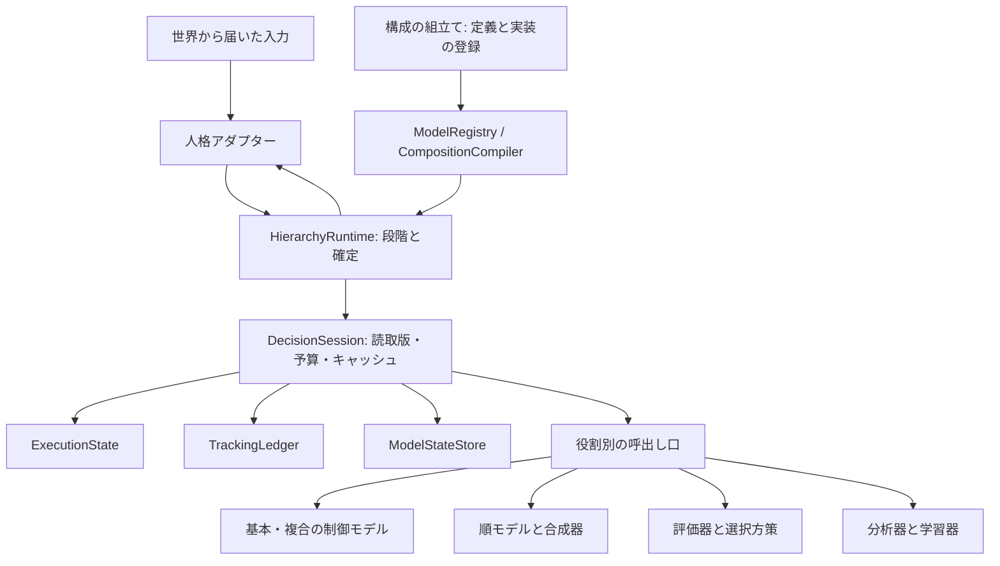

# 階層モデルの目的・責務・オブジェクト設計

更新: 2026-10-23。区分: 接続試作に採用する実装構造と、現行コードのレビュー。調査基準はcommit `de87bdd`、本体v24。同日に別人格v25の接続試作へ実装し、限定した対照を確認した。実測は[v25の結果](../baseline/HMOSAIC_CONNECTION_V25_RESULT.md)に分ける。検証の事実は[STATUS](../STATUS.md)、直近の作業は[NEXT_SESSION](../NEXT_SESSION.md)へ記す。

[DESIGN](../DESIGN.md)を目的と世界との境界の正本、[運用契約](HMOSAIC_RUNTIME_CONTRACT.md)を登録・状態遷移・保存等の正本とする。本書は、その契約をどのオブジェクトが守るかを定める。[形式仕様](HMOSAIC_FORMAL_SPEC.md)は計算法の主案で、採用は試作の計測後に確定する。本文の役割名は責務の説明で、実装名との対応と限定範囲は末尾の「試作で具体化した境界」を参照する。

## 目的から導く設計思想

目的は、本人の限られた知識・身体感覚・経験から選んだ行為が、世界の因果と資源制約に作用して生活を作ることである。食品を必ず得る手順や90日生存をコードで保証することではない。世界の整合、予測の精度、経験による変更、生活の持続は別々に測る。

将来の複雑さには、**一つの変更で理解・修正する範囲を限定する**ことで備える。目的や職業を一つ増やしたとき、基本移動モデル、身体予測、実行器、既存の親を一斉に修正する構造にはしない。同時に、時刻・所有・観測・版・学習の重複禁止は、各モデルの善意に任せず共通の境界で検査する。

オブジェクト指向として重視するのは、状態と不変条件の所有、役割ごとの契約、契約を満たす実装の差し替え、合成による再利用である。継承階層の深さやクラスの個数を抽象化の達成度にしない。状態を持たない数式・推定の計算は純粋関数でよい。保存形式は従来どおりJSONとし、実行時のオブジェクトが検証と振る舞いを提供する。

判断に用いるモデルは世界の近似である。身体予測器を世界の身体処理の基底クラスにせず、本人に届かない栄養残量や世界の係数を継承・参照させない。物理的に可能かという世界の検証と、本人が選ぶ価値があると考えるかという評価も別の契約にする。

## 現行コードと既存案の評価

外側の[PersonalityModel](../../packages/ai/personality.ts)は、内部の判断方式や職業を固定しない良い境界である。[分割案](HMOSAIC_MODULE_DESIGN.md)にも予測と制御の独立、共用、必要な主観情報だけの投影が既にある。v24では、これらを守る実行上の所有者が未分離だった。以下のレビューはv24に対するもので、別人格v25で所有者を分けた。

| 確認した箇所 | 現状・不足 | 新構成で責任を置く場所 |
|---|---|---|
| [effortDecision](../../packages/ai/effort-choice.ts) | 経験更新、候補比較、回復・避難、行程取消、応答変換が同じ関数にある。`finish` は選択した行為を身体条件で置換する | 受信・状態遷移、制御の提案、予測、評価・選択、応答変換を分ける |
| [food-acquisition](../../packages/ai/food-acquisition.ts)の`acquisitionCandidates/add` | 取得先の列挙に時刻・身体予測・除外・便益・費用が同居する | 親は行程案、子は局所予測、合成器は経過、評価器は価値を返す |
| 同ファイルの`acquisitionChoice` | `source/market/sale/buy`の進行と、取引の詳細、最高値の選択が同居する | 行程実行は共通の状態遷移、局所行為は制御モデル、選択は独立した方策 |
| `effort-choice`と`food-acquisition` | 実際に相互importがある。上位の食品行程が、全体判断のファイルにある疲労率へ依存する | 基本予測は親をimportしない。接続は構成を組み立てる一か所で行う |
| [learning-needs](../../packages/ai/learning-needs.ts) | ラッパーが行為名ごとの所要時間と複数の学習開始処理を知っている | 制御・予測・追跡の登録から対応を作る。追加モデルごとの分岐をアダプターへ増やさない |
| [VillageMemory / VillageContext](../../packages/ai/autonomous-world.ts) | 広い記憶・文脈型を複数の処理へ渡し、深い状態を直接変更する | 境界では現行型を維持し、モデルへは型付きの投影と自分の状態だけを渡す |
| [checkVillageWorld](../../packages/sim/autonomous-world.ts) | 世界の検証が既存人格の個別記憶検証も呼ぶ | v25は`checkHierarchyState`へ委譲し、内側のモデル状態は登録したcodecで検証する |
| [運用契約の型例](HMOSAIC_RUNTIME_CONTRACT.md#型例) | 定義メタデータと保存形はあるが、実装の解決、状態への書込み権限、型付きの呼出しを示していない | 登録時の型検証と実行時のcodec、モデル呼出し口、状態の更新窓口を具体化する |

結論は「抽象化の方向は妥当だが、そのまま関数をモデル名で包むだけでは不足」である。既存案の`Readonly`は浅い。登録簿の`kind`や`modelId`を巨大なswitchへ変えても、変更箇所の集中は解消しない。以上は構造のレビューであり、今回これがB1の死亡原因だったと実証したものではない。

## 責務と変更権限

実行時は次の責務を分ける。表の各行を必ず一ファイル・一クラスにする必要はないが、状態の所有者と公開操作は混ぜない。

| オブジェクト／役割 | 所有する責任と公開操作 | 渡さない権限 |
|---|---|---|
| 人格アダプター | `ActorInput`を主観入力へ変換し、試行・起床を`ActorResponse`へ戻す。時間単位を換算する | 目的の優先順位、世界の内部状態、モデルごとの学習処理 |
| `ModelRegistry` | 不変の定義・役割別実装・入出力codecを登録／解決する | 人物の経験、実行中の委譲、状態の更新 |
| `CompositionCompiler` | 構成とポートを検査し、段階別の呼出し・結果参照へ展開する | 価値の判定、本人の行動、隠れたモデル選択 |
| `HierarchyRuntime` | 運用契約のA結果対応→B計画→C選択→D応答の順序と確定点を管理する | 食品・回復・職業・具体モデルIDごとの処理 |
| `DecisionSession` | 一判断のモデル読取版、呼出しキャッシュ、予算使用量、作業用状態を所有する | 世界への書込み、他の人物の状態、判断をまたぐキャッシュ |
| `ExecutionState` | 目的・行程版・委譲・意図の参照と遷移を検証する。中断・再開・置換を明示操作で受ける | 学習係数の変更、実際のProcessの進行、追跡の一括削除 |
| `TrackingLedger` | 届いた証拠の対応、未確定・遅延結果、終了理由、重複の識別を保存する | 任意の学習式、欠測からの失敗生成 |
| `ModelStateStore` | 人物×モデルの状態・改訂・更新済み経験・診断用スナップショットを管理する | 他モデルによる直接代入、定義の書換え |
| 順モデル／制御モデル／合成器 | 型付き入力から局所予測／制御案／経過を返す | 共有状態の直接変更、物理時刻の進行 |
| 評価器／選択方策 | 目的と経過を評価／評価済み候補から選択する | 行為の隠れた置換、未評価を0へ変換すること |
| 分析器／学習器 | 保存したモデルで誤差を分析／対応する教師から自分の次状態を返す | 分析器による直接学習、未実行の案を実成果にすること |

`ExecutionState`内部も、目的・委譲・意図のそれぞれの遷移規則を持つ。`HierarchyRuntime`や`DecisionSession`へその全分岐を移さない。主体・版・参照の整合と確定はsessionが確認し、各領域の不変条件は各所有者が確認する。

図は呼出し・組立ての関係である。具体モデルからruntimeやstoreへの自由な参照は与えない。必要な投影、モデル自身の状態、登録された要求を返すための契約だけを渡す。登録簿をどこからでも引ける共通変数にしない。

## 役割別の多態性と型の境界

巨大な`BaseModel`に全機能を持たせず、既存案の`ForwardModel.predict`、`ControlModel.propose`、`Learner.update`を独立した契約として採用する。合成・評価・分析・選択もそれぞれの契約を持つ。固定ruleに空の`learn`メソッドを実装させない。予測と制御の実装方式は独立に差し替えられる。

基本制御と複合制御は、外側には同じ「要求から有限の行程案を返す」契約を実装する。移動制御なら試行または継続・観察の短い案、回復の親なら移動の委譲を含む案を返す。親は子の実装メソッドを直接呼ばず、登録された子への型付き要求を返す。実行器は`delegate/attempt/observe`の意味と予算を扱い、食品の`source/market/sale/buy`を知らなくてよい。

登録時には具体型で、登録・保存の境界では実行時codecで検証する。

- `ModelDefinition`はメタデータ、役割別インターフェースの実装は振る舞い、`ModelState`は人物のデータ。三つを登録時に対応させる。
- `ModelRef<Request, Output, State>`等の型付き参照で要求と実装の対応を検査する。文字列IDは保存と解決に使い、`Record<string, unknown>`をそのままモデル内部へ流さない。
- 各定義は要求・出力・状態のcodecを登録する。動的に読み込んだJSONの`unknown`を検証してから型付き呼出しへ渡す。型アサーションだけで境界を通さない。
- ポートは量・単位・観測／予測・対象・時間窓・根拠を持つ。構造が同じ`number`でも、分と時間、確率と疲労、別人物・別期間の観測を互換にしない。
- 新しいモデルを登録するコードが型の対応を知り、共通実行器は定義ごとに用意された検証済みの呼出し口を使う。実装の解決に具体モデル名のswitchを置かない。
- 未登録、適用域外、観測不足、予算切れを区別した結果を返す。`unknown`・区間・分岐を扱えることを差し替えの契約に含める。点予測専用の実装を無条件に代替と認めない。

`ControlModel`の共通化は「全行動に同じ引数」を要求しない。親子で互換な要求型を結線し、不一致は登録時に拒否する。新しい世界行為を導入する場合はアダプターと世界の語彙変更も必要であり、登録だけで世界に新しい能力が生まれるとはしない。

## 状態の封じ込めと保存

寿命を三つに分ける。定義は版ごとに不変で全人物から共用可能。学習状態は人物×モデルに一つ。委譲・意図・追跡は呼出しごとである。二つの親が同じ子を使うとき、学習状態は共用し、実行状態は共用しない。

モデルへ渡す読取状態は再帰的に不変として扱い、書換え可能な実状態を公開しない。実装では型による制限に加えて境界の複写または凍結で参照の漏れを防ぎ、候補の評価順を変えても結果が変わらない対照で確認する。学習器は`nextState`を返し、`ModelStateStore`だけが定義版・基準改訂・経験ID・更新対象を検査して確定する。汎用の任意パスへのpatchや`setState(any)`は公開しない。

保存対象は`memory.hierarchy`のJSONだけである。読込時にcodecと参照整合を確認し、状態を包むオブジェクトを再構成する。クラスインスタンス、関数、キャッシュ、登録簿をJSONに保存しない。IDの順序、有限数、乱数の消費、版違いの拒否は運用契約を継承する。

Aの結果対応を確定してからB〜Dを作業用状態で実行する。B〜Dで失敗した場合は、行程の変更・選択・乱数消費をまとめて破棄し、確定したAの状態に失敗記録と予備応答を加える。個別モデルの`try/catch`が状態を半分だけ書き換えたまま戻る構造にしない。結果対応の例外は契約違反として伝播する。

## 合成・フィードバック・構成変更を混同しない

計算の依存グラフ、将来の行程グラフ、世界で進行中のProcessは別のものである。計算を並列化できても、身体を同時に二つの行為へ使えることにはならない。予測の時刻を進めるのは合成器だけで、実時刻は世界だけが進める。

計画時の身体順モデルの生の予測出力は合成器の入力へ接続する。合成器が区間ごとに一度呼び、確定した予測上の後状態を次区間へ渡す。評価器・分析器は合成された経過やその参照を読めるが、別途身体を進めない。予測誤差のフィードバックはこの将来状態の結線とは別である。分析器が保存した身体モデルを実入力で再計算する場合も、診断用の呼出しとして記録し、計画の後状態を更新しない。

フィードバックの上向き辺も含めて一つのDAGを要求すると、正しい上下接続まで循環として拒否してしまう。構成の検査は計算段階・反復を区別し、同一段階の循環を拒否する。上向きの結果と次の要求は次段階・次反復へ渡す。行程の有限ループは別に回数制限を検査する。

| 信号 | 受け手と意味 | 保持する区別 |
|---|---|---|
| `PredictionFeedback` | 順モデルの局所効果・予測の学習器 | 実入力での条件付き残差と、予測入力との差の波及 |
| `ControlFeedback` | 実際に選んだ制御の修正器・学習器 | 目標未達、許された修正、実行した案。未実行の修正は仮説 |
| `ResponsibilitySignal` | 指定された上下の比較群 | 事前と事後、対象群、時点。確率式は未採用なら未評価 |
| 親の利得・構成の分析 | 保存した評価器・構成に対応する分析器／学習器 | 子の局所誤差、親の構成誤差、非線形な共同影響、欠測 |

分析器は保存したモデルに実入力を入れて診断し、更新要求を返す。現行状態で過去の予測を再現したことにしない。局所予測の更新は人物・モデル・実経験に対して一度とし、複数出力は更新項目を束ねて識別する。親の数だけ同じ学習を適用しない。目標未達を全ての子へ同じ負の教師として配送しない。

構成についても三つを分ける。

| 構成の種類 | 所有者と版 | 変更の扱い |
|---|---|---|
| 登録された接続と許可された操作 | 不変の`CompositionDefinition`、`compositionVersion` | 開発による定義変更。版を上げ、旧記録を移行しない |
| モデル内の子の選択・引数・順序 | そのモデルのJSON状態、`stateRevision`と必要な構成の改訂 | 経験に基づく変更の対象。許された操作の提案を再検査して次の判断から適用する |
| 今回実行する行程 | `PlanGraph`、`planRevision` | 観察・中断・数量変更等による再計画。これだけで構成学習とは扱わない |

学習による構成変更でも、参照する定義、ポート、循環、資源、予算を再検査する。進行中の意図や過去の予測は元の構成のまま対応させ、診断に必要な旧状態を保持する。runtimeや全人物共通の登録簿を学習器が書き換えることは許さない。どの経験でどの変更を採用するかというR09の更新則は引き続き未決で、接続試作では構成変更の学習達成を主張しない。

## 依存の向きと実装範囲

新構成は`packages/ai/hierarchy/`配下に実装した。依存は次のまとまりで分ける。

| まとまり | 依存してよいもの |
|---|---|
| 契約・値・codec | JSON、量、ID、推定、役割別インターフェース |
| 登録・構成検査 | 契約。具体モデルのimportは組立て側に限定 |
| 状態・追跡 | 契約、登録したcodecと検査済みの参照 |
| 実行・予算・合成 | 上の共通部品。具体的な食品／回復モデルはimportしない |
| モデル群 | 契約、自分の計算。親・世界・実行器の内部はimportしない |
| v25の組立て・人格アダプター | 共通部品、具体モデル、既存の人格入出力型 |

新しい目的を加える変更は親モデルと登録・接続へ、予測方式の差し替えはその実装・状態codecと構成の版へ閉じることを目標にする。登録する役割自体を増やす場合や世界の行為語彙を変える場合は共通部品も変わり得る。「将来どんな変更でも既存コードを変えない」とは約束しない。

抽象化する対象と、明示したまま残す具体性を分ける。`delegate/attempt/observe`や観測状態、有限の失敗コードの分岐は、共通プロトコルを実行するために必要である。これを無理に全て動的登録へ変えない。増やさないのは、runtimeに置かれた「食品の親なら」「このモデルIDなら」という個別の意味判断である。

| 変更例 | 変更する範囲 | 維持する範囲 |
|---|---|---|
| 同じ移動を使う第三の目的 | 新しい親と登録・構成 | 移動／身体の実装、runtime、既存の親 |
| 経験平均の移動予測を別の推定器へ差し替える | 順モデルの実装・codec・定義版と接続 | 移動制御、行程の進行、世界の移動 |
| 同じ行程に別の仮の評価を使う | 評価器と保存する評価基準の版 | 子の予測、世界、過去の評価記録 |
| 新しい世界行為を導入する | 世界の行為契約、アダプター、対応するモデルと構成 | 合成・保存・状態遷移の共通契約は、既存の表現で足りる限り維持 |

任意のスクリプト実行、全世界を載せた共通コンテキスト、すべてを一つの可変グラフへ入れる仕組み、汎用DIコンテナ、職業ごとの継承木は今回導入しない。登録した有限の要素と操作で必要な拡張を検証する。予算の呼出し口を通さない再帰・内部探索も認めず、モデル内の反復は有限にするか、明示した予算を消費する。

既存v24の相互依存をこの機会に解消する改修は行わない。別人格・別ruleset・別fixtureで接続し、旧コードは対照として残す。試作で使うのは`travel-forward@1`、`body-forward@1`、`travel-control@1`、`compose@1`、回復と食品確保の二つの仮の親である。評価は仮と記録する。

## 抽象化が機能するかを確かめる対照

運用契約の[7項目](HMOSAIC_RUNTIME_CONTRACT.md#接続試作で確認する対照)をそれぞれ独立したテストで確認し、下表の対照をその中へ加える。[v25の独立した7テスト](../../tests/hierarchy-v25.test.ts)へ組み込み、確認した。状態操作・合成証拠による対照と実世界での実走の範囲は[v25の結果](../baseline/HMOSAIC_CONNECTION_V25_RESULT.md)に区別して記す。

| 元の対照 | 抽象化について追加で確認すること |
|---|---|
| 1 登録・結線 | 第三のテスト用親を既存の移動・身体モデルへ結線しても、それらとruntimeのコード変更が不要。予測器と制御器を別々に差し替えられる。誤った要求型・状態codec・役割・ポートは拒否する |
| 2 行程 | 同じ違反を異なる親が出しても同じ共通検査で除外される。親名による特例を設けない |
| 3 合成 | 二つの親で学習状態が一つ、委譲は別。評価順を変えても実状態は不変。身体の二重適用がなく、学習も一度。実入力での残差と上流の波及を分ける |
| 4 状態機械 | 親の差し替え後も旧意図の局所結果は元の版へ戻る。予測どおりだが目標未達／目標達成だが予測外れの二例で、順・逆の信号が異なる。外部指示で制御を学習しない |
| 5 追跡 | 意図の終了で親の追跡を消さない。学習器を呼ばずに欠測・曖昧・期限を保存できる。更新要求の重複と異なる観測項目を区別する |
| 6 保存 | 実行時オブジェクトをJSONから復元し、開いた追跡・旧モデル状態・構成参照を保持する。他の人物へ学習が漏れない。読込不一致を暗黙移行しない |
| 7 予算 | 仮のモデル実装を差し替えても共通予算が効く。B〜Dの失敗でAの学習は残り、未確定の行程変更と乱数消費は残らない |

依存方向は実装時にimportと差分でも確認する。テストを通すためruntimeへ親名やモデル名の特例を足していれば、抽象化の対照は未達とする。対照の成立は接続と変更範囲の証拠であり、学習の一般化や生活改善の証拠ではない。

## 採用と未決

採用するのは、役割別の多態性、合成による共用、状態所有者を通した更新、型付き登録とJSON境界検証、共通の状態遷移、段階別の確定、具体モデルに依存しない実行器である。運用契約の7対照を維持したまま、差し替え・追加・不変性で抽象化を検証する。

未決は、形式仕様の計算法・パラメータの採用、R07の非線形な影響分析、R08の更新則・探索、R09の構成変更の採用則、R12の適応・一般化の合否である。クラス化や登録簿の導入で解決したことにはしない。物理法則・死亡条件・旧版記録を維持し、次は接続試作の計測を踏まえて計算法の採用範囲を判断する。

## 試作で具体化した境界

v25では`ModelRegistry.compile`が構成検査も所有する。`ExecutionState`と`ModelStateStore`は同じファイル内で別クラスとし、計算は純粋関数を残した。評価器と選択器は別登録、`HierarchyRuntime`は両者の中身を知らず、評価済み候補の外を選んだ応答を拒否する。具体的な世界行為のcodecは人格アダプターが用意し、Dの確定前に検査する。

登録時の型は具体codecと役割別実装で対応させ、構成内の別名参照は契約IDで検査する。動的な呼出しは実行時codecで検証する方式を採用し、本文の`ModelRef<Request, Output, State>`による全結線の静的証明はまだ導入していない。対象人物・時刻・観測窓の整合はポート単独ではなく、人物別sessionと意図・証拠の対応検査が担う。計算依存の結線は段階別に検査し、実際の呼出しは登録実装が共通の予算口を通して行う。

親モデルは移動→観察の仮案だけを返す。制御の出力は単一ステップの提案、親の出力は有限行程の提案配列という別codecであり、両者を同じ要求型へ押し込めない。吸収・中断・再開の台帳契約には合成証拠と状態操作で確認した範囲がある。身体予測の更新と子の局所残差は接続したが、数値的な親利得・寄与・制御更新・モデル内構成変更は未採用／未実装である。

この実装は追加・差し替え時の変更範囲を限定した証拠である。今後、親の行程生成・非線形分析・探索を追加する際も、具体的な親名による分岐がruntimeへ戻っていないかを確認する。

2026-10-23の回復修正: [実測](../baseline/HMOSAIC_RECOVERY_V25_RESULT.md)で、接続の成立だけでは行動の妥当性を保証しないことを確認した。休息の欠落は親の行程生成、待機の誤予測は順モデル、区間の予測枯渇は合成器、実際の疲労減少の比較は評価器へ修正を閉じた。共通実行器へ人物・親名の特例は追加していない。実行器の変更は保存する評価基準の参照と、読取専用JSONの共有配列を可変状態へ漏らさないコピー境界である。初版のモデル・構成・記録を保持し、改訂版の24時間行動対照と90日の残る栄養死を別に測った。
