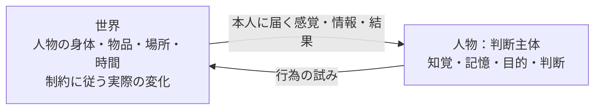
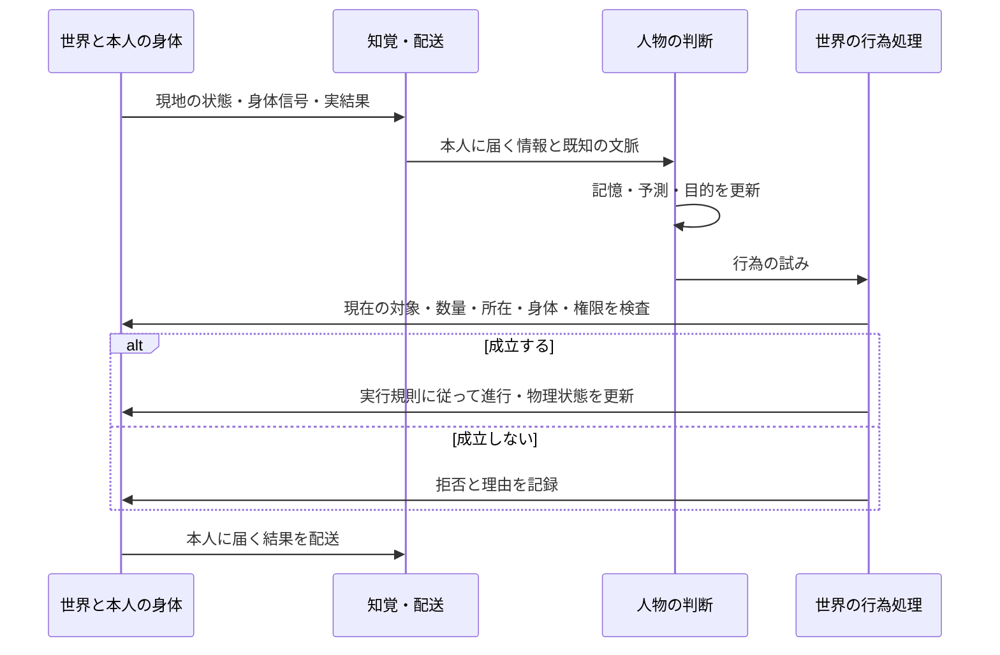

# 世界と判断主体としての人物

更新: 2026-10-24。区分: ユーザーと合意した最上位の設計原則と、現行コード `6eaf3aa` の対応調査。**今回は設計の位置づけを整理したもので、新しい境界を実装したという報告ではない。** 実行した検証は[STATUS](../STATUS.md)、比較した外部実装は[コロニー系の調査](COLONY_SIM_ARCHITECTURE_REVIEW.md)を参照する。

## 最上位の二つ

最上位の抽象化は**世界**と**判断主体である人間（人物）**である。世界は実在する状態と因果を扱い、人物は本人が知り得る情報から認識・目的・判断を作る。

人物は世界の外にある存在ではない。同じ人物が、世界の中に身体を持ち、判断主体でもある。身体と判断に別人のIDを割り当てたり、二つの正しい身体状態を保存したりしない。世界と人物の区別は責任の境界であり、互いに無関係な存在への分割ではない。

この図は最上位の責任だけを示す。下位に時計・制度・知覚・身体・予測器があっても、最上位を再び多数のモデルへ分割して説明しない。以下の細分化はこの枠組みの内側で行う。

## 共通の物理的制約

世界も人物も物理の制約から逃れられない。物の存在・所在・数量、移動、接触、時間経過、消耗・回復を、採用した法則に従って変化させる。人物の判断は行為の試みを生み、実現可能性や世界の結果を上書きしない。世界も生存者数や経済の目標値に合わせて資源を補給しない。

身体の実状態、身体から届く感覚、人物が想像する将来の身体は異なる。たとえば栄養備蓄は実状態、空腹は身体から生成する感覚、食後の回復見込みは本人の予測である。予測が外れたときに実状態を予測へ合わせない。

ここでの物理は本プロジェクトが明示した近似規則である。現行の栄養・疲労の単位は未校正であり、これを現実の人体に正確な物理モデルと呼ばない。思考や知覚も身体を持つ人物の活動だが、現行のモデル呼出し予算は計算量の上限で、思考時間・代謝コストの実装ではない。今回、判断の回数から新しい身体消耗を作る変更はしない。

所有権・約束・価格は社会的な関係であり、質量や距離と同じ物理法則ではない。ただし、その行使や伝達も人物の行為と物理的な制約に従う。権利を持つだけで物が手元へ移動せず、約束だけで納品や支払を済ませない。現行世界が検査する権限規則と物理的な実行条件を区別する。

## 責任と変更権限

| 対象 | 正本と更新の責任 | 人物が持つもの |
|---|---|---|
| 身体・所在・所持物 | 世界の実行規則。時間・物品・容量・身体・死亡条件を検査する | 感覚、観察、最後に知った所在や数量、予測 |
| 認識・記憶・目的 | 本人の判断処理。届いた情報と過去の記憶を根拠に更新する | 本人ごとに独立した主観状態。誤りや未知も保持する |
| 行為 | 人物が試みを選び、世界が受付・拒否・進行・中断・完了を確定する | 意図と予測、届いた結果の解釈 |
| 時計・情報配送 | 世界側の進行機構。本人が判断しない間も世界は進む | 現在知る時刻、待機要求、届いた刺激 |
| 社会関係 | 当事者の行為を原因とする関係・権利・債務の記録 | 相手への期待、信頼、理解している約束 |

世界を一つの巨大クラスにせず、人物をすべての実処理を持つ巨大クラスにもしない。部品・クラス・純粋関数・ECSは内部構成の選択肢である。採用の基準は、誰がどの実状態を変更できるかを追えることと、判断方法を差し替えても物理的な制約を迂回できないことである。

## 境界を通る一回のやり取り

以下は採用する意味上の契約であり、個別クラスを新設した図ではない。人物の主観状態も保存対象だが、世界の実状態とは更新責任を分ける。

食事なら、本人は知っている食品を食べようとする。世界は現時点の現物・所在・所有・可食性・必要量を検査し、消費と身体への摂取を処理する。吸収は採用した身体時計で進む。本人の「食べる」という意図や「吸収するはず」という予測だけで、食品や栄養を変更しない。競合で食品が失われた場合は、選択時の見込みが正しくても成立しない。

## 現行コードとの対応

調査対象は標準v24と隔離したv25が利用する5人の自律生活系列。旧本編全体を監査済みとはしない。

| 責任 | 現行コードと確認できたこと | 判定 |
|---|---|---|
| 世界の状態 | [VillageWorld / VillagePerson](../../packages/sim/autonomous-world.ts)。物品・地図・生態・人物・進行・Eventを保存する | 継承できる。`VillagePerson`は身体・記憶・配送・起床管理を同じ保存構造に持つ。保存の同居と更新権限の同一視を分ける必要がある |
| 物品の制約 | [physical.ts](../../packages/sim/physical.ts)。包含・所在・所有・容量・数量を検査し、transactionで操作する | 継承できる。型として可変JSONを持つため、全経路で直接変更を封じたとまでは確認していない |
| 身体の実変化 | [effort-body.ts](../../packages/sim/effort-body.ts)、[sleep-body.ts](../../packages/sim/sleep-body.ts)、[needs-body.ts](../../packages/sim/needs-body.ts) | 世界側に位置づける。`effortSensation`は実状態から感覚を作る。身体予測器とは別の責任 |
| 知覚・配送 | `localView / observe / send`（[autonomous-world.ts](../../packages/sim/autonomous-world.ts)） | 既存の接点。既知情報の全項目について到達根拠を監査したわけではない |
| 判断の契約 | [personality.ts](../../packages/ai/personality.ts)の`ActorInput → ActorResponse`。`knownContext / stimuli / subjectiveState`から`attempts / subjectiveUpdate / wait`を返す | 最上位の接点として継承できる。職業・HMOSAICをこの外側の必須契約にしない |
| 行為の確定 | `attempt / result / advanceVillageWorld`（[autonomous-world.ts](../../packages/sim/autonomous-world.ts)） | 食事は現物を検査しtransactionで消費後、`ingestEffort`へ渡す。本人の試みと実結果は既に分かれている |
| 記憶の更新 | `advanceVillageWorld`が判断前の記憶を複写し、応答の主観更新を保存する | 判断が世界の実状態を返す契約にはなっていない。ただし型・参照の全面的な隔離は未検証 |
| 人物内部 | [hierarchy/village-adapter.ts](../../packages/ai/hierarchy/village-adapter.ts)と[HMOSAIC実装図](HMOSAIC_OBJECT_DESIGN.md) | 既存の共用、別ポートのフィードバック、子の誤差分析を人物内部へ位置づける。経験による構成変更は将来対象のまま |

最上位の接点の多くは既に存在するが、既存実装の維持は制約ではない。上表の「継承できる」は責任と仕組みの再利用候補という意味で、現在のクラス・関数・ファイル構成を保存する義務ではない。枠組みに合わない実装は置換・統合・削除してよい。物理法則・既存記録とその比較可能性を保ち、どの振る舞いを意図して変えるかを明示する。HMOSAIC内部の抽象化が進んだことだけで、シミュレーター全体の責任境界が完成したと評価してはいけない。

## 具体的に残る照合点

1. **既知情報の根拠。** `localView`の`fieldGrainStores`と`breadEconomy.grainStores`は、場所の条件を付けず本人所有の保管庫の現物数量を取得する。所有していることと、その瞬間の数量を知覚できることは別である。本人の在庫知識として許す仕様か、最終観察の記憶にすべきかを決める必要がある。v25の現在の投影はこれらの保管庫情報を使用していない。今回、旧版の判断入力を変更しない。
2. **世界の進行と具体人格の組立て。** `autonomous-world.ts`が`ordinaryVillageModel`の既定値と複数の人格固有の初期化・保存検査をimportしている。身体法則そのものと、どの人格を使うかを組み立てる責任を区別する余地がある。新しい共通層を作る前に必要な依存を一覧化する。
3. **行為の確定窓口。** `attempt`内に食事・採集・運搬・売買などの規則が集約されている。世界の行為種別による分岐そのものは矛盾ではない。規則の所有者と更新操作が追える形で整理し、判断側へ物理更新を移さない。
4. **身体と記憶の所有。** `VillagePerson`から身体を分離するか、同じ保存JSONで操作だけを分けるかは未決。型名やファイル移動だけで判断せず、更新経路と再現性で評価する。

これらはコード上の構造と入力に関する指摘であり、現在の栄養死の原因を新たに実証したものではない。

## 次の実装へ進む条件

まず一つの食事の経路について、実状態→感覚・観察→本人の試み→世界の検査→現物消費→遅延吸収→結果の記憶を、現在の関数・保存項目・Eventへ対応づける。そのうえで最小の境界改善を選ぶ。

確認すべき対照は、同じ試みなら判断方式にかかわらず同じ世界規則で判定されること、本人が知らない情報を入力へ混ぜないこと、食品の競合・拒否で消費や回復を二重にしないこと、判断待機中も身体時計が進むこと、保存再開で順序と結果が一致することである。これらの新しい境界対照は今回は未実装・未実行。

その後にv25の食品・睡眠を接続する。法則・身体係数・物品・死亡条件を変えず、v24/v23/v22と既存v25記録を保つ。判断入力や挙動が変わる場合は別構成／ruleset／記録で区別する。仮評価の正式採用、生存比較、制御学習・構成学習は別の採用判断を要する。
